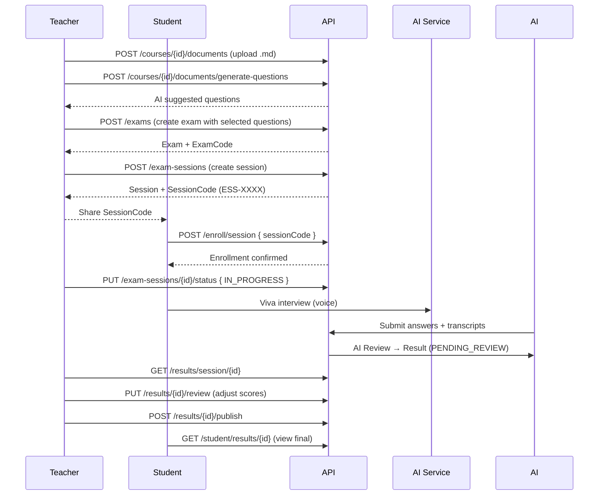

# AIVES API Documentation

**Version:** 1.0  
**Base URL:** `https://localhost:5001/api` (Development)  
**Authentication:** JWT Bearer Token  
**Content-Type:** `application/json` (except file upload: `multipart/form-data`)

---

## 🔐 Authentication

### Login
```http
POST /api/auth/login
Content-Type: application/json

{
  "username": "teacher01",
  "password": "password123"
}
```

**Response 200:**
```json
{
  "token": "eyJhbGciOiJIUzI1NiIsInR5cCI6IkpXVCJ9...",
  "expiresAt": "2026-10-10T10:30:00Z",
  "user": {
    "userId": 1,
    "username": "teacher01",
    "fullName": "Nguyễn Văn A",
    "email": "teacher01@university.edu.vn",
    "role": "TEACHER"
  }
}
```

**Usage:** Thêm header `Authorization: Bearer <token>` vào mọi request sau.

---

## 📚 1. QUẢN LÝ TÀI LIỆU & NGÂN HÀNG CÂU HỎI (Documents & Question Bank)

### 1.1 Upload file .md
```http
POST /api/courses/{courseId}/documents
Authorization: Bearer <token>
Content-Type: multipart/form-data

Form Data:
- File: [file .md] (required)
- DocType: "CONTENT" | "LEARNING_OUTCOMES" (required)
```

**Response 201:**
```json
{
  "documentId": 10,
  "courseId": 5,
  "fileName": "course_content.md",
  "docType": "CONTENT",
  "content": "# Môn học JPD123\n## Chương 1: C# Basics\n...",
  "uploadedAt": "2026-10-09T08:15:30Z"
}
```

### 1.2 Lấy danh sách file .đã upload
```http
GET /api/courses/{courseId}/documents
Authorization: Bearer <token>
```

**Response 200:**
```json
[
  {
    "documentId": 10,
    "courseId": 5,
    "fileName": "course_content.md",
    "docType": "CONTENT",
    "content": "# Môn học JPD123\n...",
    "uploadedAt": "2026-10-09T08:15:30Z"
  },
  {
    "documentId": 11,
    "courseId": 5,
    "fileName": "learning_outcomes.md",
    "docType": "LEARNING_OUTCOMES",
    "content": "# Learning Outcomes\n1. Hiểu OOP...\n2. Biết LINQ...",
    "uploadedAt": "2026-10-09T08:16:00Z"
  }
]
```

### 1.3 AI sinh câu hỏi từ tài liệu .md
```http
POST /api/courses/{courseId}/documents/generate-questions
Authorization: Bearer <token>
Content-Type: application/json

{
  "courseId": 5,
  "questionCount": 20,
  "focusTopics": "OOP, LINQ, Async Programming"
}
```

**Response 200:**
```json
{
  "generatedCount": 18,
  "questions": [
    {
      "questionId": 101,
      "questionText": "Giải thích tính đóng gói (Encapsulation) trong OOP và tại sao nó quan trọng?",
      "maxScore": 5.0,
      "sampleAnswer": "Đóng gói là che giấu chi tiết triển khai...",
      "isFollowUpAllowed": true
    },
    {
      "questionId": 102,
      "questionText": "Sự khác biệt giữa IEnumerable và IQueryable trong LINQ?",
      "maxScore": 5.0,
      "sampleAnswer": "IEnumerable xử lý trong bộ nhớ...",
      "isFollowUpAllowed": true
    }
  ]
}
```

---

## 📝 2. QUẢN LÝ ĐỀ THI (Exams)

### 2.1 Tạo đề thi mới
```http
POST /api/exams
Authorization: Bearer <token>
Content-Type: application/json

{
  "title": "Kỳ thi giữa kỳ JPD123 - Lần 1",
  "courseId": 5,
  "durationMinutes": 60,
  "maxQuestions": 10,
  "questions": [
    { "questionId": 101, "questionScore": 10.0 },
    { "questionId": 102, "questionScore": 10.0 },
    { "questionId": 105, "questionScore": 5.0 }
  ]
}
```

**Response 201:**
```json
{
  "examId": 20,
  "title": "Kỳ thi giữa kỳ JPD123 - Lần 1",
  "examCode": "EX-A1B2C3D4",
  "courseId": 5,
  "courseName": "Lập trình C# nâng cao",
  "createdBy": 1,
  "createdByName": "Nguyễn Văn A",
  "durationMinutes": 60,
  "maxQuestions": 10,
  "examStatus": "DRAFT",
  "createdAt": "2026-10-09T09:00:00Z",
  "questions": [
    {
      "questionId": 101,
      "questionText": "Giải thích tính đóng gói...",
      "questionScore": 10.0,
      "maxScore": 5.0,
      "isFollowUpAllowed": true
    }
  ]
}
```

### 2.2 AI gợi ý câu hỏi cho đề thi
```http
POST /api/exams/ai-suggest-questions
Authorization: Bearer <token>
Content-Type: application/json

{
  "courseId": 5,
  "focusTopic": "OOP, Design Patterns",
  "maxSuggestions": 15
}
```

**Response 200:**
```json
{
  "suggestedQuestions": [
    {
      "questionId": 101,
      "questionText": "Giải thích tính đóng gói...",
      "questionScore": 5.0,
      "maxScore": 5.0,
      "isFollowUpAllowed": true
    }
  ],
  "aiRationale": "Selected based on topic relevance to: \"OOP, Design Patterns\"."
}
```

### 2.3 Lấy danh sách đề thi của mình
```http
GET /api/exams/my
Authorization: Bearer <token>
```

### 2.4 Xem chi tiết đề thi
```http
GET /api/exams/{examId}
Authorization: Bearer <token>
```

---

## 🏫 3. QUẢN LÝ CA THI / PHÒNG THI (Exam Sessions)

### 3.1 Tạo ca thi (Exam Session)
```http
POST /api/exam-sessions
Authorization: Bearer <token>
Content-Type: application/json

{
  "examId": 20,
  "sessionName": "Ca thi sáng - Nhóm 1",
  "room": "Phòng 301, Tòa nhà E",
  "startTime": "2026-10-15T07:30:00Z",
  "endTime": "2026-10-15T09:30:00Z",
  "maxCapacity": 50
}
```

**Response 201:**
```json
{
  "sessionId": 50,
  "examId": 20,
  "examTitle": "Kỳ thi giữa kỳ JPD123 - Lần 1",
  "examCode": "EX-A1B2C3D4",
  "sessionName": "Ca thi sáng - Nhóm 1",
  "room": "Phòng 301, Tòa nhà E",
  "startTime": "2026-10-15T07:30:00Z",
  "endTime": "2026-10-15T09:30:00Z",
  "durationMinutes": 120,
  "status": "NOT_STARTED",
  "scheduledBy": 1,
  "scheduledByName": "Nguyễn Văn A",
  "createdAt": "2026-10-09T09:30:00Z",
  "enrolledStudents": 0,
  "sessionCode": "ESS-1A2B3C4D",
  "maxCapacity": 50
}
```

> **⚠️ Quan trọng:** `sessionCode` (ví dụ: `ESS-1A2B3C4D`) là **Enroll Code** cung cấp cho sinh viên.

### 3.2 Lấy danh sách ca thi của Teacher
```http
GET /api/exam-sessions/teacher/{teacherId}
Authorization: Bearer <token>
```

**Response 200:**
```json
[
  {
    "sessionId": 50,
    "sessionName": "Ca thi sáng - Nhóm 1",
    "examTitle": "Kỳ thi giữa kỳ JPD123 - Lần 1",
    "examCode": "EX-A1B2C3D4",
    "room": "Phòng 301, Tòa nhà E",
    "startTime": "2026-10-15T07:30:00Z",
    "endTime": "2026-10-15T09:30:00Z",
    "status": "NOT_STARTED",
    "enrolledStudents": 25
  }
]
```

### 3.3 Xem chi tiết ca thi
```http
GET /api/exam-sessions/{sessionId}
Authorization: Bearer <token>
```

### 3.4 Cập nhật trạng thái ca thi
```http
PUT /api/exam-sessions/{sessionId}/status
Authorization: Bearer <token>
Content-Type: application/json

{
  "status": "IN_PROGRESS"
}
```

**State Machine hợp lệ:**
| Current Status | Allowed Next Status |
|----------------|---------------------|
| `NOT_STARTED` | `IN_PROGRESS`, `CANCELLED` |
| `IN_PROGRESS` | `COMPLETED`, `CANCELLED` |
| `COMPLETED` | (không được chuyển) |
| `CANCELLED` | (không được chuyển) |

### 3.5 Live Monitoring (Theo dõi tiến độ real-time)
```http
GET /api/exam-sessions/{sessionId}/monitor
Authorization: Bearer <token>
```

**Response 200:**
```json
{
  "sessionId": 50,
  "sessionName": "Ca thi sáng - Nhóm 1",
  "examTitle": "Kỳ thi giữa kỳ JPD123 - Lần 1",
  "examCode": "EX-A1B2C3D4",
  "sessionCode": "ESS-1A2B3C4D",
  "startTime": "2026-10-15T07:30:00Z",
  "endTime": "2026-10-15T09:30:00Z",
  "status": "IN_PROGRESS",
  "maxCapacity": 50,
  "currentEnrollment": 42,
  "students": [
    {
      "sessionEnrollmentId": 1001,
      "studentId": 101,
      "studentName": "Trần Văn B",
      "studentEmail": "student101@university.edu.vn",
      "enrollmentStatus": "IN_PROGRESS",
      "enrolledAt": "2026-10-10T08:00:00Z",
      "startedAt": "2026-10-15T07:35:00Z",
      "lastActivityAt": "2026-10-15T08:15:00Z",
      "currentQuestionIndex": 5,
      "totalQuestions": 10,
      "answeredQuestions": 5,
      "progressPercent": 50.0
    },
    {
      "sessionEnrollmentId": 1002,
      "studentId": 102,
      "studentName": "Lê Thị C",
      "studentEmail": "student102@university.edu.vn",
      "enrollmentStatus": "NOT_STARTED",
      "enrolledAt": "2026-10-10T08:05:00Z",
      "startedAt": null,
      "lastActivityAt": null,
      "currentQuestionIndex": 0,
      "totalQuestions": 10,
      "answeredQuestions": 0,
      "progressPercent": 0.0
    }
  ]
}
```

---

## 🎓 4. SINH VIÊN ENROLL VÀO CA THI (Student Enroll)

### 4.1 Enroll bằng SessionCode
```http
POST /api/enroll/session
Authorization: Bearer <student_token>
Content-Type: application/json

{
  "sessionCode": "ESS-1A2B3C4D"
}
```

**Response 200:**
```json
{
  "sessionEnrollmentId": 1001,
  "sessionId": 50,
  "sessionName": "Ca thi sáng - Nhóm 1",
  "examTitle": "Kỳ thi giữa kỳ JPD123 - Lần 1",
  "startTime": "2026-10-15T07:30:00Z",
  "endTime": "2026-10-15T09:30:00Z",
  "status": "NOT_STARTED"
}
```

**Errors:**
| Code | Message |
|------|---------|
| 404 | "Invalid or expired Enroll Code." |
| 409 | "This session is not open for enrollment." |
| 409 | "Session has reached maximum capacity." |
| 409 | "You are already enrolled in this session." |

---

## 📊 5. TEACHER REVIEW & PUBLISH KẾT QUẢ (Results)

### 5.1 Lấy danh sách kết quả chờ review
```http
GET /api/results/session/{sessionId}
Authorization: Bearer <token>
```

**Response 200:**
```json
[
  {
    "resultId": 2001,
    "sessionId": 50,
    "studentId": 101,
    "studentName": "Trần Văn B",
    "studentEmail": "student101@university.edu.vn",
    "sessionName": "Ca thi sáng - Nhóm 1",
    "examTitle": "Kỳ thi giữa kỳ JPD123 - Lần 1",
    "aiScore": 75.5,
    "aiFeedback": "Sinh viên hiểu tốt OOP nhưng yếu LINQ...",
    "finalScore": null,
    "finalFeedback": null,
    "status": "PENDING_REVIEW",
    "submittedAt": "2026-10-15T08:45:00Z",
    "reviewedAt": null,
    "answers": [
      {
        "answerId": 5001,
        "questionId": 101,
        "questionText": "Giải thích tính đóng gói...",
        "studentAnswer": "Đóng gói là che giấu...",
        "transcript": "Đóng gói là che giấu chi tiết triển khai...",
        "audioUrl": "https://storage.../answer_5001.wav",
        "aiScore": 8.0,
        "aiFeedback": "Đúng khái niệm nhưng thiếu ví dụ",
        "finalScore": null,
        "teacherComment": null,
        "isFollowUp": false
      }
    ]
  }
]
```

### 5.2 Xem chi tiết kết quả để review
```http
GET /api/results/{resultId}
Authorization: Bearer <token>
```

### 5.3 Review & Chỉnh sửa điểm/feedback
```http
PUT /api/results/{resultId}/review
Authorization: Bearer <token>
Content-Type: application/json

{
  "finalScore": 82.0,
  "finalFeedback": "Tốt tổng thể, cần cải thiện LINQ và Async",
  "answerReviews": [
    {
      "answerId": 5001,
      "finalScore": 9.0,
      "teacherComment": "Đã thêm ví dụ thực tế, điểm tăng"
    },
    {
      "answerId": 5002,
      "finalScore": 6.0,
      "teacherComment": "Câu trả lời chưa đủ sâu về LINQ deferred execution"
    }
  ]
}
```

**Response 200:**
```json
{
  "resultId": 2001,
  "sessionId": 50,
  "studentId": 101,
  "studentName": "Trần Văn B",
  "studentEmail": "student101@university.edu.vn",
  "sessionName": "Ca thi sáng - Nhóm 1",
  "examTitle": "Kỳ thi giữa kỳ JPD123 - Lần 1",
  "aiScore": 75.5,
  "aiFeedback": "Sinh viên hiểu tốt OOP...",
  "finalScore": 82.0,
  "finalFeedback": "Tốt tổng thể, cần cải thiện LINQ và Async",
  "status": "REVIEWED",
  "submittedAt": "2026-10-15T08:45:00Z",
  "reviewedAt": "2026-10-16T10:00:00Z",
  "answers": [...]
}
```

### 5.4 Approve & Publish Final Result
```http
POST /api/results/{resultId}/publish
Authorization: Bearer <token>
Content-Type: application/json
Body: {} (empty)
```

**Response 200:**
```json
{
  "resultId": 2001,
  "status": "PUBLISHED",
  "finalScore": 82.0,
  "finalFeedback": "Tốt tổng thể...",
  "publishedAt": "2026-10-16T10:05:00Z",
  "reviewedBy": 1,
  "reviewedAt": "2026-10-16T10:05:00Z"
}
```

> Sau khi publish, sinh viên có thể xem kết quả qua Student Portal.

---

## 📋 ENUM VALUES

### UserRole
- `ADMIN`
- `TEACHER`
- `STUDENT`

### ExamStatus
- `DRAFT` - Nháp, chưa công bố
- `SCHEDULED` - Đã lên lịch
- `OPEN` - Đang mở cho enroll
- `CLOSED` - Đã đóng
- `CANCELLED` - Đã huỷ

### SessionStatus
- `NOT_STARTED` - Chưa bắt đầu (mặc định khi tạo)
- `IN_PROGRESS` - Đang diễn ra
- `COMPLETED` - Hoàn thành
- `CANCELLED` - Đã huỷ

### SubmissionStatus (Result)
- `PENDING_REVIEW` - AI đã chấm, chờ Teacher review
- `SUBMITTED` - Đã nộp (legacy)
- `REVIEWED` - Teacher đã review, chờ publish
- `PUBLISHED` - Đã công bố chính thức
- `CANCELLED` - Huỷ

### DocType
- `CONTENT` - Nội dung môn học
- `LEARNING_OUTCOMES` - Chuẩn đầu ra

---

## ⚠️ ERROR RESPONSE FORMAT

```json
{
  "message": "Mô tả lỗi chi tiết"
}
```

| HTTP Code | Khi nào |
|-----------|---------|
| 400 | Validation failed, business rule violation |
| 401 | Token missing/invalid/expired |
| 403 | Forbidden (wrong role, not owner) |
| 404 | Resource not found |
| 409 | Conflict (duplicate, capacity full, already enrolled) |
| 500 | Server error |

---

## 🚀 QUICK START FLOW (Frontend Integration)



---

## 📞 CONTACT & SUPPORT

- **Backend Team:** Hưng, Thịnh, Bắc
- **AI Team:** Trí, Hữu  
- **Frontend Team:** Huyền
- **Repo:** `D:\FPT\GitHub\AIVES_FPT\backend`

---

*Generated: 2026-10-09*  
*AIVES - AI-powered Viva Exam System*