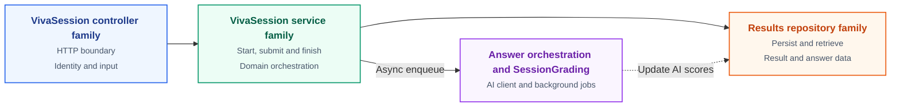

# Application Responsibilities — AIVES V2.0

> Responsibility view of the audited **VivaSession Controller**, **VivaSession Service**, **Results Repository**, and **Background AI Jobs** families (Slide 13 layout).

---

## 1. Architecture Diagram

---

## 2. Responsibilities Breakdown

| Component Family | Scope | Responsibilities (Audited) | Underlying Classes |
| :--- | :--- | :--- | :--- |
| **VivaSession controller family** | HTTP Gateway | Validates student JWT authentication, room session codes, and request payloads. | `VivaSessionController`, `ChunkedAudioController` |
| **VivaSession service family** | Domain Orchestration | Coordinates the live viva session lifecycle (`Start`, `Submit`, `Finish`) and dispatches grading jobs. | `VivaSessionService`, `ChunkedAudioUploadService` |
| **Results repository family** | Persistence & Data Access | Persists and retrieves student answers, R2 audio keys, and evaluations. Enforces `BR-11`, `BR-12`, and `BR-15`. | `ResultRepository`, `AnswerRepository` |
| **Answer orchestration & SessionGrading** | Background AI Queue | Hangfire async background job processing. Calls Gemini AI rubric scoring and updates final scores in the repository. | `HangfireQueueService`, `SessionGradingService`, `AiServiceClient` |

---

## 3. Interactive HTML Viewer

The interactive HTML view with responsive slide vector rendering is available at:
👉 **[`docs/application-responsibilities.html`](file:///d:/FPT/GitHub/AIVES_FPT/docs/application-responsibilities.html)**
