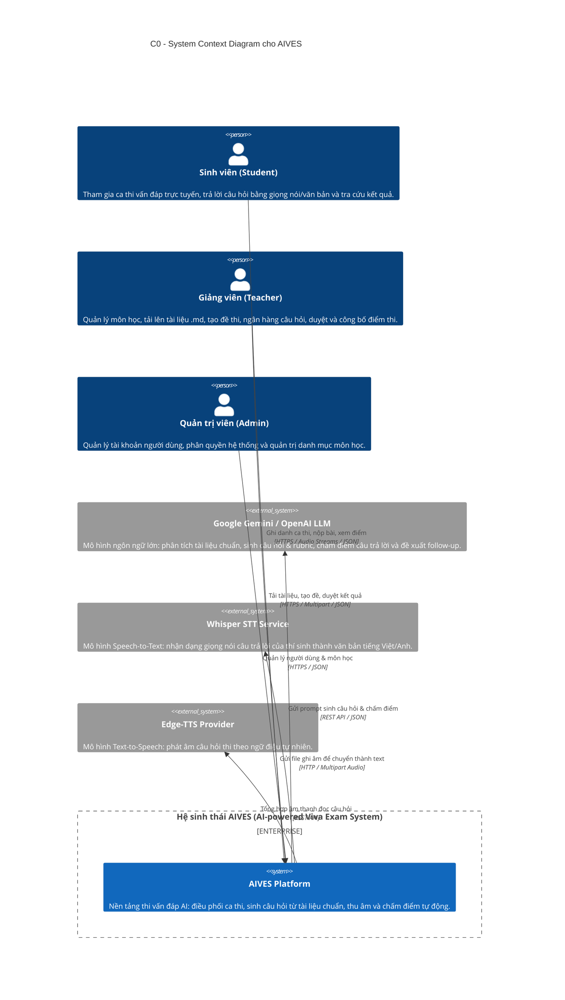
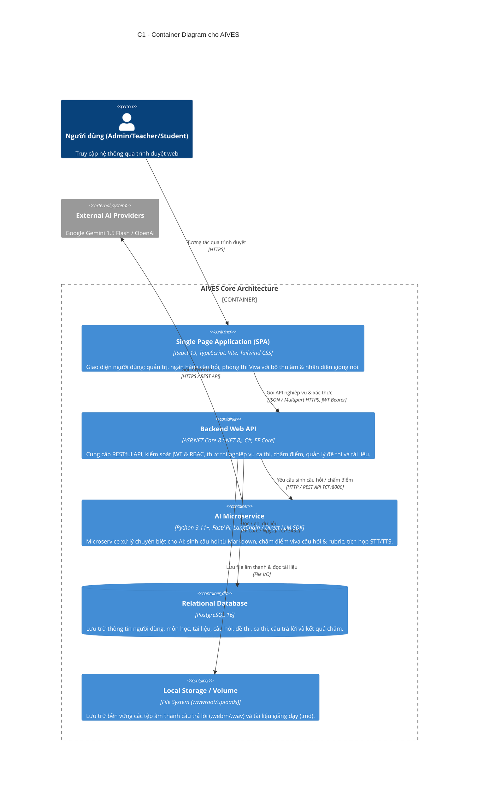
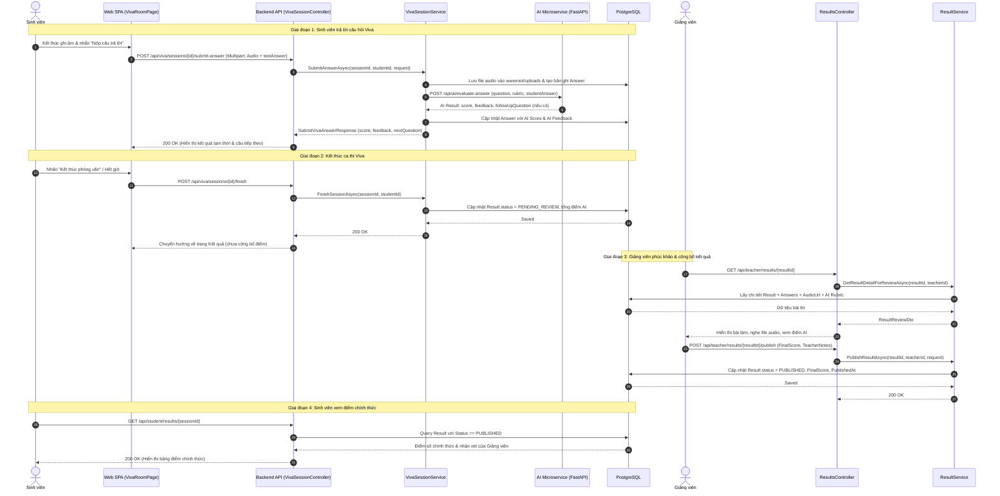
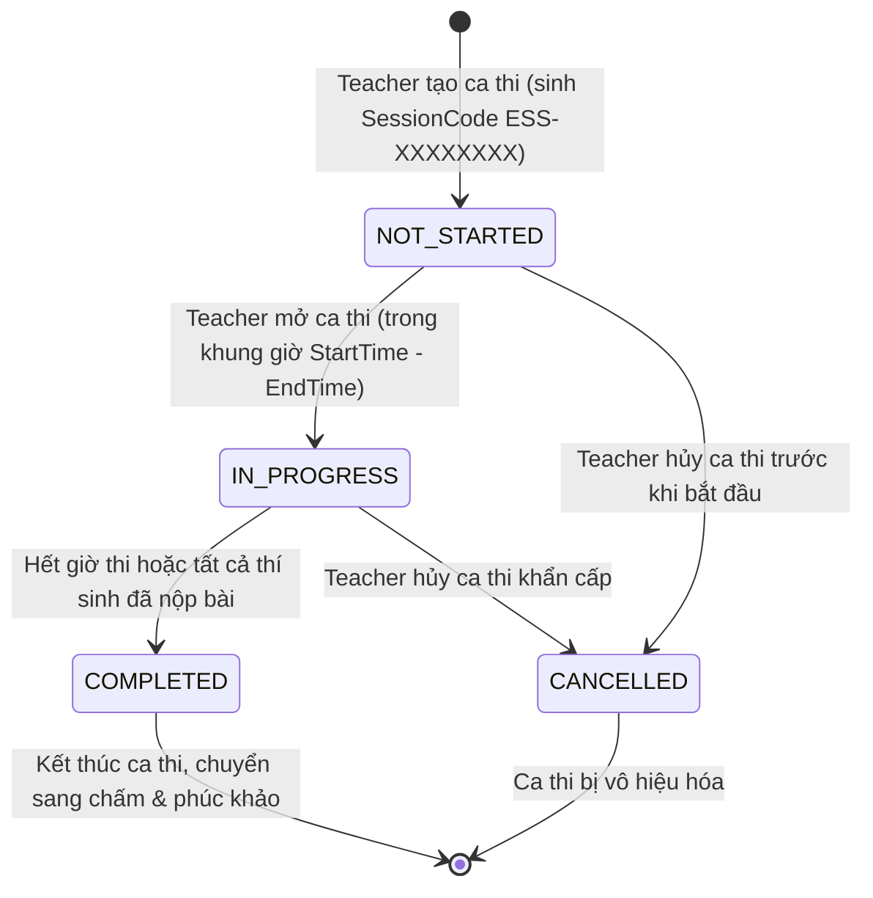
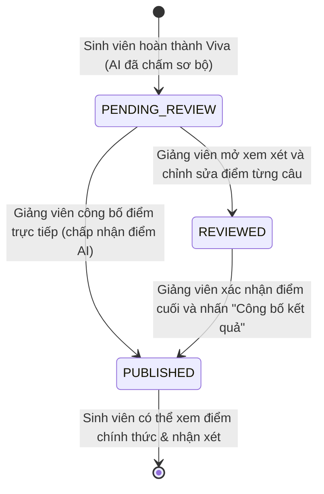

# AIVES - Kiến trúc Hệ thống & Thiết kế Phần mềm (SWD392)

Tài liệu thiết kế kiến trúc chuẩn C4 (C0 System Context, C1 Container) và sơ đồ UML (Sequence, State Machine, Traceability Matrix) cho hệ thống **AIVES** (AI-powered Viva Examination System).

---

## 1. C4 Model - C0: System Context Diagram

Sơ đồ ngữ cảnh hệ thống định rõ ranh giới của AIVES và tương tác với các đối tượng người dùng (Actors) cũng như các hệ thống bên ngoài (External Services).

---

## 2. C4 Model - C1: Container Diagram

Sơ đồ Container thể hiện các thành phần phần mềm có thể deploy độc lập, trách nhiệm và giao thức giao tiếp giữa chúng.

---

## 3. Sequence Diagram: Luồng Thi Vấn Đáp & Công Bố Điểm (Submit Answer -> Review -> Publish)

Quy trình khép kín từ lúc Sinh viên thi Viva, AI chấm điểm, Giảng viên phúc khảo/duyệt và công bố điểm cho Sinh viên.

---

## 4. State Machine Diagram

### 4.1. Vòng đời Ca thi (`ExamSession`)
Quản lý trạng thái ca thi theo đúng ràng buộc `ValidateStatusTransition` tại `ExamSessionService.cs`:

### 4.2. Vòng đời Kết quả bài thi (`Result`)
Quản lý trạng thái công bố điểm thi theo đúng `ResultService.cs`:

---

## 5. Bảng Truy vết Nghiệp vụ (Traceability Matrix)

| Business Rule | Sơ đồ liên quan | UI Component | API Route | Controller & Service | Entity & Table DB | Trạng thái kiểm chứng |
|---|---|---|---|---|---|---|
| **BR-01**: Admin quản lý tài khoản & phân quyền (RBAC) | C0, C1 | `UsersPage.tsx`, `UserFormDialog.tsx` | `GET /api/admin/users` `POST /api/auth/admin/create-user` `DELETE /api/admin/users/{id}` | `AdminUserController`, `AuthController`, `UserService` | `Users` (`users`) | Đã kiểm thử CRUD, xóa an toàn |
| **BR-02**: Admin phân công giảng viên phụ trách môn | C0, C1 | `AdminCoursesPage.tsx` | `POST /api/admin/courses` `PUT /api/admin/courses/{id}` `PUT /api/admin/courses/{id}/assign-teacher` | `AdminCourseController`, `CourseService` | `Courses` (`courses`) | Đã kiểm thử tạo, sửa tên & gán GV |
| **BR-03**: Giảng viên upload tài liệu chuẩn (.md) | C1, Sequence | `TeacherCoursesPage.tsx` | `POST /api/courses/{id}/documents` `GET /api/courses/{id}/documents/{docId}` | `TeacherDocumentController`, `DocumentsController`, `DocumentService` | `MarkdownDocuments` (`markdown_documents`) | Upload Multipart, lưu nội dung vào DB & xem lại |
| **BR-04**: AI sinh câu hỏi từ tài liệu chuẩn | C1 | `TeacherQuestionsPage.tsx` | `POST /api/courses/{id}/documents/generate-questions` | `DocumentsController`, `DocumentService`, FastAPI AI Service | `QuestionBanks` (`question_banks`) | Hỗ trợ chọn số lượng, level và trọng tâm |
| **BR-05**: Giảng viên quản lý ngân hàng câu hỏi (CRUD) | C1 | `TeacherQuestionsPage.tsx` | `GET /api/courses/{id}/questions` `DELETE /api/courses/{id}/questions/{id}` | `QuestionBankController`, `QuestionBankService` | `QuestionBanks` (`question_banks`) | Tìm kiếm, lọc theo level và xóa câu hỏi |
| **BR-06**: Giảng viên tạo đề thi từ ngân hàng | Sequence | `CreateExamDialog.tsx`, `ExamDetailDialog.tsx` | `POST /api/exams` `POST /api/exams/suggest-questions` `PUT /api/exams/{id}/questions` | `ExamsController`, `ExamService` | `Exams` (`exams`), `ExamQuestions` | AI gợi ý chọn câu, bắt buộc có câu hỏi |
| **BR-07**: Giảng viên lập lịch ca thi & sinh SessionCode | State ExamSession | `SessionsPage.tsx` | `POST /api/exam-sessions` `PATCH /api/exam-sessions/{id}/status` | `ExamSessionsController`, `ExamSessionService` | `ExamSessions` (`exam_sessions`) | Mã `ESS-XXXXXXXX`, chặn tạo ca rỗng |
| **BR-08**: Sinh viên ghi danh bằng SessionCode | Sequence, State | `EnrollPage.tsx`, `StudentSessionsPage.tsx` | `POST /api/student/enrollments` `GET /api/student/enrollments` | `StudentEnrollmentsController`, `EnrollController` | `SessionEnrollments` | Kiểm tra lịch, sĩ số tối đa |
| **BR-09**: Sinh viên trả lời Viva (âm thanh & văn bản) | C1, Sequence | `VivaRoomPage.tsx` | `POST /api/viva/sessions/{id}/start` `POST /api/viva/sessions/{id}/submit-answer` | `VivaSessionController`, `VivaSessionService` | `Answers` (`answers`), File storage audio | Thu âm trực tiếp, STT, AI chấm điểm rubric |
| **BR-10**: Giảng viên phúc khảo & sửa điểm bài thi | Sequence, State Result | `TeacherResultsPage.tsx`, `ResultReviewModal.tsx` | `GET /api/teacher/results/{id}` `PUT /api/teacher/results/{id}/review` | `ResultsController`, `ResultService` | `Results`, `Answers` | Nghe file ghi âm, xem gợi ý rubric AI |
| **BR-11**: Công bố kết quả & sinh viên tra cứu | Sequence, State Result | `StudentResultsPage.tsx` | `POST /api/teacher/results/{id}/publish` `GET /api/student/results/{sessionId}` | `ResultsController`, `StudentResultController`, `ResultService` | `Results` (`results`) | Điểm chính thức chỉ hiển thị khi `PUBLISHED` |
