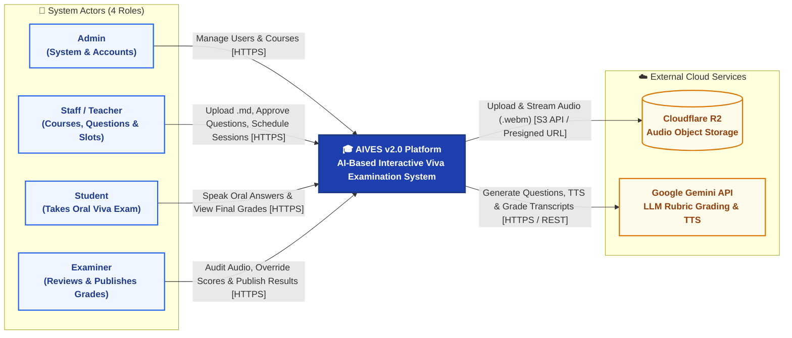
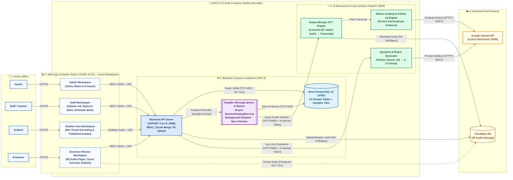
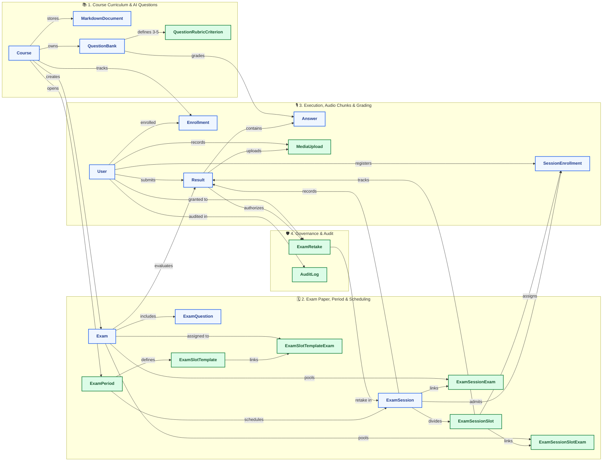
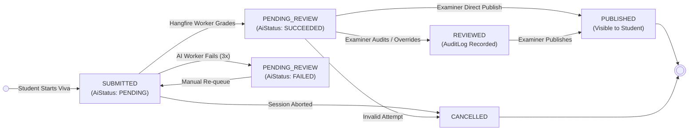
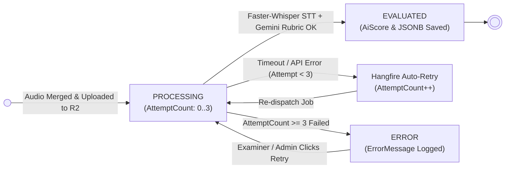

# AIVES v2.0 — System Architecture & Master Diagrams

> **Version:** 2.0 (Audited & Synchronized with Codebase)  
> **Scope:** C0 Context, C1 Multi-Container (with Hangfire Queue & Protocols), Full 21-Entity ERD, Entity Lifecycle State Machines, 7 End-to-End Sequence Flows, and Traceability Matrix.

> ### 📌 Các bộ sơ đồ & Tài liệu liên quan
>
> | Bộ sơ đồ | Dùng để | Liên kết |
> |---|---|---|
> | **🌟 Master Architecture Dashboard** | Xem & xuất ảnh UHD 4x/8x/SVG toàn bộ sơ đồ | [`aives-diagrams.html`](../aives-diagrams.html) |
> | **1. C0 & C1 Diagrams (Left-to-Right)** | Kiến trúc Multi-Container & Protocol | [`c0-c1-diagram.html`](../c0-c1-diagram.html) · [`c0-c1-diagram.md`](../c0-c1-diagram.md) |
> | **2. Complete 21-Entity ERD** | CSDL 21 bảng đồng bộ `AivesDbContext.cs` | [`erd-diagram.html`](../erd-diagram.html) · [`erd-diagram.md`](../erd-diagram.md) |
> | **3. Entity State Lifecycles** | Vòng đời Result, Answer Queue Retry, ExamPeriod, Session | [`lifecycle-diagram.html`](../lifecycle-diagram.html) · [`lifecycle-diagram.md`](../lifecycle-diagram.md) |
> | **4. End-to-End Sequence Diagrams** | 7 luồng tương tác khép kín từ AI gen đến Retake | [`sequence-diagram.html`](../sequence-diagram.html) · [`sequence-diagram.md`](../sequence-diagram.md) |
> | **5. Static Workflow Data Models** | Mô hình dữ liệu tĩnh (WF-01, WF-02, WF-03) | [`workflow-data-models.html`](../workflow-data-models.html) · [`workflow-data-models.md`](../workflow-data-models.md) |

---

## 1. C0 — System Context Diagram (Level 0, Left-to-Right)

High-level system boundary showing the **4 User Roles** (`Admin`, `Staff / Teacher`, `Examiner`, `Student`), the **AIVES v2.0 Platform**, and its **2 External Cloud Dependencies** (`Cloudflare R2` and `Google Gemini API`).

---

## 2. C1 — Multi-Container Architecture (Queue, Backend–AI & Protocols)

Detailed multi-container deployment inside the AIVES v2.0 boundary, explicitly modeling the **Hangfire Message Queue & Worker**, **Backend–AI internal protocol (`HTTP:8000 / X-Internal-Token`)**, **Cloudflare R2 (`S3 API / Presigned URL`)**, and **Neon PostgreSQL 16 (`TCP:5432`)**.

> **Topology multi-container (Docker Compose):**
>
> | Service | Cổng trong container | Cổng host | Ghi chú |
> |---|---|---|---|
> | `frontend` | `:80` (Nginx) | `:5173` | Reverse proxy `/api` và `/uploads` → `http://backend:8080` |
> | `backend` | `:8080` | `:5068` | ASP.NET Core 8 + Hangfire Worker (`SessionGradingService`) |
> | `ai-service` | `:8000` | `:8000` | FastAPI / uvicorn, chỉ nội bộ qua Docker DNS với header `X-Internal-Token` |
> | `postgres` | `:5432` | — | PostgreSQL 16 (profile: local-db, mặc định kết nối Neon Cloud) |
>
> Internal DNS: `backend` → `http://ai-service:8000`, `ai-service` → `http://backend:8080`.  
> Bản PlantUML C1 chi tiết: [`c1_container.puml`](./c1_container.puml).

---

## 3. Complete 21-Entity Database Architecture (ERD)

Covers all 21 `DbSet<T>` entities in `AivesDbContext.cs`, organized into 4 logical domain containers: `Course Curriculum & Questions`, `Exam Paper & Scheduling`, `Execution & Audio`, and `Governance & Audit`.

---

## 4. Entity Lifecycles & State Machine Diagrams

### 4.1 Result & AI Evaluation Lifecycle (`SubmissionStatus` + `AiEvaluationStatus`)

### 4.2 Answer & Hangfire Queue Retry Lifecycle (`AnswerStatus`)

### 4.3 ExamPeriod, Exam & ExamSession Lifecycles

```mermaid
flowchart TB
    subgraph EP["🗓️ A. ExamPeriod Lifecycle (ExamPeriodStatus)"]
        direction LR
        EP_D["DRAFT"] -->|"Staff Activates"| EP_A["ACTIVE"]
        EP_A -->|"Period Ends"| EP_C["COMPLETED"]
        EP_D -->|"Cancel"| EP_X["CANCELLED"]
        EP_A -->|"Cancel"| EP_X
    end

    subgraph EX["📄 B. Exam Paper Lifecycle (ExamStatus)"]
        direction LR
        EX_D["DRAFT"] -->|"Assign to Period/Slot"| EX_S["SCHEDULED"]
        EX_S -->|"Window Opens"| EX_O["OPEN"]
        EX_O -->|"Window Closes"| EX_CL["CLOSED"]
        EX_D -->|"Cancel"| EX_X["CANCELLED"]
        EX_S -->|"Cancel"| EX_X
    end

    subgraph ES["🎙️ C. ExamSession Lifecycle (SessionStatus)"]
        direction LR
        ES_N["NOT_STARTED"] -->|"StartTime Reached / First Student Joins"| ES_I["IN_PROGRESS"]
        ES_I -->|"EndTime Reached / All Finished"| ES_C["COMPLETED"]
        ES_N -->|"Staff Cancels"| ES_X["CANCELLED"]
        ES_I -->|"Emergency Cancel"| ES_X
    end
```

---

## 5. End-to-End Sequence Diagrams

Chi tiết toàn bộ 7 luồng tương tác với animation và xuất ảnh độ phân giải cao tại [`docs/sequence-diagram.html`](../sequence-diagram.html) và [`docs/sequence-diagram.md`](../sequence-diagram.md):
1. **Seq 1**: Upload Course Markdown & AI Question/Rubric Generation
2. **Seq 2**: Exam Paper, ExamPeriod & Multi-Slot Session Scheduling
3. **Seq 3**: Live Viva Exam, Chunked Audio Upload to R2 & Queue Dispatch
4. **Seq 4**: Async Hangfire Queue Worker, Whisper STT & Gemini Rubric Grading
5. **Seq 5**: Examiner Audio Review, Score Override & Grade Publication
6. **Seq 6**: Student Pre-Exam Authentication & Slot Eligibility Verification
7. **Seq 7**: End-to-End Retake Authorization, Slot Re-allocation & Re-grading

---

## 6. Bảng Truy vết Nghiệp vụ (Traceability Matrix)

| Business Rule | Sơ đồ liên quan | UI Component | API Route | Controller & Service | Entity & Table DB | Trạng thái kiểm chứng |
|---|---|---|---|---|---|---|
| **BR-01**: Admin quản lý tài khoản & phân quyền (RBAC) | C0, C1 | `UsersPage.tsx`, `UserFormDialog.tsx` | `GET /api/admin/users` `POST /api/auth/admin/create-user` `DELETE /api/admin/users/{id}` | `AdminUserController`, `AuthController`, `UserService` | `Users` (`users`) | Đã kiểm thử CRUD, xóa an toàn |
| **BR-02**: Admin phân công giảng viên phụ trách môn | C0, C1 | `AdminCoursesPage.tsx` | `POST /api/admin/courses` `PUT /api/admin/courses/{id}` `PUT /api/admin/courses/{id}/assign-teacher` | `AdminCourseController`, `CourseService` | `Courses` (`courses`) | Đã kiểm thử tạo, sửa tên & gán GV |
| **BR-03**: Giảng viên upload tài liệu chuẩn (.md) | C1, Sequence | `TeacherCoursesPage.tsx` | `POST /api/courses/{id}/documents` `GET /api/courses/{id}/documents/{docId}` | `TeacherDocumentController`, `DocumentsController`, `DocumentService` | `MarkdownDocuments` (`markdown_documents`) | Upload Multipart, lưu nội dung vào DB & xem lại |
| **BR-04**: AI sinh câu hỏi từ tài liệu chuẩn | C1 | `TeacherQuestionsPage.tsx` | `POST /api/courses/{id}/documents/generate-questions` | `DocumentsController`, `DocumentService`, FastAPI AI Service | `QuestionBanks` (`question_banks`) | Hỗ trợ chọn số lượng, level và trọng tâm |
| **BR-05**: Giảng viên quản lý ngân hàng câu hỏi (CRUD) | C1 | `TeacherQuestionsPage.tsx` | `GET /api/courses/{id}/questions` `DELETE /api/courses/{id}/questions/{id}` | `QuestionBankController`, `QuestionBankService` | `QuestionBanks` (`question_banks`) | Tìm kiếm, lọc theo level và xóa câu hỏi |
| **BR-06**: Giảng viên tạo đề thi từ ngân hàng | Sequence | `CreateExamDialog.tsx`, `ExamDetailDialog.tsx` | `POST /api/exams` `POST /api/exams/suggest-questions` `PUT /api/exams/{id}/questions` | `ExamsController`, `ExamService` | `Exams` (`exams`), `ExamQuestions` | AI gợi ý chọn câu, bắt buộc có câu hỏi |
| **BR-07**: Giảng viên lập lịch ca thi & sinh SessionCode | State ExamSession | `SessionsPage.tsx` | `POST /api/exam-sessions` `PATCH /api/exam-sessions/{id}/status` | `ExamSessionsController`, `ExamSessionService` | `ExamSessions` (`exam_sessions`) | Mã `ESS-XXXXXXXX`, chặn tạo ca rỗng |
| **BR-08**: Sinh viên ghi danh bằng SessionCode | Sequence, State | `EnrollPage.tsx`, `StudentSessionsPage.tsx` | `POST /api/student/enrollments` `GET /api/student/enrollments` | `StudentEnrollmentsController`, `EnrollController` | `SessionEnrollments` | Kiểm tra lịch, sĩ số tối đa |
| **BR-09**: Sinh viên trả lời Viva (âm thanh & văn bản) | C1, Sequence | `VivaRoomPage.tsx` | `POST /api/viva/sessions/{id}/start` `POST /api/viva/sessions/{id}/submit-answer` | `VivaSessionController`, `VivaSessionService` | `Answers` (`answers`), File storage audio | Thu âm trực tiếp, STT, AI chấm điểm rubric |
| **BR-10**: Giảng viên phúc khảo & sửa điểm bài thi | Sequence, State Result | `TeacherResultsPage.tsx`, `ResultReviewModal.tsx` | `GET /api/teacher/results/{id}` `PUT /api/teacher/results/{id}/review` | `ResultsController`, `ResultService` | `Results`, `Answers` | Nghe file ghi âm, xem gợi ý rubric AI |
| **BR-11**: Công bố kết quả & sinh viên tra cứu | Sequence, State Result | `StudentResultsPage.tsx` | `POST /api/teacher/results/{id}/publish` `GET /api/student/results/{sessionId}` | `ResultsController`, `StudentResultController`, `ResultService` | `Results` (`results`) | Điểm chính thức chỉ hiển thị khi `PUBLISHED` |
| **BR-14**: Ghi đè điểm AI & bắt buộc ghi nhận AuditLog | C1, Seq 5 | `ResultReviewModal.tsx` | `PATCH /api/results/{id}/override` | `ResultsController`, `ResultService` | `AuditLogs` (`audit_logs`) | Lưu FinalScore, lý do & ActorId |
| **BR-15**: Khóa bài thi khi công bố kết quả | C1, Seq 5 | `ResultReviewModal.tsx` | `POST /api/results/{id}/publish` | `ResultsController`, `ResultService` | `Results` (`results`) | Không thể sửa sau khi đã công bố |
| **BR-17**: Hangfire Queue Retry tối đa 3 lần | C1, Seq 4 | Background | `POST /api/v1/grade-session` | `SessionGradingService`, AI Microservice | `Answers` (`answers`) | Tự động retry theo backoff 30s-120s-300s |
