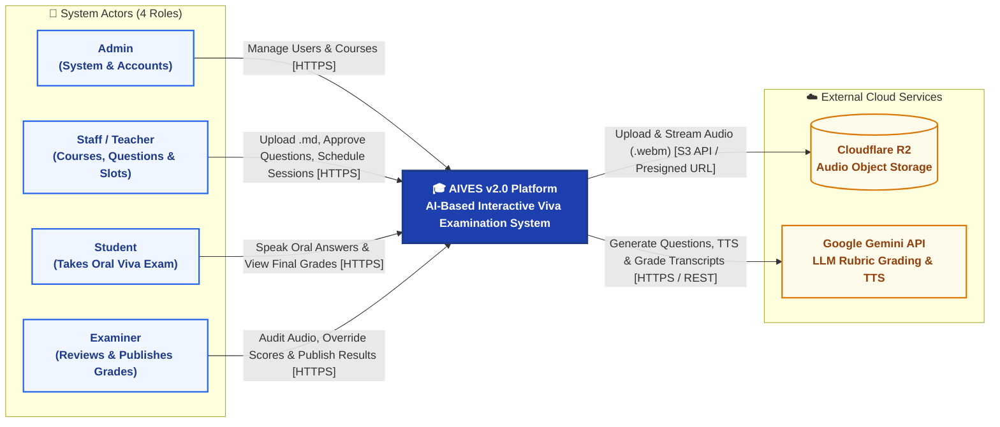
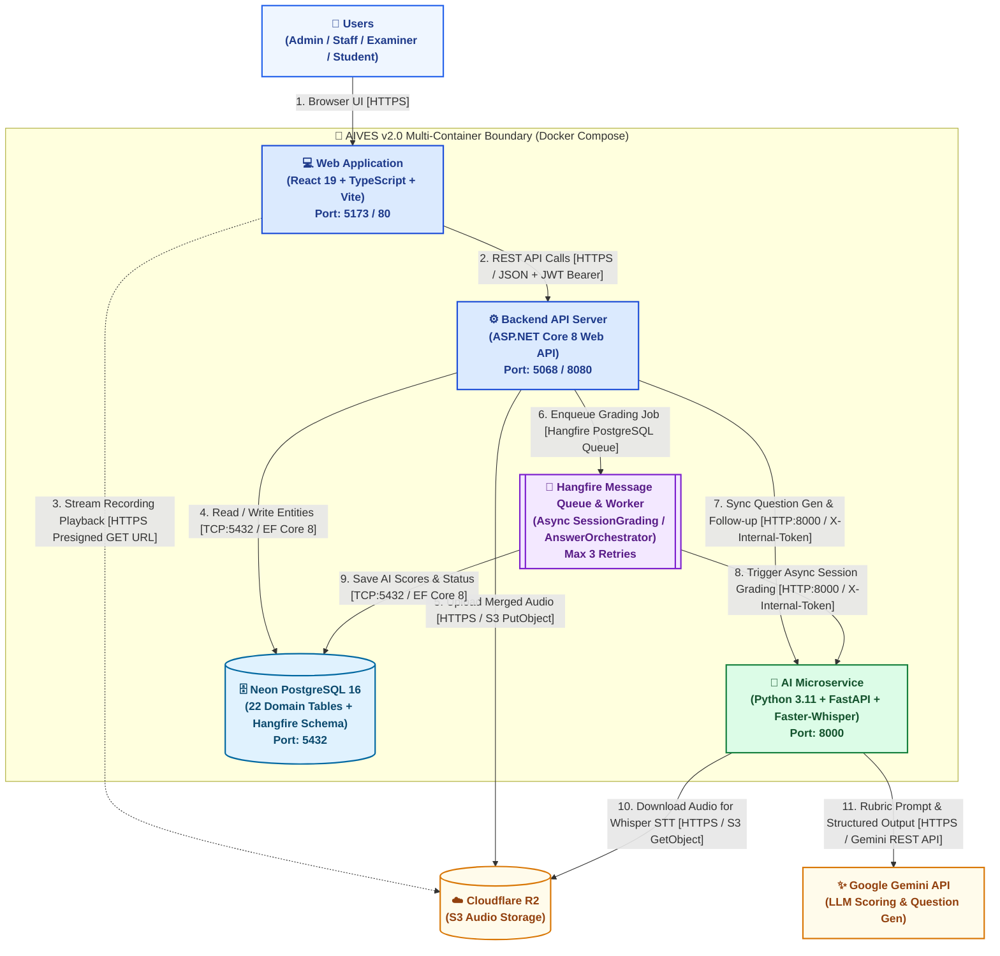
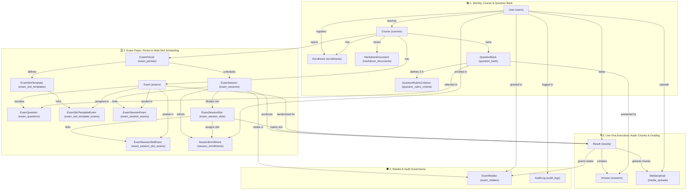
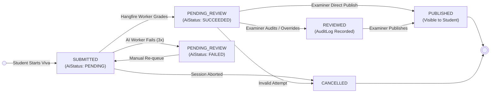
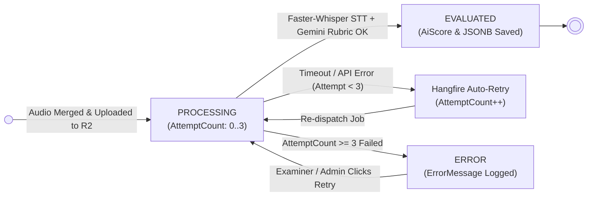

# AIVES v2.0 — System Architecture & Master Diagrams

> **Version:** 2.0 (Audited & Synchronized with Codebase)  
> **Scope:** C0 Context, C1 Multi-Container (with Hangfire Queue & Protocols), Full 21-Entity ERD, Entity Lifecycle State Machines, and 5 End-to-End Sequence Flows.

---

## 1. C0 — System Context Diagram (Level 0)

High-level system boundary showing the **4 User Roles** (`Admin`, `Staff / Teacher`, `Examiner`, `Student`), the **AIVES v2.0 Platform**, and its **2 External Cloud Dependencies** (`Cloudflare R2` and `Google Gemini API`).

---

## 2. C1 — Multi-Container Architecture (Queue, Backend–AI & Protocols)

Detailed multi-container deployment inside the AIVES v2.0 boundary, explicitly modeling the **Hangfire Message Queue & Worker**, **Backend–AI internal protocol (`HTTP:8000 / X-Internal-Token`)**, **Cloudflare R2 (`S3 API / Presigned URL`)**, and **Neon PostgreSQL 16 (`TCP:5432`)**.

---

## 3. Complete 21-Entity Database Architecture (ERD)

Covers all 21 `DbSet<T>` entities in `AivesDbContext.cs`, including `ExamPeriod`, `ExamSlotTemplate`, `ExamSlotTemplateExam`, `ExamSessionExam`, `ExamSessionSlot`, `ExamSessionSlotExam`, `QuestionRubricCriterion`, `MediaUpload`, `ExamRetake`, and `AuditLog`.

---

## 4. Entity Lifecycles & State Machine Diagrams

### 4.1 Result & AI Evaluation Lifecycle (`SubmissionStatus` + `AiEvaluationStatus`)

### 4.2 Answer & Hangfire Queue Retry Lifecycle (`AnswerStatus`)

### 4.3 ExamPeriod, Exam & ExamSession Lifecycles

```mermaid
flowchart TB
    subgraph EP["🗓️ A. ExamPeriod Lifecycle (ExamPeriodStatus)"]
        direction LR
        EP_D["DRAFT"] -->|"Staff Activates"| EP_A["ACTIVE"]
        EP_A -->|"Period Ends"| EP_C["COMPLETED"]
        EP_D -->|"Cancel"| EP_X["CANCELLED"]
        EP_A -->|"Cancel"| EP_X
    end

    subgraph EX["📄 B. Exam Paper Lifecycle (ExamStatus)"]
        direction LR
        EX_D["DRAFT"] -->|"Assign to Period/Slot"| EX_S["SCHEDULED"]
        EX_S -->|"Window Opens"| EX_O["OPEN"]
        EX_O -->|"Window Closes"| EX_CL["CLOSED"]
        EX_D -->|"Cancel"| EX_X["CANCELLED"]
        EX_S -->|"Cancel"| EX_X
    end

    subgraph ES["🎙️ C. ExamSession Lifecycle (SessionStatus)"]
        direction LR
        ES_N["NOT_STARTED"] -->|"StartTime Reached / First Student Joins"| ES_I["IN_PROGRESS"]
        ES_I -->|"EndTime Reached / All Finished"| ES_C["COMPLETED"]
        ES_N -->|"Staff Cancels"| ES_X["CANCELLED"]
        ES_I -->|"Emergency Cancel"| ES_X
    end
```

---

## 5. End-to-End Sequence Diagrams

See [docs/sequence-diagram.html](file:///d:/FPT/GitHub/AIVES_FPT/docs/sequence-diagram.html) and [docs/sequence-diagram.md](file:///d:/FPT/GitHub/AIVES_FPT/docs/sequence-diagram.md) for all 5 complete interactive sequence diagrams:
1. **Seq 1**: Upload Markdown Materials & AI Question/Rubric Generation
2. **Seq 2**: Exam Paper, ExamPeriod & Multi-Slot Session Scheduling
3. **Seq 3**: Live Viva Exam, Chunked Audio Upload to R2 & Queue Dispatch
4. **Seq 4**: Async Hangfire Queue Worker, Whisper STT & Gemini Rubric Grading
5. **Seq 5**: Examiner Audio Review, Score Override, Retake Grant & Grade Publication
