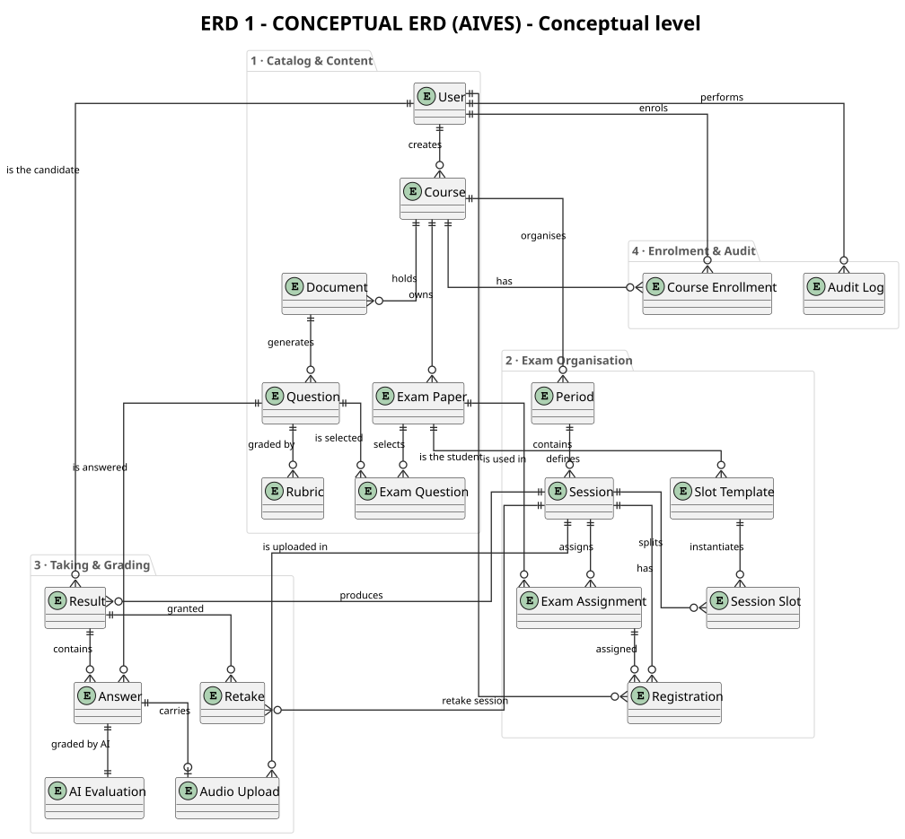
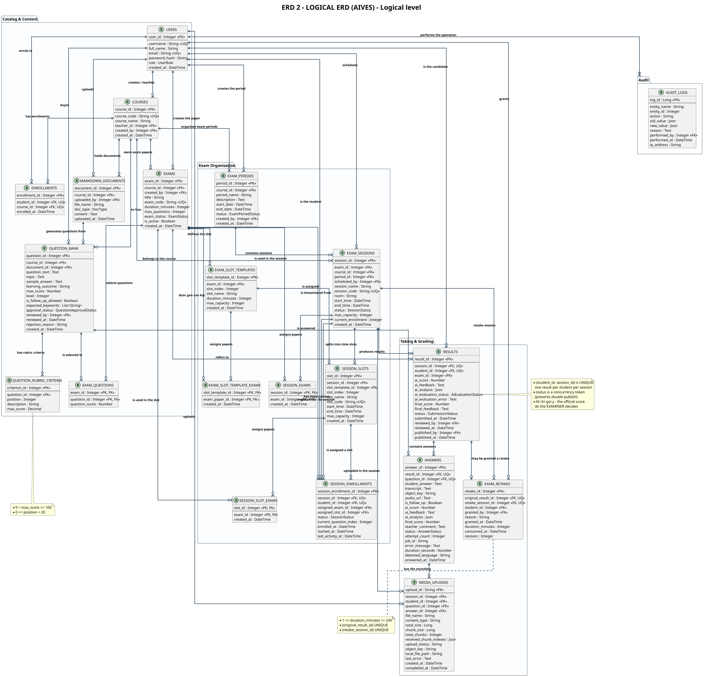
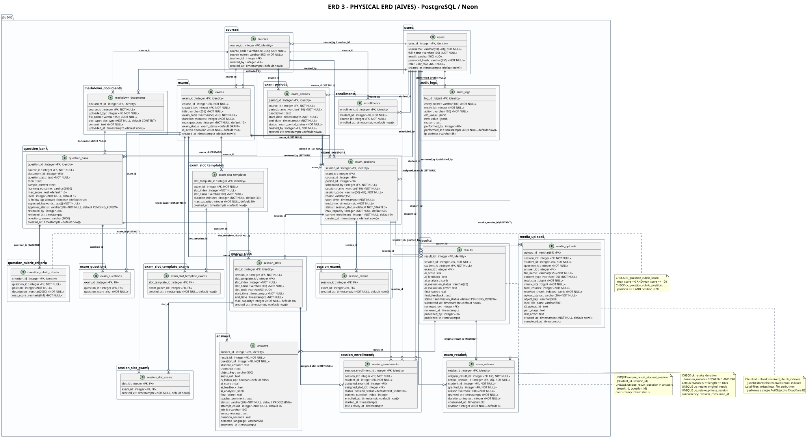

# AIVES - All ERDs (3 levels)

> Member 5 · The three ERD levels: Conceptual · Logical · Physical

### [ERD 1 · Conceptual ERD](./erd-01-conceptual_en.html)

Conceptual level: business entities and their relationships — no attributes, no keys, no data types.

- Mức/Level: **Conceptual** · Kích thước/size: `1008×935`
- Nguồn/Source: [`erd_01_conceptual_en.puml`](./erd_01_conceptual_en.puml)

### [ERD 2 · Logical ERD](./erd-02-logical_en.html)

Logical level: 3NF-normalised relations with attributes, primary keys, foreign keys and business rules.

- Mức/Level: **Logical** · Kích thước/size: `2751×2645`
- Nguồn/Source: [`erd_02_logical_en.puml`](./erd_02_logical_en.puml)

### [ERD 3 · Physical ERD](./erd-03-physical_en.html)

Physical level: 1:1 with the live Neon schema — data types, UNIQUE, FK with ON DELETE rules, CHECK constraints.

- Mức/Level: **Physical** · Kích thước/size: `3450×1877`
- Nguồn/Source: [`erd_03_physical_en.puml`](./erd_03_physical_en.puml)

## The three ERD levels

| Level | Scope | Question answered |
|---|---|---|
| <b>Conceptual</b> | Business entities, relationships between them, cardinality | <i>“Which things does the system store and how are they related?”</i> |
| <b>Logical</b> | 3NF-normalised relations, attributes, PK/FK, business rules | <i>“How is the stored structure normalised?”</i> |
| <b>Physical</b> | PostgreSQL data types, indexes, constraints, ON DELETE rules | <i>“What does the real Neon schema look like?”</i> |

---

## Source files & how to use them

| File | Content | Used for |
|---|---|---|
| `docs/architecture/erd/erd_0*.puml` | PlantUML source (self-contained, renders offline) | Regenerating the three ERD diagrams |
| `docs/architecture/erd/ERD_*.svg` | Vector image, infinitely scalable | Dropping into PowerPoint / slides |
| `docs/architecture/erd/ERD_*.png` | Full-resolution raster (rendered from the SVG) | Documents that need a raster image |
| `docs/architecture/erd/erd-*.md` | Markdown documentation with entity & constraint tables | Reading / printing the explanation |
| `ops/tools/dump_neon_schema.py` | Script that dumps the live Neon schema | Regenerating the physical level |

---

*Generated from `docs/architecture/erd/` · [Trang HTML](./all-erd-en.html)*
