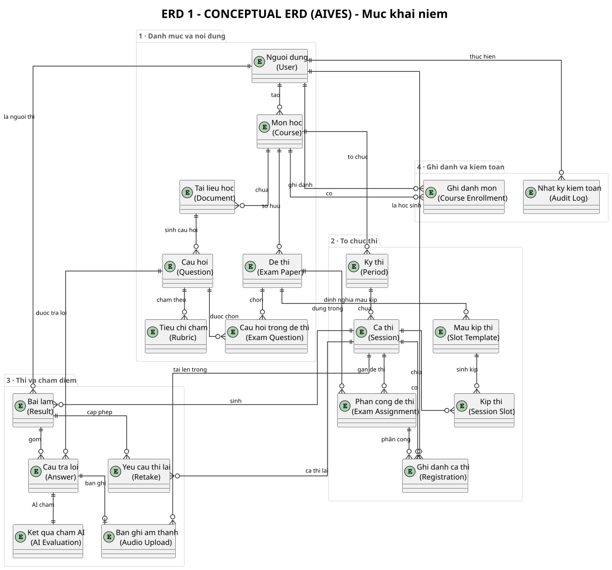
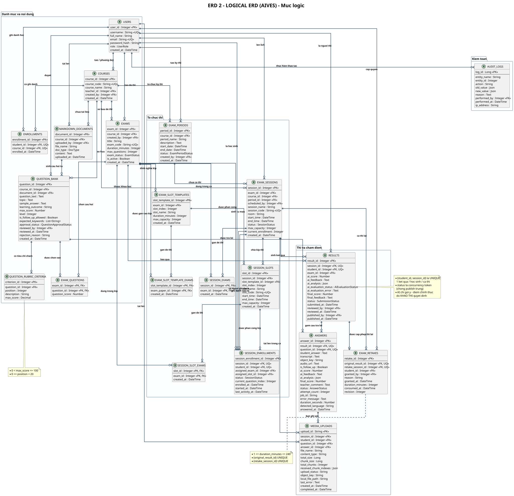
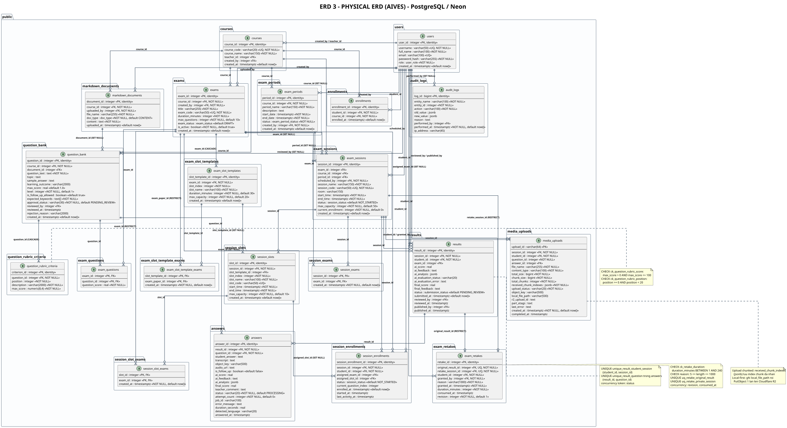

# AIVES - Toàn bộ ERD (3 mức)

> Thành viên 5 · Bộ 3 sơ đồ ERD: Conceptual · Logical · Physical

### [ERD 1 · Sơ đồ ERD khái niệm (Conceptual)](./erd-01-conceptual.html)

Mức khái niệm: thực thể nghiệp vụ và quan hệ giữa chúng — không thuộc tính, không khóa, không kiểu dữ liệu.

- Mức/Level: **Conceptual** · Kích thước/size: `1149×1071`
- Nguồn/Source: [`erd_01_conceptual.puml`](./erd_01_conceptual.puml)

### [ERD 2 · Sơ đồ ERD logic (Logical)](./erd-02-logical.html)

Mức logic: quan hệ đã chuẩn hóa 3NF kèm thuộc tính, khóa chính, khóa ngoại và quy tắc nghiệp vụ.

- Mức/Level: **Logical** · Kích thước/size: `2710×2619`
- Nguồn/Source: [`erd_02_logical.puml`](./erd_02_logical.puml)

### [ERD 3 · Sơ đồ ERD vật lý (Physical)](./erd-03-physical.html)

Mức vật lý: ánh xạ 1:1 với schema Neon thật — kiểu dữ liệu, UNIQUE, FK kèm ON DELETE, CHECK constraint.

- Mức/Level: **Physical** · Kích thước/size: `3446×1877`
- Nguồn/Source: [`erd_03_physical.puml`](./erd_03_physical.puml)

## Ba mức ERD và ý nghĩa

| Mức | Phạm vi | Câu hỏi trả lời |
|---|---|---|
| <b>Conceptual</b> | Thực thể nghiệp vụ, quan hệ giữa chúng, cardinality | <i>“Hệ thống lưu những gì nào và liên quan ra sao?”</i> |
| <b>Logical</b> | Relation chuẩn hóa 3NF, thuộc tính, PK/FK, ràng buộc nghiệp vụ | <i>“Cấu trúc lưu trữ được chuẩn hóa ra sao?”</i> |
| <b>Physical</b> | Kiểu dữ liệu PostgreSQL, index, constraint, quy tắc ON DELETE | <i>“Schema thật trên Neon trông như thế nào?”</i> |

---

## File nguồn & cách dùng

| File | Nội dung | Dùng để |
|---|---|---|
| `docs/architecture/erd/erd_0*.puml` | PlantUML source (tự chứa, render offline) | Render lại 3 sơ đồ ERD |
| `docs/architecture/erd/ERD_*.svg` | Ảnh vector, co giãn vô hạn | Nhét vào PowerPoint / slide |
| `docs/architecture/erd/ERD_*.png` | Ảnh raster full-resolution (render từ SVG) | Tài liệu cần ảnh bitmap |
| `docs/architecture/erd/erd-*.md` | Tài liệu markdown kèm bảng thực thể & ràng buộc | Đọc / in phần giải thích |
| `ops/tools/dump_neon_schema.py` | Script dump schema thật từ Neon | Sinh lại sơ đồ mức vật lý |

---

*Generated from `docs/architecture/erd/` · [Trang HTML](./all-erd.html)*
