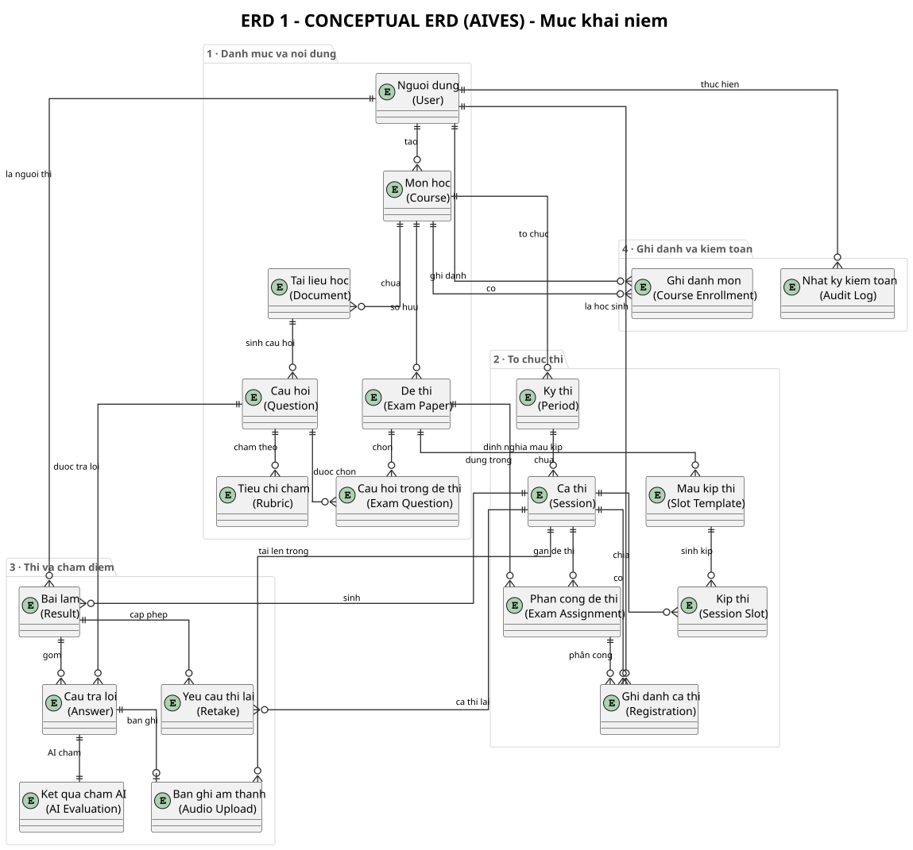

# ERD 1 - Sơ đồ ERD khái niệm

> Thành viên 5 · ERD · Bản tiếng Việt

## Đặc điểm của mức khái niệm

- Chỉ mô tả <b>thực thể nghiệp vụ</b> và <b>quan hệ</b> giữa chúng &ndash; không thuộc tính, không khóa, không kiểu dữ liệu.
- Phù hợp để thảo luận với người nghiệp vụ (giảng viên, trưởng khoa) và giải thích phạm vi hệ thống.
- 4 nhóm nghiệp vụ: <b>Danh mục &amp; nội dung</b>, <b>Tổ chức thi</b>, <b>Thi &amp; chấm điểm</b>, <b>Ghi danh &amp; kiểm toán</b>.
- <b>20 thực thể</b> nghiệp vụ. Ba bảng nối nhiều–nhiều (<code>session_exams</code>, <code>exam_slot_template_exams</code>, <code>session_slot_exams</code>) được gộp thành một thực thể khái niệm <b>Exam Assignment</b> để giữ sơ đồ dễ đọc.

## Các thực thể nghiệp vụ chính

| <b>User</b> | Tài khoản người dùng với vai trò ADMIN / STAFF / EXAMINER / STUDENT | Danh mục &amp; nội dung |
| <b>Course</b> | Môn học do giảng viên phụ trách, giảng viên tạo | Danh mục &amp; nội dung |
| <b>Document</b> | Tài liệu Markdown (nội dung bài học hoặc learning outcome) nạp lên | Danh mục &amp; nội dung |
| <b>Question</b> | Câu hỏi trong ngân hàng câu hỏi, có trạng thái duyệt | Danh mục &amp; nội dung |
| <b>Rubric</b> | Tiêu chí chấm điểm của một câu hỏi | Danh mục &amp; nội dung |
| <b>Exam Paper</b> | Đề thi chọn từ ngân hàng câu hỏi | Danh mục &amp; nội dung |
| <b>Exam Question</b> | Câu hỏi được chọn vào một đề thi kèm điểm | Danh mục &amp; nội dung |
| <b>Period</b> | Kỳ thi thuộc một môn học | Tổ chức thi |
| <b>Session</b> | Ca thi trong một kỳ thi, gắn mã ghi danh và sức chứa | Tổ chức thi |
| <b>Slot Template</b> | Mẫu chia kíp thi theo thời lượng và sức chứa | Tổ chức thi |
| <b>Session Slot</b> | Kíp thi cụ thể sinh ra trong một ca thi | Tổ chức thi |
| <b>Exam Assignment</b> | Phân công đề thi cho ca thi / kíp thi (gộp 3 bảng nối nhiều–nhiều) | Tổ chức thi |
| <b>Registration</b> | Học sinh ghi danh vào ca thi và được phân công kíp / đề | Tổ chức thi |
| <b>Result</b> | Bài làm của học sinh trong một ca thi | Thi &amp; chấm điểm |
| <b>Answer</b> | Câu trả lời (văn bản hoặc giọng nói) cho một câu hỏi | Thi &amp; chấm điểm |
| <b>AI Evaluation</b> | Kết quả chấm gợi ý của AI (điểm, nhận xét, phân tích) | Thi &amp; chấm điểm |
| <b>Audio Upload</b> | Tệp âm thanh bài làm, lưu trên Cloudflare R2 | Thi &amp; chấm điểm |
| <b>Retake</b> | Yêu cầu thi lại khi xảy ra sự cố | Thi &amp; chấm điểm |
| <b>Course Enrollment</b> | Học sinh ghi danh học môn | Ghi danh &amp; kiểm toán |
| <b>Audit Log</b> | Nhật ký kiểm toán mọi thao tác nhạy cảm | Ghi danh &amp; kiểm toán |

---

*Generated from `docs/architecture/erd/` &middot; sources: `erd_01_conceptual.puml`*

* [Diagram index](./erd-index.md)
* [All ERDs on one page](./all-erd.md)
