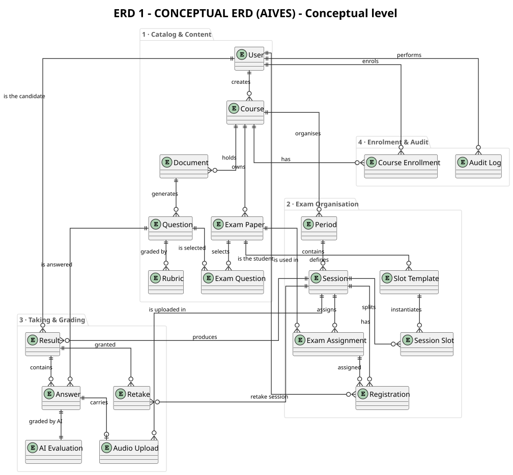

# ERD 1 - Conceptual ERD

> Member 5 · ERD · English version

## What the conceptual level captures

- Describes only <b>business entities</b> and their <b>relationships</b> &ndash; no attributes, no keys, no data types.
- Meant for business stakeholders (lecturers, department head) to agree on system scope.
- Four business areas: <b>Catalog &amp; Content</b>, <b>Exam Organisation</b>, <b>Taking &amp; Grading</b>, <b>Enrolment &amp; Audit</b>.
- <b>20 business entities</b>. The three many-to-many junction tables (<code>session_exams</code>, <code>exam_slot_template_exams</code>, <code>session_slot_exams</code>) are folded into a single conceptual entity, <b>Exam Assignment</b>, to keep the diagram readable.

## Main business entities

| <b>User</b> | Account with role ADMIN / STAFF / EXAMINER / STUDENT | Catalog &amp; Content |
| <b>Course</b> | Course owned by a teacher, created by staff | Catalog &amp; Content |
| <b>Document</b> | Uploaded Markdown content (lesson or learning outcome) | Catalog &amp; Content |
| <b>Question</b> | Question in the question bank, with approval status | Catalog &amp; Content |
| <b>Rubric</b> | Scoring criterion of a question | Catalog &amp; Content |
| <b>Exam Paper</b> | Exam paper assembled from the question bank | Catalog &amp; Content |
| <b>Exam Question</b> | Question selected into an exam paper, with its score | Catalog &amp; Content |
| <b>Period</b> | Exam period belonging to a course | Exam Organisation |
| <b>Session</b> | Session inside a period, with join code and capacity | Exam Organisation |
| <b>Slot Template</b> | Template splitting a paper into timed, capacity-limited slots | Exam Organisation |
| <b>Session Slot</b> | Concrete time slot instantiated inside a session | Exam Organisation |
| <b>Exam Assignment</b> | Assignment of an exam paper to a session / slot (folds the three junction tables) | Exam Organisation |
| <b>Registration</b> | Student registers for a session and gets a slot / paper | Exam Organisation |
| <b>Result</b> | Candidate submission within a session | Taking &amp; Grading |
| <b>Answer</b> | Answer (text or speech) to one question | Taking &amp; Grading |
| <b>AI Evaluation</b> | AI suggested score, feedback and analysis | Taking &amp; Grading |
| <b>Audio Upload</b> | Audio file of the submission, stored on Cloudflare R2 | Taking &amp; Grading |
| <b>Retake</b> | Request for a new attempt after an incident | Taking &amp; Grading |
| <b>Course Enrollment</b> | Student enrols in a course | Enrolment &amp; Audit |
| <b>Audit Log</b> | Audit trail of every sensitive action | Enrolment &amp; Audit |

---

*Generated from `docs/architecture/erd/` &middot; sources: `erd_01_conceptual_en.puml`*

* [Diagram index](./erd-index-en.md)
* [All ERDs on one page](./all-erd-en.md)
