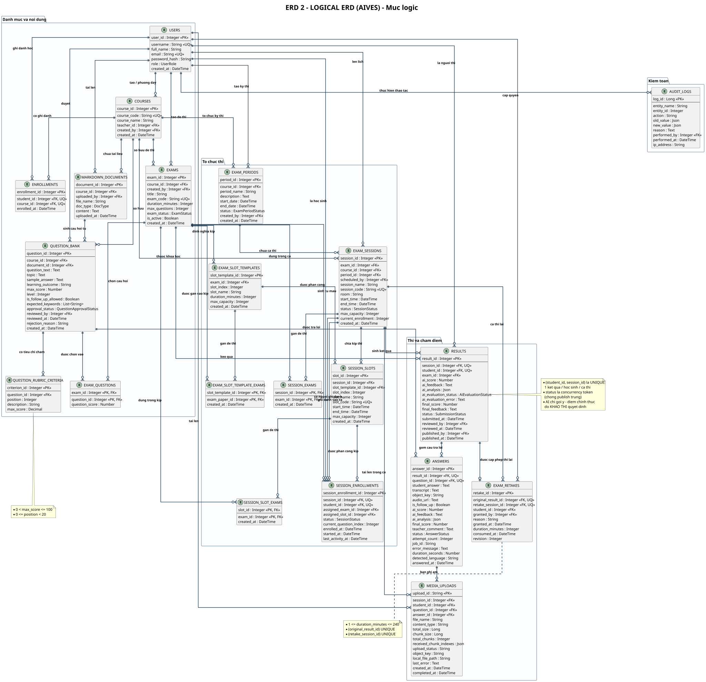

# ERD 2 - Sơ đồ ERD logic

> Thành viên 5 · ERD · Bản tiếng Việt

## Đặc điểm của mức logic

- Mô tả <b>quan hệ đã chuẩn hóa 3NF</b> với đầy đủ thuộc tính, khóa chính (PK) và khóa ngoại (FK).
- Kiểu dữ liệu ở mức <b>trừu tượng</b> (Integer, String, DateTime, Boolean, Text, Decimal) &ndash; không gắn với DBMS cụ thể.
- Bảng trung gian cho quan hệ nhiều–nhiều: <code>exam_questions</code>, <code>session_exams</code>, <code>session_slot_exams</code>, <code>exam_slot_template_exams</code>, <code>enrollments</code>, <code>session_enrollments</code>.
- Ghi rõ các ràng buộc nghiệp vụ: UNIQUE, CHECK, quy tắc xóa dữ liệu và concurrency token.

## Các quan hệ chính và ràng buộc

| <b>USERS</b> | Tài khoản người dùng &ndash; vai trò hệ thống | PK <code>user_id</code> · UQ <code>username</code>, <code>email</code> |
| <b>COURSES</b> | Môn học | PK <code>course_id</code> · UQ <code>course_code</code> · FK giảng viên, người tạo |
| <b>ENROLLMENTS</b> | Ghi danh học môn | UQ <code>(student_id, course_id)</code> |
| <b>MARKDOWN_DOCUMENTS</b> | Tài liệu nội dung / learning outcome | FK <code>course_id</code>, <code>uploaded_by</code> |
| <b>QUESTION_BANK</b> | Ngân hàng câu hỏi | UQ trạng thái duyệt · FK tài liệu nguồn (SET NULL) |
| <b>QUESTION_RUBRIC_CRITERIA</b> | Tiêu chí chấm của câu hỏi | CHECK <code>0 &lt; max_score &le; 100</code>, <code>0 &le; position &lt; 20</code> |
| <b>EXAMS</b> / <b>EXAM_QUESTIONS</b> | Đề thi và các câu hỏi được chọn | PK gộp <code>(exam_id, question_id)</code> |
| <b>EXAM_PERIODS</b> / <b>EXAM_SESSIONS</b> | Kỳ thi và ca thi | UQ <code>session_code</code> · theo dõi sức chứa |
| <b>EXAM_SLOT_TEMPLATES</b> / <b>SESSION_SLOTS</b> | Mẫu kíp thi và kíp thi thực tế | UQ <code>(session_id, slot_index)</code>, <code>slot_code</code> |
| <b>SESSION_ENROLLMENTS</b> | Ghi danh ca thi &amp; phân công đề/kíp | UQ <code>(student_id, session_id)</code> · concurrency token |
| <b>RESULTS</b> | Kết quả bài làm của học sinh | UQ <code>(student_id, session_id)</code> · concurrency token <code>status</code> |
| <b>ANSWERS</b> | Câu trả lời của học sinh | UQ <code>(result_id, question_id)</code> |
| <b>MEDIA_UPLOADS</b> | Phiên upload âm thanh theo chunk | PK <code>upload_id</code> · jsonb chunk indexes |
| <b>EXAM_RETAKES</b> | Quyền thi lại | CHECK <code>1 &le; duration_minutes &le; 240</code> · UQ result/session |
| <b>AUDIT_LOGS</b> | Nhật ký kiểm toán | jsonb old/new value · FK người thực hiện (SET NULL) |

---

*Generated from `docs/architecture/erd/` &middot; sources: `erd_02_logical.puml`*

* [Diagram index](./erd-index.md)
* [All ERDs on one page](./all-erd.md)
