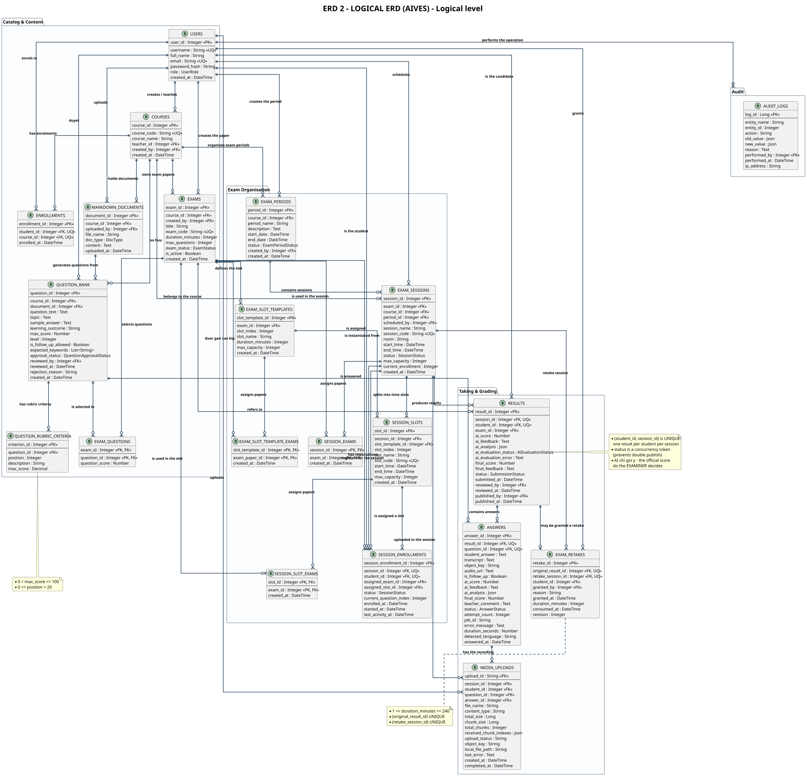

# ERD 2 - Logical ERD

> Member 5 · ERD · English version

## What the logical level captures

- Describes <b>3NF-normalised relations</b> with full attributes, primary keys (PK) and foreign keys (FK).
- Data types stay <b>abstract</b> (Integer, String, DateTime, Boolean, Text, Decimal) &ndash; independent of any DBMS.
- Junction tables for many-to-many links: <code>exam_questions</code>, <code>session_exams</code>, <code>session_slot_exams</code>, <code>exam_slot_template_exams</code>, <code>enrollments</code>, <code>session_enrollments</code>.
- Business rules are explicit: UNIQUE, CHECK, delete behaviour and concurrency tokens.

## Main relations and constraints

| <b>USERS</b> | User accounts and system roles | PK <code>user_id</code> · UQ <code>username</code>, <code>email</code> |
| <b>COURSES</b> | Courses | PK <code>course_id</code> · UQ <code>course_code</code> · FK teacher, creator |
| <b>ENROLLMENTS</b> | Course enrolment | UQ <code>(student_id, course_id)</code> |
| <b>MARKDOWN_DOCUMENTS</b> | Content / learning outcome documents | FK <code>course_id</code>, <code>uploaded_by</code> |
| <b>QUESTION_BANK</b> | Question bank | Approval status · FK source document (SET NULL) |
| <b>QUESTION_RUBRIC_CRITERIA</b> | Rubric criteria of a question | CHECK <code>0 &lt; max_score &le; 100</code>, <code>0 &le; position &lt; 20</code> |
| <b>EXAMS</b> / <b>EXAM_QUESTIONS</b> | Exam papers and their selected questions | Composite PK <code>(exam_id, question_id)</code> |
| <b>EXAM_PERIODS</b> / <b>EXAM_SESSIONS</b> | Exam periods and sessions | UQ <code>session_code</code> · capacity tracking |
| <b>EXAM_SLOT_TEMPLATES</b> / <b>SESSION_SLOTS</b> | Slot templates and concrete slots | UQ <code>(session_id, slot_index)</code>, <code>slot_code</code> |
| <b>SESSION_ENROLLMENTS</b> | Session registration and paper/slot assignment | UQ <code>(student_id, session_id)</code> · concurrency token |
| <b>RESULTS</b> | Result of a candidate in a session | UQ <code>(student_id, session_id)</code> · concurrency token <code>status</code> |
| <b>ANSWERS</b> | Answers of the candidate | UQ <code>(result_id, question_id)</code> |
| <b>MEDIA_UPLOADS</b> | Chunked audio upload sessions | PK <code>upload_id</code> · jsonb chunk indexes |
| <b>EXAM_RETAKES</b> | Grants of a retake | CHECK <code>1 &le; duration_minutes &le; 240</code> · UQ result/session |
| <b>AUDIT_LOGS</b> | Audit trail | jsonb old/new value · FK performer (SET NULL) |

---

*Generated from `docs/architecture/erd/` &middot; sources: `erd_02_logical_en.puml`*

* [Diagram index](./erd-index-en.md)
* [All ERDs on one page](./all-erd-en.md)
