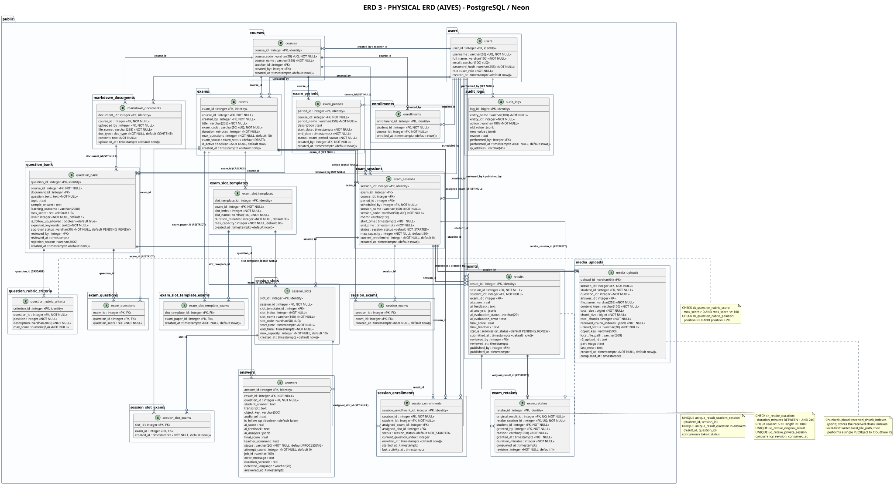

# ERD 3 - Physical ERD

> Member 5 · ERD · English version

## What the physical level captures

- Maps <b>1:1</b> to the live Neon schema: <b>21 tables</b> in schema <code>public</code>.
- Shows <b>concrete PostgreSQL types</b>: <code>integer</code>, <code>bigint</code>, <code>varchar(n)</code>, <code>text</code>, <code>jsonb</code>, <code>text[]</code>, <code>real</code>, <code>numeric(8,4)</code>, <code>timestamptz</code> plus the application-defined enums.
- Every <b>PK</b>, <b>UNIQUE</b> and <b>FK</b> carries its <b>ON DELETE</b> rule (CASCADE / SET NULL / RESTRICT) and the <b>CHECK constraints</b>.
- Tables are grouped in packages named after the real tables (<code>public.users</code>, <code>public.results</code>, &hellip;).

## Physical tables and technical characteristics

| <code>users</code> | 7 | <code>user_id</code> serial | Enum <code>user_role</code> · UQ username/email |
| <code>courses</code> | 6 | <code>course_id</code> serial | UQ <code>course_code</code> · FK SET NULL |
| <code>enrollments</code> | 4 | <code>enrollment_id</code> serial | UQ <code>(student_id, course_id)</code> |
| <code>markdown_documents</code> | 7 | <code>document_id</code> serial | Enum <code>doc_type</code> · <code>text</code> content |
| <code>question_bank</code> | 17 | <code>question_id</code> serial | <code>expected_keywords text[]</code> · <code>approval_status</code> |
| <code>question_rubric_criteria</code> | 5 | <code>criterion_id</code> serial | 2 CHECK constraints on score and position |
| <code>exams</code> / <code>exam_questions</code> | 9 / 3 | <code>exam_id</code> · composite PK | Enum <code>exam_status</code> · soft delete <code>is_active</code> |
| <code>exam_periods</code> | 9 | <code>period_id</code> serial | Enum <code>exam_period_status</code> |
| <code>exam_sessions</code> | 14 | <code>session_id</code> serial | Enum <code>session_status</code> · UQ <code>session_code</code> |
| <code>session_exams</code> / <code>session_slot_exams</code> | 3 / 3 | Composite 2-column PK | Many-to-many junction tables |
| <code>exam_slot_templates</code> / <code>exam_slot_template_exams</code> | 7 / 3 | <code>slot_template_id</code> · composite PK | FK <code>exam_paper_id</code> RESTRICT |
| <code>session_slots</code> | 11 | <code>slot_id</code> serial | UQ <code>(session_id, slot_index)</code>, <code>slot_code</code> |
| <code>session_enrollments</code> | 11 | <code>session_enrollment_id</code> serial | Concurrency tokens <code>status</code>, <code>started_at</code> |
| <code>results</code> | 19 | <code>result_id</code> serial | <code>ai_analysis jsonb</code> · concurrency token <code>status</code> |
| <code>answers</code> | 21 | <code>answer_id</code> serial | <code>ai_analysis jsonb</code> · <code>attempt_count</code> for retry |
| <code>media_uploads</code> | 21 | <code>upload_id varchar(64)</code> | <code>received_chunk_indexes jsonb</code> · local-first + R2 |
| <code>exam_retakes</code> | 10 | <code>retake_id</code> serial | CHECK duration · UQ result/session · concurrency <code>revision</code> |
| <code>audit_logs</code> | 11 | <code>log_id bigint</code> identity | <code>old_value/new_value jsonb</code> |

---

*Generated from `docs/architecture/erd/` &middot; sources: `erd_03_physical_en.puml`*

* [Diagram index](./erd-index-en.md)
* [All ERDs on one page](./all-erd-en.md)
