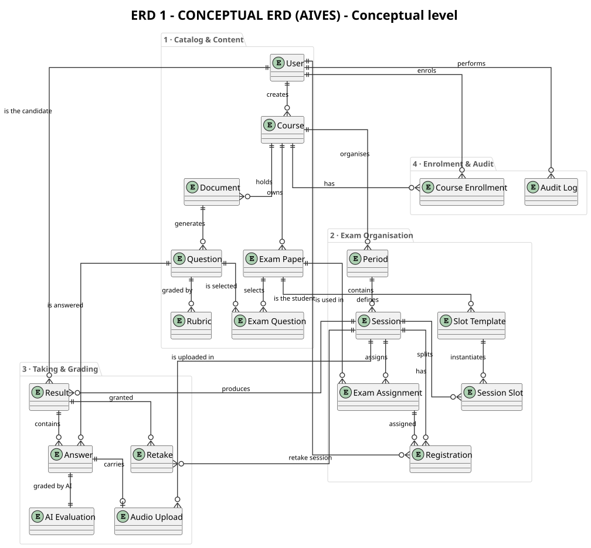
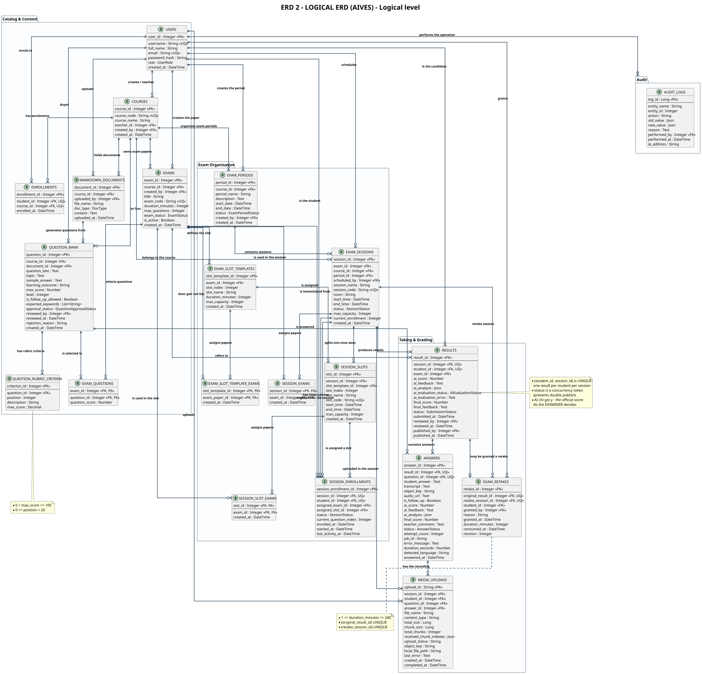
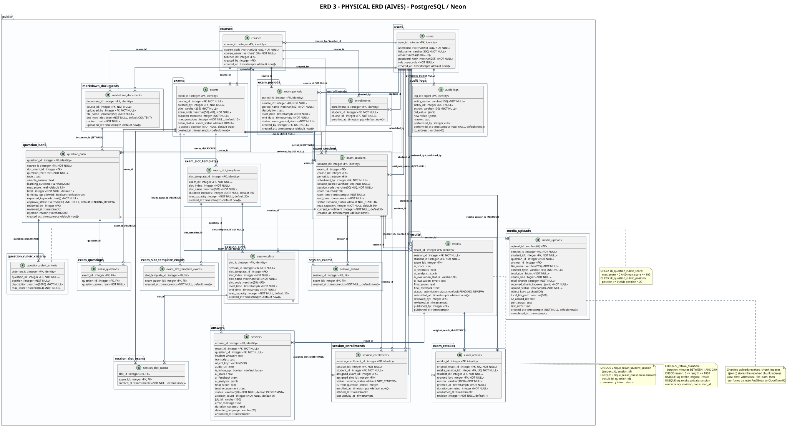

# AIVES – ERD Index (3 levels)

> Member 5 · English version

## Diagrams

### [ERD 1 &ndash; Conceptual ERD](./erd-01-conceptual_en.md)

- Level: **Conceptual**
- Source: [`erd_01_conceptual_en.puml`](./erd_01_conceptual_en.puml)
- Page: [HTML](./erd-01-conceptual_en.html) · Markdown: [MD](./erd-01-conceptual_en.md)

### [ERD 2 &ndash; Logical ERD](./erd-02-logical_en.md)

- Level: **Logical**
- Source: [`erd_02_logical_en.puml`](./erd_02_logical_en.puml)
- Page: [HTML](./erd-02-logical_en.html) · Markdown: [MD](./erd-02-logical_en.md)

### [ERD 3 &ndash; Physical ERD](./erd-03-physical_en.md)

- Level: **Physical**
- Source: [`erd_03_physical_en.puml`](./erd_03_physical_en.puml)
- Page: [HTML](./erd-03-physical_en.html) · Markdown: [MD](./erd-03-physical_en.md)

## The three ERD levels

| Level | Scope | Question answered |
|---|---|---|
| <b>Conceptual</b> | Business entities, relationships between them, cardinality | <i>“Which things does the system store and how are they related?”</i> |
| <b>Logical</b> | 3NF-normalised relations, attributes, PK/FK, business rules | <i>“How is the stored structure normalised?”</i> |
| <b>Physical</b> | PostgreSQL data types, indexes, constraints, ON DELETE rules | <i>“What does the real Neon schema look like?”</i> |

---

*Generated from `docs/architecture/erd/`*

* [All ERDs on one page](./all-erd-en.md)
