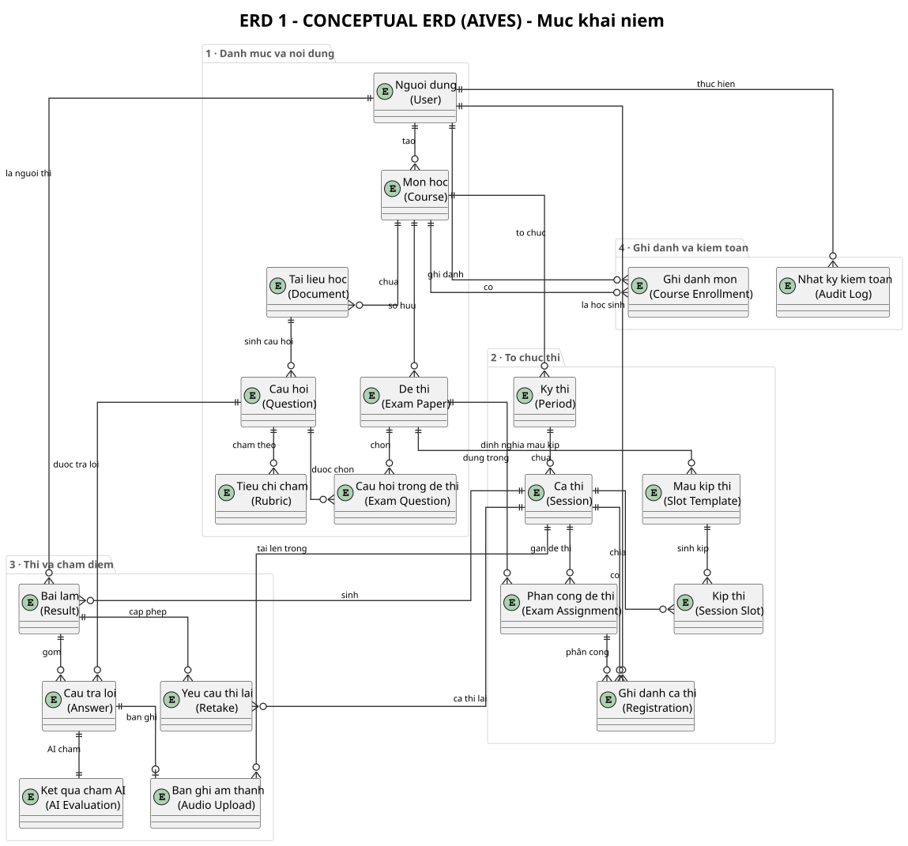
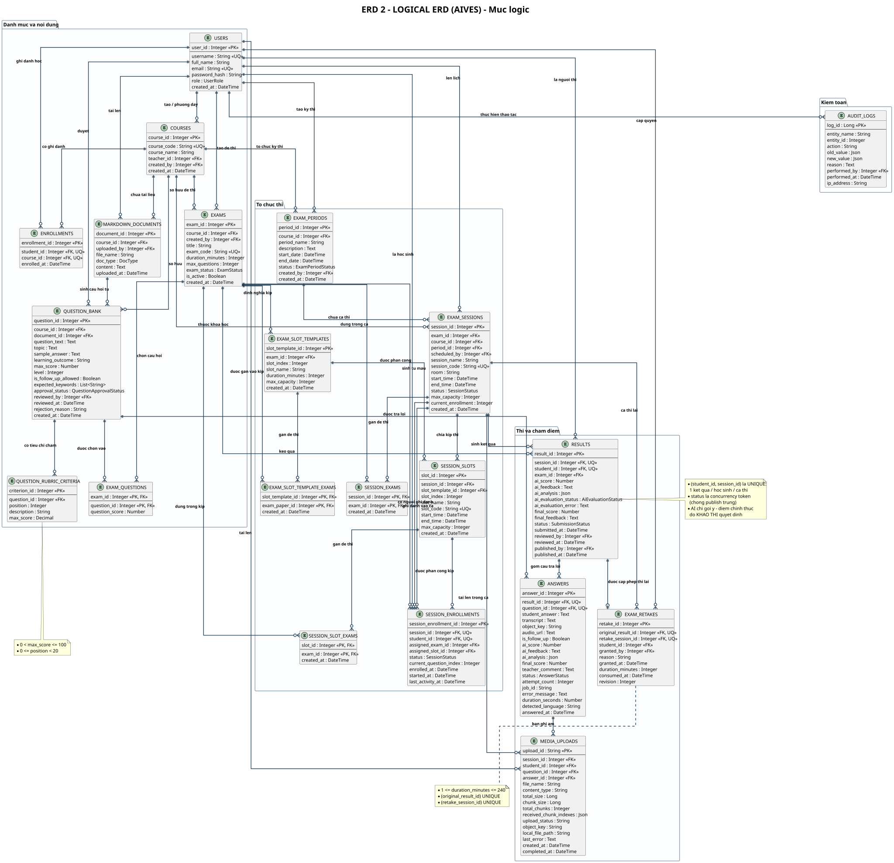
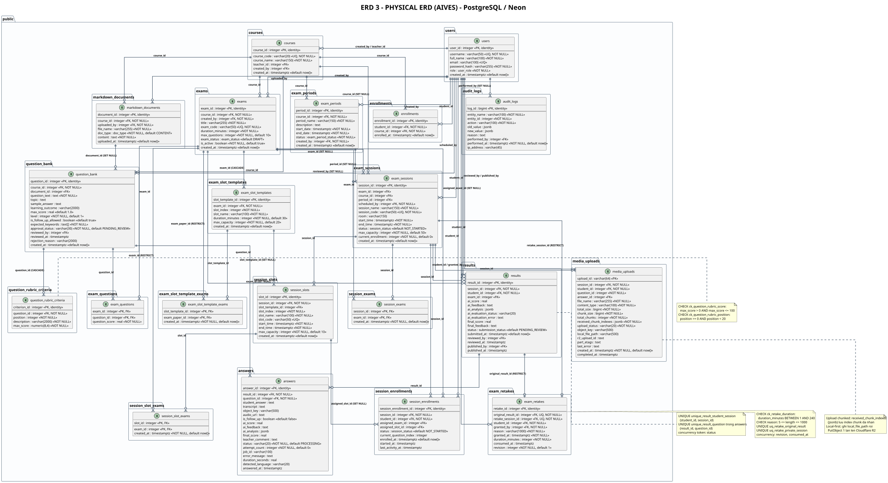

# AIVES – Danh mục ERD (3 mức)

> Thành viên 5 · Bản tiếng Việt

## Các sơ đồ

### [ERD 1 &ndash; Sơ đồ ERD khái niệm](./erd-01-conceptual.md)

- Level: **Conceptual**
- Source: [`erd_01_conceptual.puml`](./erd_01_conceptual.puml)
- Page: [HTML](./erd-01-conceptual.html) · Markdown: [MD](./erd-01-conceptual.md)

### [ERD 2 &ndash; Sơ đồ ERD logic](./erd-02-logical.md)

- Level: **Logical**
- Source: [`erd_02_logical.puml`](./erd_02_logical.puml)
- Page: [HTML](./erd-02-logical.html) · Markdown: [MD](./erd-02-logical.md)

### [ERD 3 &ndash; Sơ đồ ERD vật lý](./erd-03-physical.md)

- Level: **Physical**
- Source: [`erd_03_physical.puml`](./erd_03_physical.puml)
- Page: [HTML](./erd-03-physical.html) · Markdown: [MD](./erd-03-physical.md)

## Ba mức ERD và ý nghĩa

| Mức | Phạm vi | Câu hỏi trả lời |
|---|---|---|
| <b>Conceptual</b> | Thực thể nghiệp vụ, quan hệ giữa chúng, cardinality | <i>“Hệ thống lưu những gì nào và liên quan ra sao?”</i> |
| <b>Logical</b> | Relation chuẩn hóa 3NF, thuộc tính, PK/FK, ràng buộc nghiệp vụ | <i>“Cấu trúc lưu trữ được chuẩn hóa ra sao?”</i> |
| <b>Physical</b> | Kiểu dữ liệu PostgreSQL, index, constraint, quy tắc ON DELETE | <i>“Schema thật trên Neon trông như thế nào?”</i> |

---

*Generated from `docs/architecture/erd/`*

* [All ERDs on one page](./all-erd.md)
