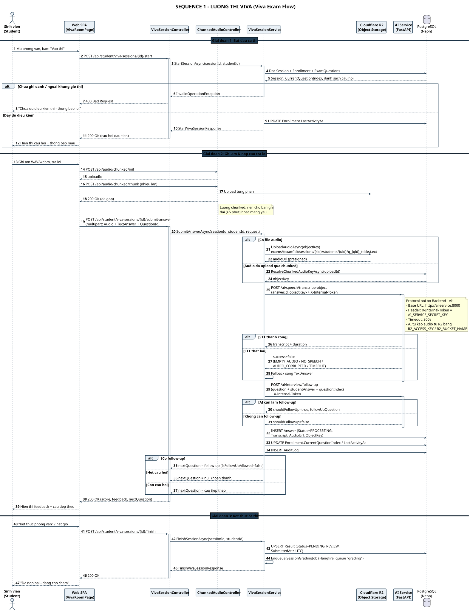

# SEQ 1 – Luồng thi Viva

> Thành viên 5 · Sequence Diagram · Bản tiếng Việt

**3 giai đoạn**: bắt đầu ca thi → ghi âm & nộp câu trả lời (STT + sinh follow-up) → kết thúc & xếp hàng chấm.

## Tóm tắt luồng

Sơ đồ mô tả trọn vẹn vòng đời một lượt thi Viva của Sinh viên: từ lúc mở phòng thi, ghi âm và nộp từng câu trả lời, cho tới khi kết thúc ca thi và bài được đẩy vào hàng đợi chấm AI.

Điểm quan trọng được thể hiện: file âm thanh được upload theo **luồng chunked** (`/api/audio/chunked/init` → `chunk` → `complete`) cho bản ghi dài hoặc mạng yếu; Backend gọi AI Service để **STT** và **sinh câu hỏi follow-up**, nhưng nếu AI lỗi thì hệ thống **fallback sang TextAnswer** thay vì mất bài. Mỗi câu trả lời được lưu với `Status = PROCESSING`, còn toàn bộ bài sẽ sang `PENDING_REVIEW` khi sinh viên kết thúc ca thi.

## Các participant & trách nhiệm

| Participant | Trách nhiệm |
| Sinh viên (Student) | Bắt đầu ca thi, ghi âm, nộp câu trả lời, kết thúc bài |
| Web SPA (VivaRoomPage) | Ghi âm WAV/webm, upload chunked, hiển thị câu hỏi & feedback |
| VivaSessionController | Nhận request, phân quyền STUDENT, trả lỗi 400/403/404/409 |
| ChunkedAudioController | Init / chunk / complete / abort — upload audio dài theo phần |
| VivaSessionService | Nghiệp vụ: STT, follow-up, lưu Answer, cập nhật Enrollment |
| Cloudflare R2 | Lưu file âm thanh, trả presigned URL |
| AI Service (FastAPI) | `/ai/speech/transcribe-object` và `/ai/interview/follow-up` |
| PostgreSQL (Neon) | Session, Enrollment, ExamQuestions, Answer, Result, AuditLog |

---

* Nguồn PlantUML: [`seq_01_viva_flow.puml`](./seq_01_viva_flow.puml) · SVG: [`SEQ_01_VIVA_FLOW.svg`](./SEQ_01_VIVA_FLOW.svg) · PNG: [`SEQ_01_VIVA_FLOW.png`](./SEQ_01_VIVA_FLOW.png)*
* [Danh mục Sequence Diagram](./sequence-index.md) · [Tất cả trên 1 trang](../all-diagrams.md)
