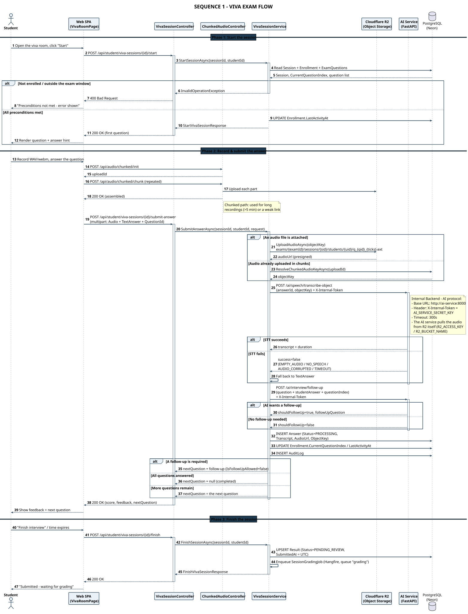

# SEQ 1-EN – Viva Exam Flow

> Member 5 · Sequence Diagram · English version

**Three phases**: start the session → record & submit the answer (STT + follow-up generation) → finish and queue for grading.

## Flow summary

The diagram covers the full life of one Viva attempt: opening the room, recording and submitting each answer, finishing the session, and queueing the submission for AI grading.

Key points shown: the audio file is uploaded through the **chunked path** (`/api/audio/chunked/init` → `chunk` → `complete`) for long recordings or a weak link; the Backend calls the AI Service for **STT** and **follow-up generation**, and if the AI fails the system **falls back to TextAnswer** instead of losing the submission. Each answer is stored with `Status = PROCESSING`, while the whole session moves to `PENDING_REVIEW` when the student finishes.

## Participants & responsibilities

| Participant | Responsibility |
| Student | Starts the session, records, submits the answer, finishes the exam |
| Web SPA (VivaRoomPage) | Records WAV/webm, chunked upload, renders questions & feedback |
| VivaSessionController | Accepts requests, enforces the STUDENT role, returns 400/403/404/409 |
| ChunkedAudioController | Init / chunk / complete / abort — chunked upload of long recordings |
| VivaSessionService | Business logic: STT, follow-up, persists Answer, updates Enrollment |
| Cloudflare R2 | Stores the audio file, returns a presigned URL |
| AI Service (FastAPI) | `/ai/speech/transcribe-object` and `/ai/interview/follow-up` |
| PostgreSQL (Neon) | Session, Enrollment, ExamQuestions, Answer, Result, AuditLog |

---

* PlantUML source: [`seq_01_viva_flow_en.puml`](./seq_01_viva_flow_en.puml) · SVG: [`SEQ_01_VIVA_FLOW_EN.svg`](./SEQ_01_VIVA_FLOW_EN.svg) · PNG: [`SEQ_01_VIVA_FLOW_EN.png`](./SEQ_01_VIVA_FLOW_EN.png)*
* [Sequence Diagram index](./sequence-index-en.md) · [All on one page](../all-diagrams-en.md)
