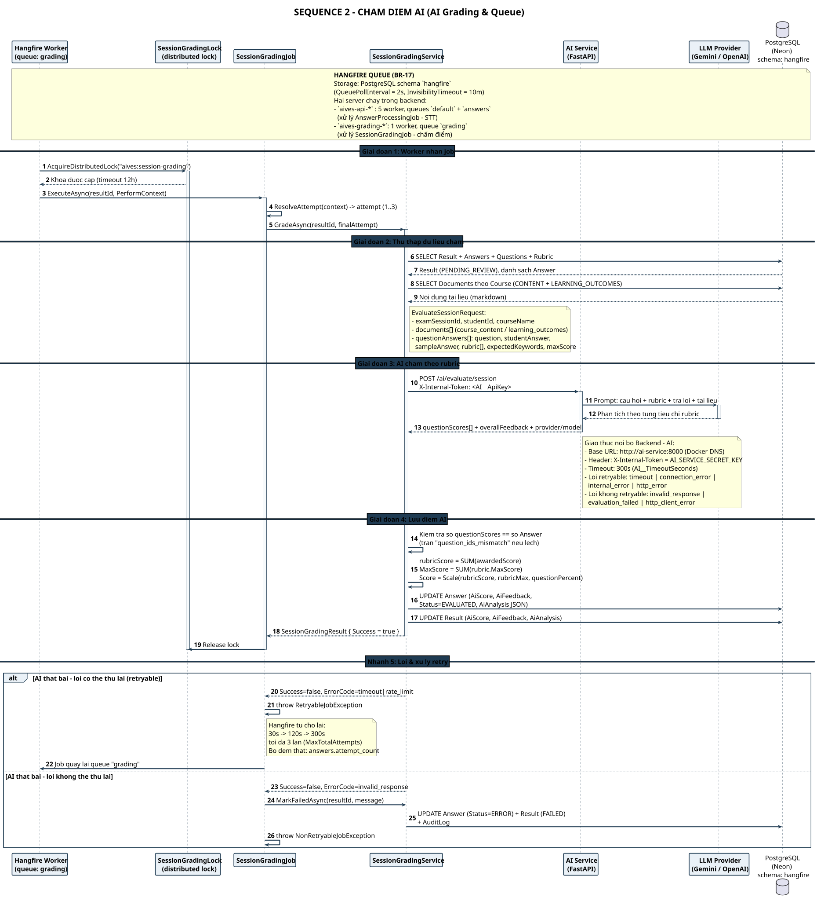

# SEQ 2 – Chấm điểm AI

> Thành viên 5 · Sequence Diagram · Bản tiếng Việt

**Hangfire worker** giữ 1 khóa phân tán toàn hệ thống nên chấm lần lượt từng bài. Hàng đợi lưu trong schema `hangfire` của PostgreSQL; lỗi retryable được thử lại 30s → 120s → 300s (tối đa 3 lần).

## Tóm tắt luồng

Sơ đồ mô tả luồng chấm điểm tự động chạy **ngoài request HTTP**, trong worker Hangfire.

Điểm nhấn thiết kế: `SessionGradingLock` giữ **một khóa phân tán toàn hệ thống** (`aives:session-grading`, timeout 12 giờ) nên các bài được chấm **lần lượt**, tránh việc gọi LLM dồn dập. Hệ thống gom đủ context (Result + Answers + Rubric + Documents) rồi gửi **một lần** `/ai/evaluate/session` cho toàn bộ bài.

Điểm được kiểm tra nghiêm ngặt: số phân tích AI trả về phải **khớp đúng** số câu đã nộp, nếu lệch → `question_ids_mismatch` → thất bại ngay, không retry. Lỗi retryable (timeout, rate limit) được Hangfire thử lại với backoff 30s → 120s → 300s, tối đa 3 lḀn; lỗi non-retryable → `Answer.Status = ERROR`, `Result = FAILED` và ghi audit log.

## Các participant & trách nhiệm

| Participant | Trách nhiệm |
| Hangfire Worker | Queue `grading`, 1 worker — chấm lần lượt từng bài |
| SessionGradingLock | Khóa phân tán `aives:session-grading`, timeout 12 giờ |
| SessionGradingJob | Resolve attempt (1..3), phân loại lỗi retryable / non-retryable |
| SessionGradingService | Thu thập context, gọi AI, quy đổi điểm theo rubric, lưu AiScore |
| AI Service (FastAPI) | `/ai/evaluate/session` — chấm theo từng tiêu chí rubric |
| LLM Provider | Gemini / OpenAI — sinh phân tích rubric cho từng câu |
| PostgreSQL (Neon) | Result, Answers, Rubric, Documents, AiAnalysis, AuditLog |

---

* Nguồn PlantUML: [`seq_02_grading.puml`](./seq_02_grading.puml) · SVG: [`SEQ_02_GRADING.svg`](./SEQ_02_GRADING.svg) · PNG: [`SEQ_02_GRADING.png`](./SEQ_02_GRADING.png)*
* [Danh mục Sequence Diagram](./sequence-index.md) · [Tất cả trên 1 trang](../all-diagrams.md)
