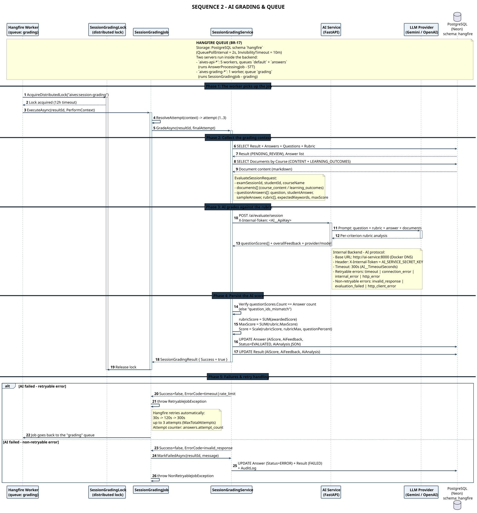

# SEQ 2-EN – AI Grading

> Member 5 · Sequence Diagram · English version

The **Hangfire worker** holds one system-wide distributed lock, so exams are graded one at a time. The queue lives in the PostgreSQL schema `hangfire`; retryable errors back off 30s → 120s → 300s (max 3 attempts).

## Flow summary

The diagram shows the automatic grading flow that runs **outside the HTTP request**, inside the Hangfire worker.

Design highlight: `SessionGradingLock` holds **one system-wide distributed lock** (`aives:session-grading`, 12-hour timeout) so submissions are graded **one at a time**, avoiding a burst of concurrent LLM calls. The system gathers the full context (Result + Answers + Rubric + Documents) and issues **a single** `/ai/evaluate/session` call for the whole submission.

Strict validation: the number of AI analyses returned must **exactly match** the number of submitted answers, otherwise `question_ids_mismatch` fails the job immediately with no retry. Retryable errors (timeout, rate limit) are retried by Hangfire with a 30s → 120s → 300s backoff, up to 3 attempts; non-retryable errors set `Answer.Status = ERROR`, `Result = FAILED` and write an audit log.

## Participants & responsibilities

| Participant | Responsibility |
| Hangfire Worker | The `grading` queue, one worker — grades one exam at a time |
| SessionGradingLock | Distributed lock `aives:session-grading`, 12-hour timeout |
| SessionGradingJob | Resolves the attempt (1..3), classifies retryable / non-retryable errors |
| SessionGradingService | Collects the context, calls the AI, scales the rubric score, persists AiScore |
| AI Service (FastAPI) | `/ai/evaluate/session` — grades against each rubric criterion |
| LLM Provider | Gemini / OpenAI — produces the per-criterion rubric analysis |
| PostgreSQL (Neon) | Result, Answers, Rubric, Documents, AiAnalysis, AuditLog |

---

* PlantUML source: [`seq_02_grading_en.puml`](./seq_02_grading_en.puml) · SVG: [`SEQ_02_GRADING_EN.svg`](./SEQ_02_GRADING_EN.svg) · PNG: [`SEQ_02_GRADING_EN.png`](./SEQ_02_GRADING_EN.png)*
* [Sequence Diagram index](./sequence-index-en.md) · [All on one page](../all-diagrams-en.md)
