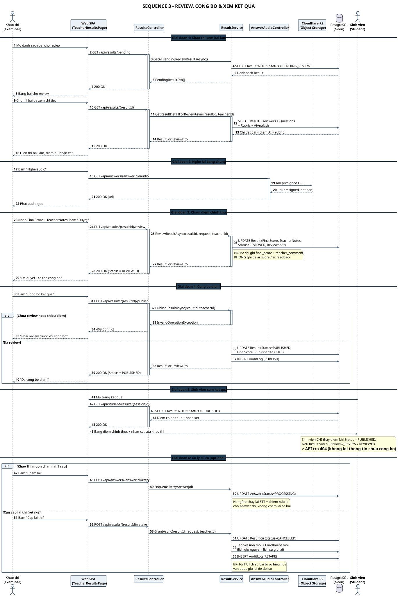

# SEQ 3 – Review, Công bố & Xem kết quả

> Thành viên 5 · Sequence Diagram · Bản tiếng Việt

Sinh viên **chỉ thấy điểm khi `Status = PUBLISHED`** — trước đó API trả 404. Điểm AI không bao giờ bị ghi đè bởi điểm chính thức.

## Tóm tắt luồng

Sơ đồ mô tả vòng đời kết quả từ lúc AI chấm xong đến khi sinh viên nhìn thấy điểm chính thức.

Vòng đời `Result`: **`PENDING_REVIEW` → `REVIEWED` → `PUBLISHED`**. Khảo thí nghe lại bằng chứng qua presigned URL của Cloudflare R2, chấm điểm chính thức rồi mới publish.

Hai quy tắc nghiệp vụ được thể hiện rõ:
- **BR-15**: review chỉ ghi `final_score` + `teacher_comment`, **không ghi đè** `ai_score` / `ai_feedback` — điểm AI và điểm người được giữ riêng để đối chiếu.
- **BR-11**: sinh viên chỉ đọc được điểm khi `Status = PUBLISHED`; trước đó API trả 404 nên không rò rỉ thông tin.

Phần cuối mô tả xử lý sự cố: **chấm lại 1 câu** (`RetryAnswerJob`) và **cấp lại thi** (retake) — bài cũ được chuyển `CANCELLED` nhưng vẫn giữ lịch sử để đối soát.

## Các participant & trách nhiệm

| Participant | Trách nhiệm |
| Khảo thí (Examiner) | Mở danh sách pending, nghe audio, chấm điểm chính thức, publish |
| ResultsController | `GET /api/results`, `PUT /{id}/review`, `POST /{id}/publish` |
| ResultService | Kiểm tra trạng thái, ghi FinalScore / TeacherNotes, chuyển sang PUBLISHED |
| AnswerAudioController | Sinh presigned URL để nghe lại bằng chứng |
| Cloudflare R2 | Phát lại file âm thanh qua presigned URL |
| Sinh viên (Student) | Xem điểm chính thức sau khi publish; xem lịch sử bài thi bù |
| PostgreSQL (Neon) | Result (PENDING_REVIEW → REVIEWED → PUBLISHED), Answers, AuditLog |

---

* Nguồn PlantUML: [`seq_03_review_publish.puml`](./seq_03_review_publish.puml) · SVG: [`SEQ_03_REVIEW_PUBLISH.svg`](./SEQ_03_REVIEW_PUBLISH.svg) · PNG: [`SEQ_03_REVIEW_PUBLISH.png`](./SEQ_03_REVIEW_PUBLISH.png)*
* [Danh mục Sequence Diagram](./sequence-index.md) · [Tất cả trên 1 trang](../all-diagrams.md)
