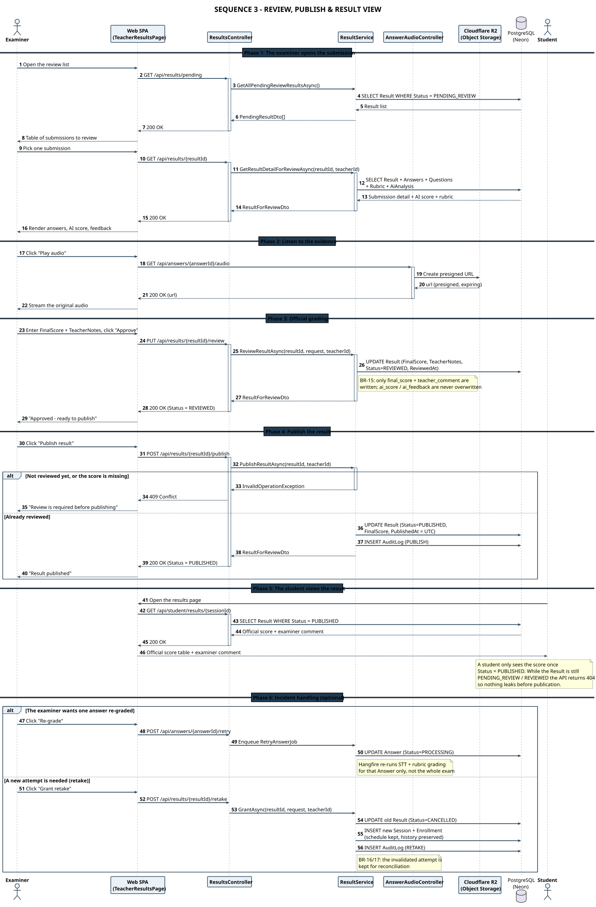

# SEQ 3-EN – Review, Publish & Result View

> Member 5 · Sequence Diagram · English version

A student **only sees the score once `Status = PUBLISHED`** — before that the API returns 404. The AI score is never overwritten by the official score.

## Flow summary

The diagram covers the result lifecycle from the moment AI grading finishes until the student sees the official score.

The `Result` lifecycle is **`PENDING_REVIEW` → `REVIEWED` → `PUBLISHED`**. The examiner replays the evidence through a Cloudflare R2 presigned URL, enters the official score, and only then publishes.

Two business rules are made explicit:
- **BR-15**: a review only writes `final_score` + `teacher_comment` and **never overwrites** `ai_score` / `ai_feedback` — the AI score and the human score stay separate for reconciliation.
- **BR-11**: a student can only read the score when `Status = PUBLISHED`; before that the API returns 404 so nothing leaks.

The closing section covers incident handling: **re-grading one answer** (`RetryAnswerJob`) and **granting a retake** — the old submission moves to `CANCELLED` but its history is preserved.

## Participants & responsibilities

| Participant | Responsibility |
| Examiner | Opens the pending list, listens to the audio, grades officially, publishes |
| ResultsController | `GET /api/results`, `PUT /{id}/review`, `POST /{id}/publish` |
| ResultService | Validates the state, writes FinalScore / TeacherNotes, moves to PUBLISHED |
| AnswerAudioController | Issues a presigned URL to replay the evidence |
| Cloudflare R2 | Serves the audio file back through the presigned URL |
| Student | Views the official score after publication; takes the retake |
| PostgreSQL (Neon) | Result (PENDING_REVIEW → REVIEWED → PUBLISHED), Answers, AuditLog |

---

* PlantUML source: [`seq_03_review_publish_en.puml`](./seq_03_review_publish_en.puml) · SVG: [`SEQ_03_REVIEW_PUBLISH_EN.svg`](./SEQ_03_REVIEW_PUBLISH_EN.svg) · PNG: [`SEQ_03_REVIEW_PUBLISH_EN.png`](./SEQ_03_REVIEW_PUBLISH_EN.png)*
* [Sequence Diagram index](./sequence-index-en.md) · [All on one page](../all-diagrams-en.md)
