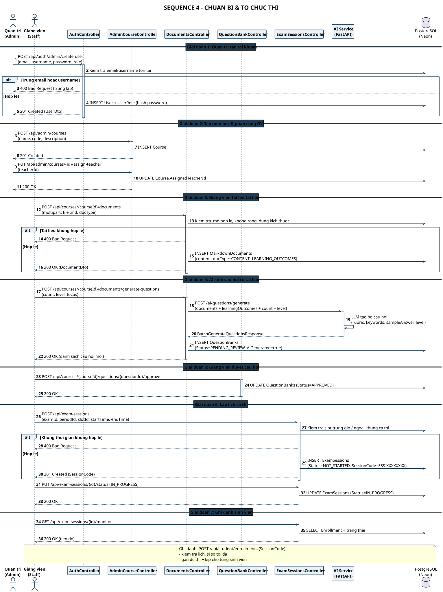

# SEQ 4 – Chuẩn bị & Tổ chức thi

> Thành viên 5 · Sequence Diagram · Bản tiếng Việt

Chuỗi chuẩn bị: **tạo tài khoản → tạo môn học → upload .md → AI sinh câu hỏi → duyệt → lập lịch ca thi → ghi danh**.

## Tóm tắt luồng

Sơ đồ mô tả chuỗi chuẩn bị nghiệp vụ trước khi kỳ thi diễn ra, chia vai trò rõ giữa Quản trị và Giảng viên.

Điểm kiểm soát chất lượng quan trọng: **tài liệu .md phải hợp lệ** (không rỗng, đúng kích thước, đúng định dạng) thì mới được lưu; **câu hỏi do AI sinh ra luôn ở trạng thái `PENDING_REVIEW`** và bắt buộc giảng viên approve mới được dùng dựng đề — AI không bao giờ tự đưa vào đề thi.

Khi tạo ca thi, hệ thống kiểm tra **slot trùng giờ / ngoài khung ca thi** và sinh `SessionCode` theo định dạng `ESS-XXXXXXXX`; giảng viên mở ca bằng cách chuyển sang `IN_PROGRESS` rồi theo dõi tiến độ ghi danh qua endpoint monitor.

## Các participant & trách nhiệm

| Participant | Trách nhiệm |
| Quản trị (Admin) | Tạo tài khoản & gán vai trò, tạo môn học, phân công giảng viên |
| Giang viên (Staff) | Upload tài liệu .md, duyệt câu hỏi AI, lập lịch ca thi, theo dõi ghi danh |
| AuthController | `POST /api/auth/admin/create-user` — kiểm tra trùng email/username |
| AdminCourseController | Tạo Course và gán giảng viên phụ trách |
| DocumentsController | Upload .md hợp lệ, sinh câu hỏi AI |
| QuestionBankController | Duyệt / từ chối câu hỏi AI (PENDING_REVIEW → APPROVED) |
| ExamSessionsController | Tạo ca thi (SessionCode ESS-XXXXXXXX), mở ca (IN_PROGRESS), monitor |
| AI Service (FastAPI) | `/ai/questions/generate` — sinh bộ câu hỏi từ tài liệu |
| PostgreSQL (Neon) | Users, Courses, MarkdownDocuments, QuestionBanks, ExamSessions, Enrollment |

---

* Nguồn PlantUML: [`seq_04_admin_prep.puml`](./seq_04_admin_prep.puml) · SVG: [`SEQ_04_ADMIN_PREP.svg`](./SEQ_04_ADMIN_PREP.svg) · PNG: [`SEQ_04_ADMIN_PREP.png`](./SEQ_04_ADMIN_PREP.png)*
* [Danh mục Sequence Diagram](./sequence-index.md) · [Tất cả trên 1 trang](../all-diagrams.md)
