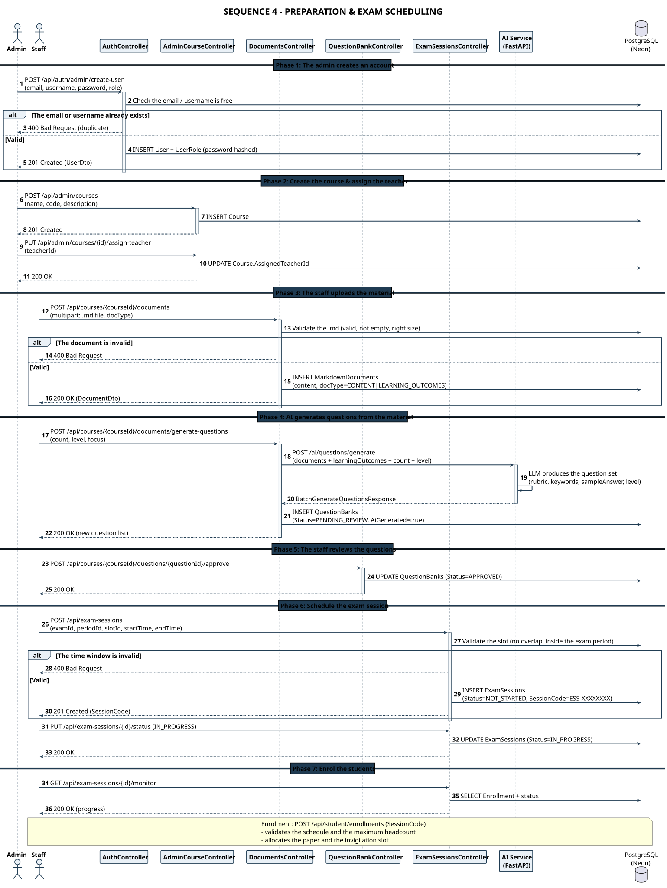

# SEQ 4-EN – Preparation & Exam Scheduling

> Member 5 · Sequence Diagram · English version

Preparation chain: **create account → create course → upload .md → AI generates questions → approve → schedule session → enrol**.

## Flow summary

The diagram describes the business preparation chain before an exam session, with the split between Admin and Staff made explicit.

The key quality gates: the **.md material must be valid** (not empty, right size, right format) before it is stored; and **every AI-generated question starts as `PENDING_REVIEW`** and must be approved by staff before it can be used to build a paper — the AI never places a question in an exam on its own.

When the session is created the system validates the **slot for overlap / outside the exam period** and generates a `SessionCode` in the `ESS-XXXXXXXX` format; the teacher then opens the session by moving it to `IN_PROGRESS` and tracks enrolment through the monitor endpoint.

## Participants & responsibilities

| Participant | Responsibility |
| Admin | Creates accounts & roles, creates the course, allocates the teacher |
| Staff | Uploads the .md material, approves AI questions, schedules the session, monitors enrolment |
| AuthController | `POST /api/auth/admin/create-user` — duplicate email/username check |
| AdminCourseController | Creates the Course and assigns the responsible teacher |
| DocumentsController | Validates the uploaded .md, triggers AI question generation |
| QuestionBankController | Approves / rejects AI questions (PENDING_REVIEW → APPROVED) |
| ExamSessionsController | Creates the session (SessionCode ESS-XXXXXXXX), opens it (IN_PROGRESS), monitors |
| AI Service (FastAPI) | `/ai/questions/generate` — generates the question set from the material |
| PostgreSQL (Neon) | Users, Courses, MarkdownDocuments, QuestionBanks, ExamSessions, Enrollment |

---

* PlantUML source: [`seq_04_admin_prep_en.puml`](./seq_04_admin_prep_en.puml) · SVG: [`SEQ_04_ADMIN_PREP_EN.svg`](./SEQ_04_ADMIN_PREP_EN.svg) · PNG: [`SEQ_04_ADMIN_PREP_EN.png`](./SEQ_04_ADMIN_PREP_EN.png)*
* [Sequence Diagram index](./sequence-index-en.md) · [All on one page](../all-diagrams-en.md)
