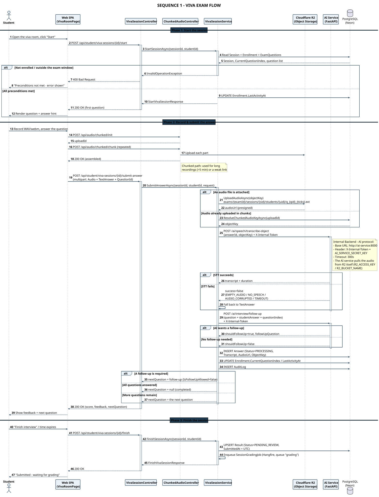
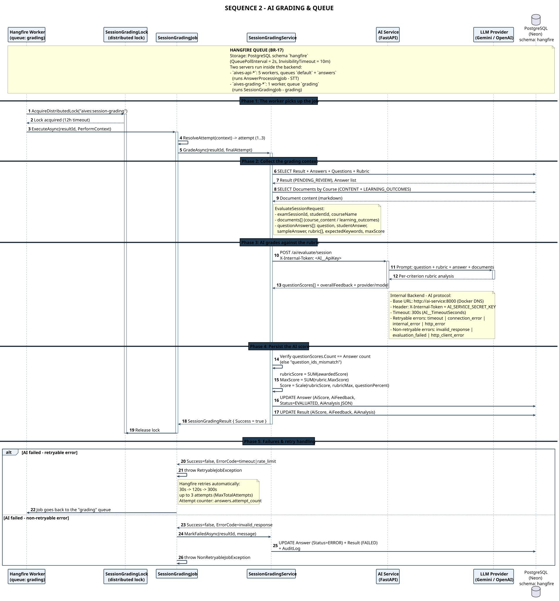
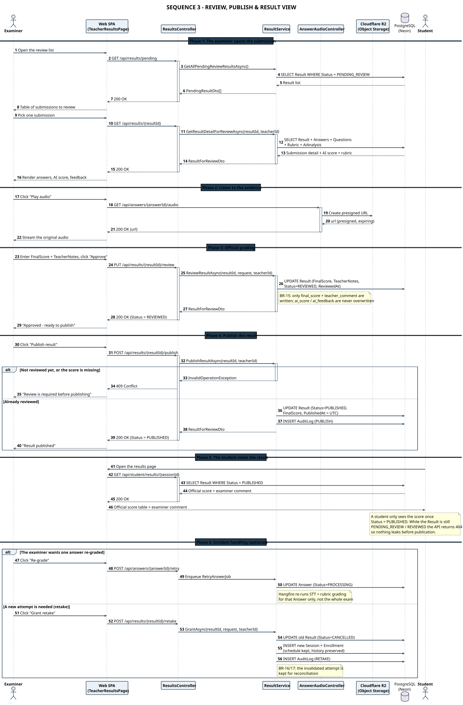
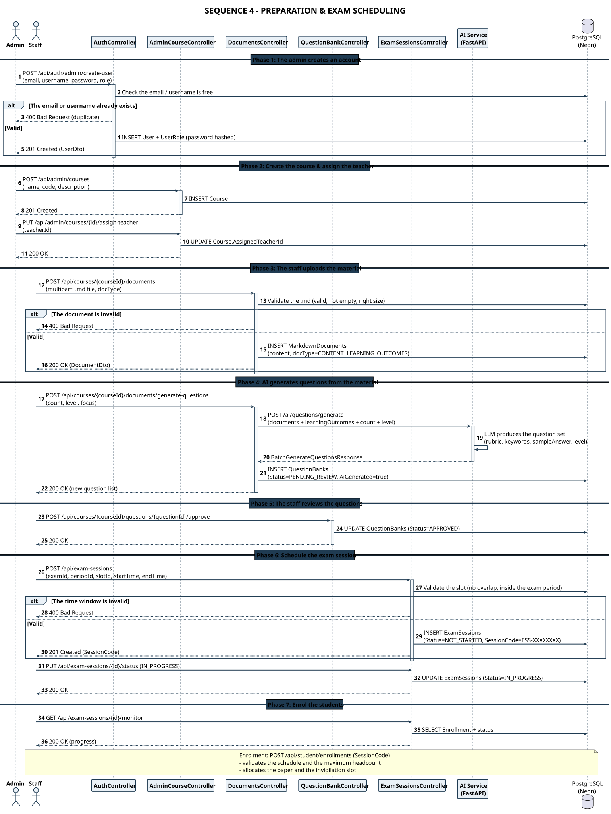

# AIVES – Sequence Diagram Index

> Member 5 · English version

## Diagrams

### [SEQ 1-EN · Viva Exam Flow](./seq-01-viva-flow_en.html)

*3 phases · 8 participants · 2293×2837* — Start the session → record & submit the answer (STT + follow-up) → finish and queue for grading

- Page: [`seq-01-viva-flow_en.html`](./seq-01-viva-flow_en.html) · [Markdown](./seq-01-viva-flow_en.md)
- Source: [`seq_01_viva_flow_en.puml`](./seq_01_viva_flow_en.puml)

### [SEQ 2-EN · AI Grading](./seq-02-grading_en.html)

*5 phases · 7 participants · 2320×2021* — Hangfire worker + distributed lock → LLM rubric grading → persist AiScore, backoff 30s/120s/300s

- Page: [`seq-02-grading_en.html`](./seq-02-grading_en.html) · [Markdown](./seq-02-grading_en.md)
- Source: [`seq_02_grading_en.puml`](./seq_02_grading_en.puml)

### [SEQ 3-EN · Review, Publish & Result View](./seq-03-review-publish_en.html)

*6 phases · 7 participants · 2159×3285* — PENDING_REVIEW → REVIEWED → PUBLISHED; the student only sees the score once PUBLISHED

- Page: [`seq-03-review-publish_en.html`](./seq-03-review-publish_en.html) · [Markdown](./seq-03-review-publish_en.md)
- Source: [`seq_03_review_publish_en.puml`](./seq_03_review_publish_en.puml)

### [SEQ 4-EN · Preparation & Exam Scheduling](./seq-04-admin-prep_en.html)

*7 phases · 9 participants · 1959×2606* — Create account → create course → upload .md → AI generates questions → approve → schedule → enrol

- Page: [`seq-04-admin-prep_en.html`](./seq-04-admin-prep_en.html) · [Markdown](./seq-04-admin-prep_en.md)
- Source: [`seq_04_admin_prep_en.puml`](./seq_04_admin_prep_en.puml)

## Every participant in the system

| Participant | Role |
|---|---|
| **Student** | Takes the exam, records, submits, views the score after publication |
| **Staff** | Uploads material, approves AI questions, schedules the session, enrols students |
| **Examiner** | Reviews evidence, grades officially, publishes, handles incidents |
| **Admin** | Manages accounts, courses, teacher allocation |
| **Web SPA** | The web / Windows client front end |
| **Backend API (ASP.NET Core)** | Controller + Service + Hangfire worker + audit log |
| **AI Service (FastAPI)** | Question generation, STT, follow-up generation, LLM rubric grading |
| **Cloudflare R2** | Stores & serves the audio files through presigned URLs |
| **PostgreSQL (Neon)** | The single system of record |

## Error branches summary

| Error branch | Condition | Handling |
|---|---|---|
| Start preconditions not met | `BR-11` | 400/403 + message, the student retries |
| STT failure | `FR-AI-03` | EMPTY_AUDIO / TIMEOUT / INTERNAL_ERROR → fall back to TextAnswer |
| Follow-up generation failure | `FR-AI-02` | Skip the follow-up, still persist the Answer |
| AI grading failed (retryable) | `BR-15` | Hangfire retries 30s → 120s → 300s, up to 3 attempts |
| AI grading failed (non-retryable) | `FR-AI-02` | Answer.Status = ERROR, Result = FAILED, audit log written |
| AI returned the wrong number of analyses | `BR-15` | question_ids_mismatch → fails immediately, no retry |
| Publish before review | `BR-10` | 409 Conflict, the examiner reviews again first |
| Re-grade one answer / grant a retake | `FR-EXA-05/06` | RetryAnswerJob or a new Session, history preserved |

---

*...*
