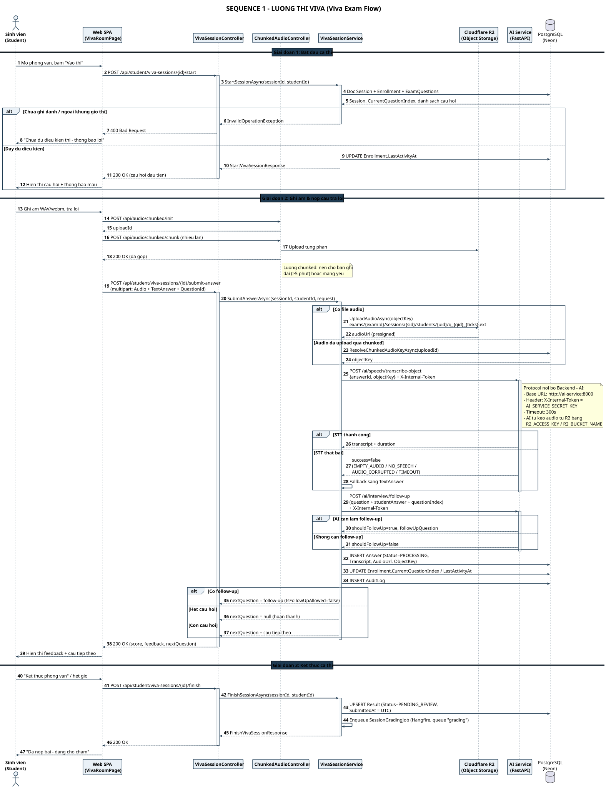
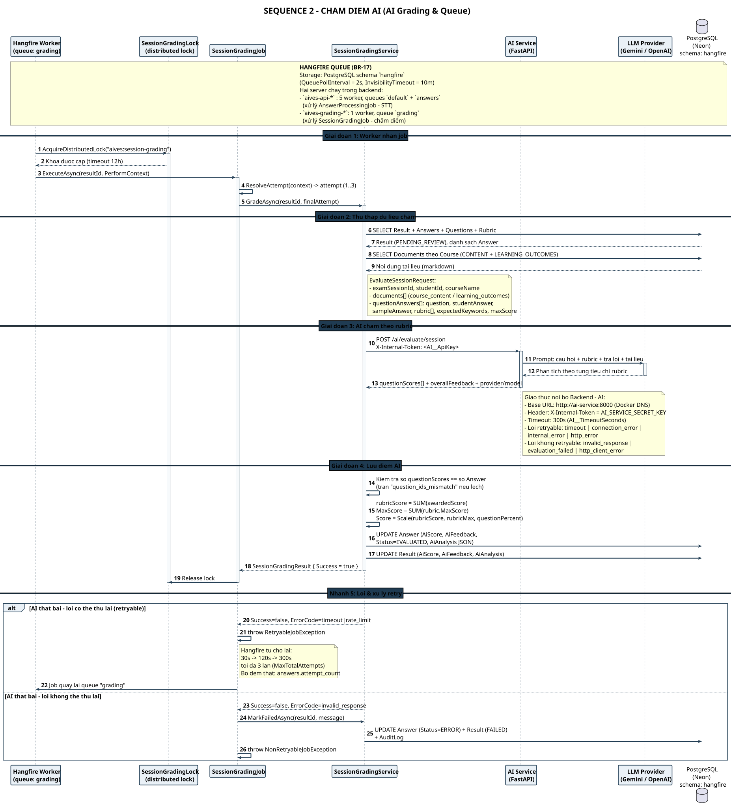
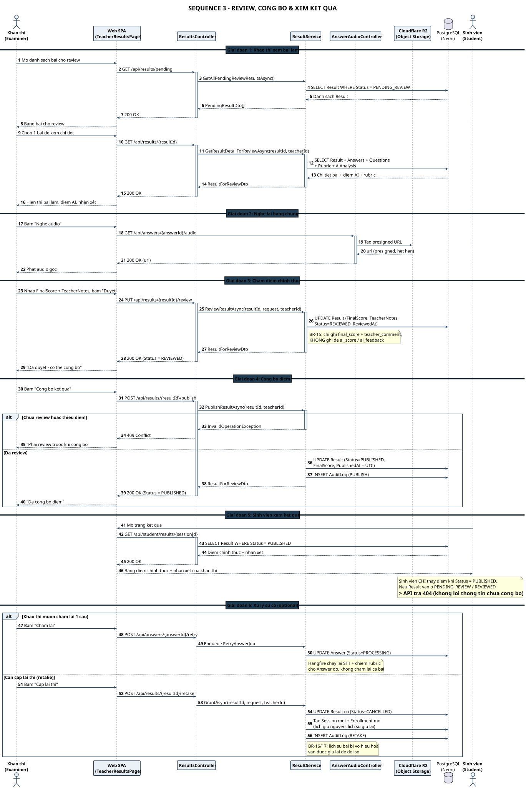
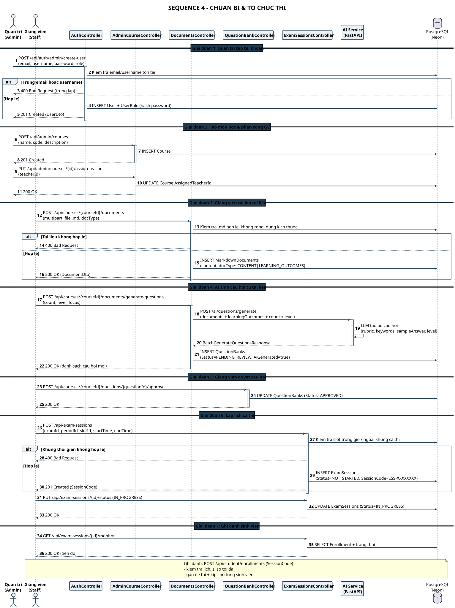

# AIVES – Danh mục Sequence Diagram

> Thành viên 5 · Bản tiếng Việt

## Các sơ đồ

### [SEQ 1 · Luồng thi Viva](./seq-01-viva-flow.html)

*3 giai đoạn · 8 participant · 2271×2858* — Bắt đầu ca thi → ghi âm & nộp câu trả lời (STT + follow-up) → kết thúc & xếp hàng chấm

- Trang/Page: [`seq-01-viva-flow.html`](./seq-01-viva-flow.html) · [Markdown](./seq-01-viva-flow.md)
- Nguồn/Source: [`seq_01_viva_flow.puml`](./seq_01_viva_flow.puml)

### [SEQ 2 · Chấm điểm AI](./seq-02-grading.html)

*5 giai đoạn · 7 participant · 2263×2021* — Hangfire worker + khóa phân tán → gọi LLM chấm rubric → lưu AiScore, retry backoff 30s/120s/300s

- Trang/Page: [`seq-02-grading.html`](./seq-02-grading.html) · [Markdown](./seq-02-grading.md)
- Nguồn/Source: [`seq_02_grading.puml`](./seq_02_grading.puml)

### [SEQ 3 · Review, Công bố & Xem kết quả](./seq-03-review-publish.html)

*6 giai đoạn · 7 participant · 2198×3287* — PENDING_REVIEW → REVIEWED → PUBLISHED; sinh viên chỉ thấy điểm khi PUBLISHED

- Trang/Page: [`seq-03-review-publish.html`](./seq-03-review-publish.html) · [Markdown](./seq-03-review-publish.md)
- Nguồn/Source: [`seq_03_review_publish.puml`](./seq_03_review_publish.puml)

### [SEQ 4 · Chuẩn bị & Tổ chức thi](./seq-04-admin-prep.html)

*7 giai đoạn · 9 participant · 1966×2627* — Tạo tài khoản → tạo môn học → upload .md → AI sinh câu hỏi → duyệt → lập lịch ca thi → ghi danh

- Trang/Page: [`seq-04-admin-prep.html`](./seq-04-admin-prep.html) · [Markdown](./seq-04-admin-prep.md)
- Nguồn/Source: [`seq_04_admin_prep.puml`](./seq_04_admin_prep.puml)

## Tất cả participant trong hệ thống

| Participant | Role |
|---|---|
| **Sinh viên (Student)** | Tham gia thi, ghi âm, nộp bài, xem điểm sau khi công bố |
| **Giang vien (Staff)** | Upload tai lieu, duyet cau hoi AI, lap lich ca thi, ghi danh |
| **Khao thi (Examiner)** | Review bang chung, cham diem chinh thuc, cong bo, xu ly su co |
| **Quan tri (Admin)** | Quan ly tai khoan, mon hoc, phan cong giang vien |
| **Web SPA** | Giao dien phia web / Windows client |
| **Backend API (ASP.NET Core)** | Controller + Service + Hangfire worker + audit log |
| **AI Service (FastAPI)** | Sinh cau hoi, STT, sinh follow-up, cham rubric theo LLM |
| **Cloudflare R2** | Luu tru & phat file am thanh qua presigned URL |
| **PostgreSQL (Neon)** | Co so du lieu duy nhat cua he thong |

## Tổng hợp các nhánh lỗi

| Error branch | Condition | Handling |
|---|---|---|
| Chua du dieu kien bat dau ca thi | `BR-11` | 400/403 + thong bao, sinh vien thu lai |
| STT that bai | `FR-AI-03` | EMPTY_AUDIO / TIMEOUT / INTERNAL_ERROR → fallback sang TextAnswer |
| Sinh follow-up that bai | `FR-AI-02` | Bo qua follow-up, van luu Answer vao DB |
| AI cham diem that bai (retryable) | `BR-15` | Hangfire thu lai 30s → 120s → 300s, toi da 3 lan |
| AI cham diem that bai (non-retryable) | `FR-AI-02` | Answer.Status = ERROR, Result = FAILED, ghi audit log |
| AI tra so phan tich lech so cau hoi | `BR-15` | question_ids_mismatch → that bai ngay, khong retry |
| Cong bo khi chua review | `BR-10` | 409 Conflict, khao thi review lai truoc |
| Ye cau cham lai 1 cau / cap lai thi | `FR-EXA-05/06` | RetryAnswerJob hoac tao Session moi, giu lich su |

---

*...*
