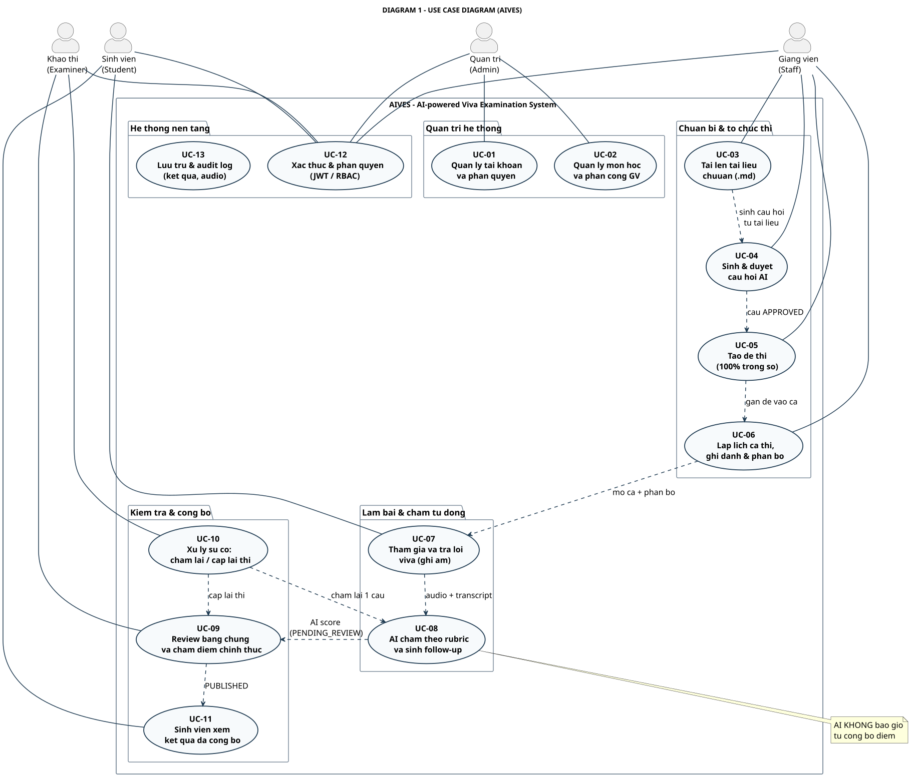

# DIAGRAM 1 – Use Case Diagram (bản rút gọn)

**Phần công việc:** Thành viên 5 – Tài liệu đồ thị (bản dùng để thuyết trình)
**Bản chi tiết đầy đủ:** [`swimlane-index.md`](../swimlane-index.md) → SWL-1 / SWL-2A / SWL-2B
**Nguồn đối chiếu:** SRS 07/11/2026 + `backend/Aives.Api/Controllers/*` (21 controller, 60+ endpoint)

| | |
|---|---|
| **Nguồn PlantUML** | `diagram_01_usecase.puml` |
| **Ảnh** | `DIAGRAM_01_USECASE.svg` / `.png` (1819x1553) |
| **Bản tiếng Anh** | [`diagram-01-usecase_en.md`](./diagram-01-usecase_en.md) |

---

## Ý tưởng chính

Sơ đồ gom **13 use case** thành **5 nhóm nghiệp vụ**, và **4 actor** theo đúng enum `UserRole` trong mã nguồn (`ADMIN`, `STAFF`, `EXAMINER`, `STUDENT`).

Mỗi actor chỉ "chạm" vào những use case thuộc vai trò của mình — đây là ranh giới trách nhiệm mà bản swimlane chi tiết sẽ mở rộng.

---

## 4 actor

| Actor | Tiếng Việt | Trách nhiệm |
|---|---|---|
| **Student** | Sinh viên | Ghi danh, làm bài, xem điểm đã công bố |
| **Staff** | Giảng viên | Tài liệu, ngân hàng câu hỏi, đề thi, lịch thi |
| **Examiner** | Khảo thí | Review bằng chứng, chấm điểm chính thức, xử lý sự cố |
| **Admin** | Quản trị | Tài khoản, phân quyền, môn học, phân công giảng viên |

---

## 13 use case theo 5 nhóm

| Nhóm | Use case | Nội dung |
|---|---|---|
| **Quản trị hệ thống** | UC-01 | Quản lý tài khoản & phân quyền |
| | UC-02 | Quản lý môn học & phân công giảng viên |
| **Chuẩn bị & tổ chức thi** | UC-03 | Tải lên tài liệu chuẩn (`.md`) |
| | UC-04 | Sinh & duyệt câu hỏi AI |
| | UC-05 | Tạo đề thi (tổng trọng số 100%) |
| | UC-06 | Lập lịch ca thi, ghi danh & phân bổ |
| **Làm bài & chấm tự động** | UC-07 | Tham gia & trả lời viva (ghi âm) |
| | UC-08 | AI chấm theo rubric & sinh follow-up |
| **Kiểm tra & công bố** | UC-09 | Review bằng chứng & chấm điểm chính thức |
| | UC-10 | Xử lý sự cố: chấm lại / cấp lại thi |
| | UC-11 | Sinh viên xem kết quả đã công bố |
| **Hệ thống nền tảng** | UC-12 | Xác thực & phân quyền (JWT / RBAC) |
| | UC-13 | Lưu trữ & audit log (kết quả, audio) |

---

## Quan hệ giữa các use case

| Quan hệ | Từ → Đến | Ý nghĩa |
|---|---|---|
| `<<include>>` | UC-03 → UC-04 | Sinh câu hỏi cần tài liệu chuẩn làm đầu vào |
| `<<include>>` | UC-04 → UC-05 | Chỉ câu hỏi `APPROVED` mới được dựng đề |
| `<<include>>` | UC-05 → UC-06 | Đề thi được gán vào ca thi |
| `<<include>>` | UC-06 → UC-07 | Ca thi mở & phân bổ cho sinh viên |
| `<<include>>` | UC-07 → UC-08 | Audio + transcript đầu vào cho AI |
| `<<include>>` | UC-08 → UC-09 | AI score chuyển sang hàng đợi review |
| `<<include>>` | UC-09 → UC-11 | Chỉ sau `PUBLISHED` sinh viên mới xem được |
| `<<extend>>` | UC-10 → UC-08 | Chấm lại **một câu** (retry answer) |
| `<<extend>>` | UC-10 → UC-09 | Cấp lại thi (retake) → review lại |

---

## Điểm cần nhấn mạnh khi thuyết trình

- **4 actor đúng theo RBAC thật** — mỗi use case có endpoint tương ứng trong `AdminUserController`, `TeacherDocumentController`, `ResultsController`, `VivaSessionController`.
- **AI chỉ "sinh" và "chấm gợi ý"** — không có đường nối trực tiếp nào từ UC-08 sang UC-11 (công bố). Phải qua UC-09 của Khảo thí.
- **Luồng là 1 chuỗi không khép kín**: UC-03 → 04 → 05 → 06 → 07 → 08 → 09 → 11. Mỗi mắt xích là 1 nhóm chức năng.
- **UC-10 là nhánh lỗi** — không phải luồng chính, chỉ kích hoạt khi có khiếu nại/sự cố.

---

## Liên hệ với bản chi tiết

| Use case | Swimlane chi tiết | Lane chịu trách nhiệm |
|---|---|---|
| UC-01, UC-02 | [SWL-1](../swimlane-01-preparation-scheduling.md) | ADMIN |
| UC-03 … UC-06 | [SWL-1](../swimlane-01-preparation-scheduling.md) | STAFF + AI Service |
| UC-07, UC-08 | [SWL-2A](../swimlane-02a-exam-delivery-grading.md) | STUDENT · Client · Backend · AI · Hangfire |
| UC-09 … UC-11 | [SWL-2B](../swimlane-02b-review-publish-incident.md) | EXAMINER + Backend + STUDENT |

---

[[← Danh mục diagram rút gọn](./simplified-index.md)] · [[DIAGRAM 2 – Swimlane rút gọn →](./diagram-02-swimlane.md)]
