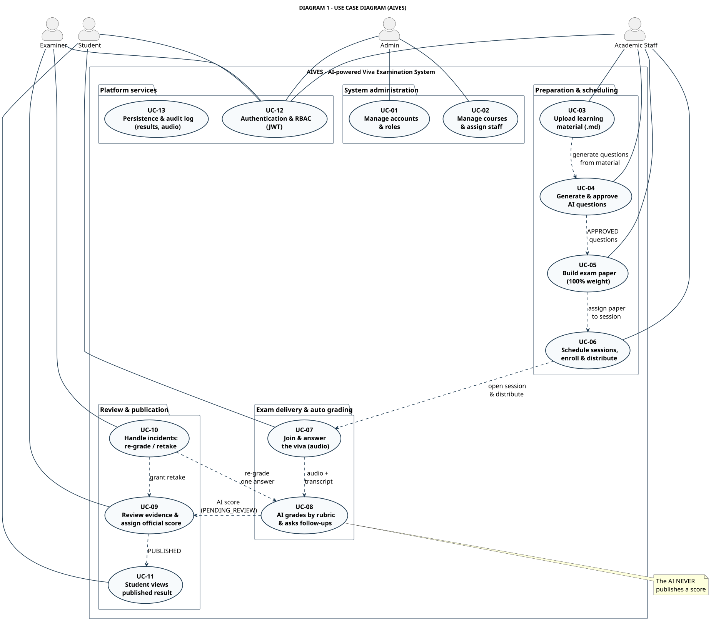

# DIAGRAM 1-EN – Use Case Diagram (simplified)

**Part of work:** Member 5 – Diagram documentation (presentation version)
**Detailed version:** [`swimlane-index-en.md`](../swimlane-index-en.md) → SWL-1 / SWL-2A / SWL-2B
**Source of truth:** SRS 07/11/2026 + `backend/Aives.Api/Controllers/*` (21 controllers, 60+ endpoints)

| | |
|---|---|
| **PlantUML source** | `diagram_01_usecase_en.puml` |
| **Images** | `DIAGRAM_01_USECASE_EN.svg` / `.png` (1848x1615) |
| **Vietnamese version** | [`diagram-01-usecase.md`](./diagram-01-usecase.md) |

---

## Key idea

The diagram groups **13 use cases** into **5 business areas**, with **4 actors** matching the real `UserRole` enum in the source code (`ADMIN`, `STAFF`, `EXAMINER`, `STUDENT`).

Each actor only touches the use cases belonging to its own role — that is the responsibility boundary the detailed swimlane diagrams expand on.

---

## 4 actors

| Actor | Responsibility |
|---|---|
| **Student** | Enroll, take the exam, view the published result |
| **Academic Staff** | Learning material, question bank, exam paper, schedule |
| **Examiner** | Evidence review, official grading, incident handling |
| **Admin** | Accounts, RBAC, courses, staff assignment |

---

## 13 use cases in 5 groups

| Group | Use case | Content |
|---|---|---|
| **System administration** | UC-01 | Manage accounts & roles |
| | UC-02 | Manage courses & assign staff |
| **Preparation & scheduling** | UC-03 | Upload learning material (`.md`) |
| | UC-04 | Generate & approve AI questions |
| | UC-05 | Build exam paper (100% total weight) |
| | UC-06 | Schedule sessions, enroll & distribute |
| **Exam delivery & auto grading** | UC-07 | Join & answer the viva (audio) |
| | UC-08 | AI grades by rubric & asks follow-ups |
| **Review & publication** | UC-09 | Review evidence & assign official score |
| | UC-10 | Handle incidents: re-grade / retake |
| | UC-11 | Student views published result |
| **Platform services** | UC-12 | Authentication & RBAC (JWT) |
| | UC-13 | Persistence & audit log (results, audio) |

---

## Relations between use cases

| Relation | From → To | Meaning |
|---|---|---|
| `<<include>>` | UC-03 → UC-04 | Question generation needs the learning material as input |
| `<<include>>` | UC-04 → UC-05 | Only `APPROVED` questions can be used to build a paper |
| `<<include>>` | UC-05 → UC-06 | The paper is assigned to a session |
| `<<include>>` | UC-06 → UC-07 | The session is opened & distributed to students |
| `<<include>>` | UC-07 → UC-08 | Audio + transcript are the AI input |
| `<<include>>` | UC-08 → UC-09 | The AI score enters the review queue |
| `<<include>>` | UC-09 → UC-11 | Only after `PUBLISHED` can the student see it |
| `<<extend>>` | UC-10 → UC-08 | Re-grade **one answer** (retry answer) |
| `<<extend>>` | UC-10 → UC-09 | Grant a retake → review again |

---

## Key points for the presentation

- **4 actors match the real RBAC** — every use case has a matching endpoint in `AdminUserController`, `TeacherDocumentController`, `ResultsController`, `VivaSessionController`.
- **The AI only "generates" and "suggests"** — there is no direct link from UC-08 to UC-11 (publication). It must pass through UC-09 owned by the examiner.
- **The flow is one unbroken chain**: UC-03 → 04 → 05 → 06 → 07 → 08 → 09 → 11. Each link is one functional area.
- **UC-10 is an error branch**, not the main flow — it only activates on a complaint or incident.

---

## Link to the detailed version

| Use case | Detailed swimlane | Responsible lane |
|---|---|---|
| UC-01, UC-02 | [SWL-1-EN](../swimlane-01-preparation-scheduling_en.md) | ADMIN |
| UC-03 … UC-06 | [SWL-1-EN](../swimlane-01-preparation-scheduling_en.md) | STAFF + AI Service |
| UC-07, UC-08 | [SWL-2A-EN](../swimlane-02a-exam-delivery-grading_en.md) | STUDENT · Client · Backend · AI · Hangfire |
| UC-09 … UC-11 | [SWL-2B-EN](../swimlane-02b-review-publish-incident_en.md) | EXAMINER + Backend + STUDENT |

---

[[← Simplified diagram index](./simplified-index-en.md)] · [[DIAGRAM 2-EN – Simplified Swimlane →](./diagram-02-swimlane_en.md)]
