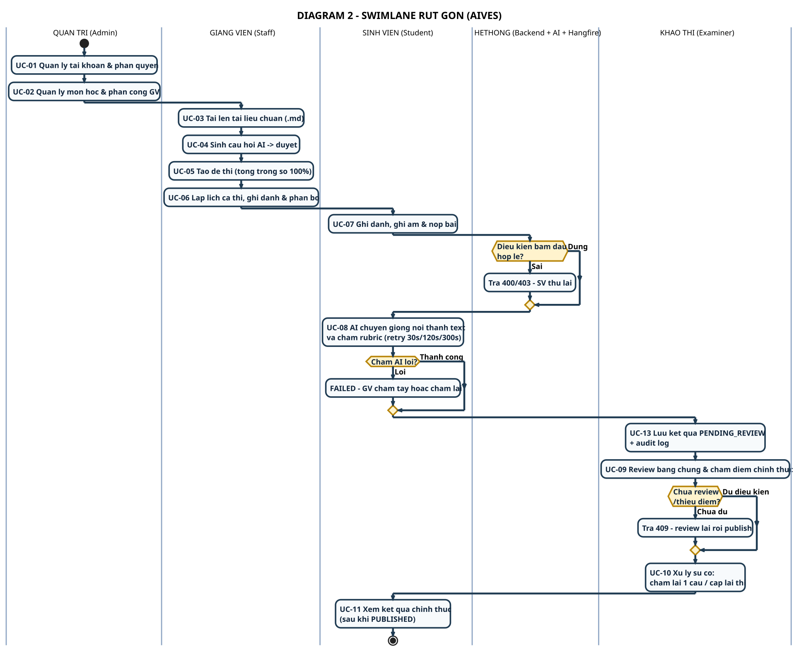

# DIAGRAM 2 – Swimlane rút gọn (1 activity = 1 luồng)

**Phần công việc:** Thành viên 5 – Tài liệu đồ thị (bản dùng để thuyết trình)
**Bản chi tiết đầy đủ:** [`swimlane-02-exam-grading-publish.md`](../swimlane-02-exam-grading-publish.md) (6 lane, 8 nhánh lỗi chi tiết)
**Nguồn đối chiếu:** SRS 07/11/2026 + mã nguồn thực tế

| | |
|---|---|
| **Nguồn PlantUML** | `diagram_02_swimlane.puml` |
| **Ảnh** | `DIAGRAM_02_SWIMLANE.svg` / `.png` (1929x1570) |
| **Bản tiếng Anh** | [`diagram-02-swimlane_en.md`](./diagram-02-swimlane_en.md) |

---

## Nguyên tắc rút gọn

| Bản chi tiết | Bản rút gọn |
|---|---|
| Mỗi hộp = 1 hành động nhỏ (VD: *"Bấm Bắt đầu → POST /api/…/start"*) | **Mỗi hộp = 1 luồng nghiệp vụ** (VD: *"UC-07 Ghi danh, ghi âm & nộp bài"*) |
| 6 lane, ~40 hộp | **5 lane, 13 hộp** |
| 8 nhánh lỗi chi tiết | **3 nhánh lỗi chính** (điều kiện bắt đầu / chấm AI lỗi / chưa review) |
| Chi tiết API, retry backoff, audit log | Giữ 1 dòng chú thích quan trọng nhất |

**Mục đích:** dùng để giới thiệu tổng quan trong 1 slide; khi cần đi sâu vào handoff hay nhánh lỗi thì mở bản chi tiết.

---

## 5 lane

| Lane | Ý nghĩa | Vai trò thật |
|---|---|---|
| **QUẢN TRỊ (Admin)** | Quản lý tài khoản, môn học, phân công | `ADMIN` |
| **GIẢNG VIÊN (Staff)** | Tài liệu → câu hỏi → đề thi → lịch thi | `STAFF` |
| **SINH VIÊN (Student)** | Ghi danh, ghi âm, nộp bài, xem điểm | `STUDENT` |
| **HỆ THỐNG (Backend + AI + Hangfire)** | Kiểm tra điều kiện, STT, chấm rubric, lưu kết quả | Dịch vụ nội bộ |
| **KHẢO THÍ (Examiner)** | Review, chấm điểm chính thức, xử lý sự cố | `EXAMINER` |

> **Thứ tự lane = thứ tự thời gian của luồng**: Admin → Giảng viên → Sinh viên → Hệ thống → Khảo thí → (quay lại Sinh viên).

---

## 13 hộp = 13 luồng

| # | Hộp | Lane | Ý nghĩa ngắn |
|---|---|---|---|
| 1 | UC-01 Quản lý tài khoản & phân quyền | Admin | Tạo user, gán role (`ADMIN`/`STAFF`/`EXAMINER`/`STUDENT`) |
| 2 | UC-02 Quản lý môn học & phân công GV | Admin | Course + assign teacher |
| 3 | UC-03 Tải lên tài liệu chuẩn (.md) | Giảng viên | Markdown + Learning Outcome |
| 4 | UC-04 Sinh câu hỏi AI → duyệt | Giảng viên | `PENDING_REVIEW` → approve/reject |
| 5 | UC-05 Tạo đề thi (tổng trọng số 100%) | Giảng viên | Chỉ nhận câu `APPROVED` |
| 6 | UC-06 Lập lịch ca thi, ghi danh & phân bổ | Giảng viên | Period → Session → Slot → enroll |
| 7 | UC-07 Ghi danh, ghi âm & nộp bài | Sinh viên | Start → record → submit → finish |
| 8 | *Điều kiện bắt đầu hợp lệ?* | Hệ thống | **Nhánh lỗi 1** → 400/403 |
| 9 | UC-08 AI chuyển giọng nói thành text & chấm rubric | Hệ thống | Hangfire retry 30s/120s/300s |
| 10 | *Chấm AI lỗi?* | Hệ thống | **Nhánh lỗi 2** → FAILED → GV chấm tay |
| 11 | UC-13 Lưu kết quả `PENDING_REVIEW` + audit log | Hệ thống | `AiScore` ≠ điểm chính thức |
| 12 | UC-09 Review bằng chứng & chấm điểm chính thức | Khảo thí | `FinalScore` + `TeacherComment` |
| 13 | *Chưa review / thiếu điểm?* | Khảo thí | **Nhánh lỗi 3** → 409 |
| 14 | UC-10 Xử lý sự cố: chấm lại 1 câu / cấp lại thi | Khảo thí | Retry ≠ Retake |
| 15 | UC-11 Xem kết quả chính thức (sau `PUBLISHED`) | Sinh viên | `GET /api/student/results/{sessionId}` |

---

## 3 nhánh lỗi được giữ lại

Đây đúng là 3 nhánh lỗi mà đề bài yêu cầu:

| Nhánh | Điều kiện | Xử lý | Quay về lane |
|---|---|---|---|
| **Điều kiện bắt đầu** | Chưa tới giờ kíp / ca chưa mở / chưa ghi danh | 400/403 → SV thử lại | **Sinh viên** |
| **Chấm AI lỗi** | STT hỏng / contract sai / hết lượt retry | `FAILED` → GV chấm tay hoặc chấm lại | **Khảo thí** |
| **Chưa review** | Thiếu điểm chính thức / chưa `REVIEWED` | 409 → review lại rồi publish | **Khảo thí** |

> Bản chi tiết còn có: STT lỗi (`EMPTY_AUDIO`/`TIMEOUT`), không có câu trả lời nào, điểm tổng ngoài khoảng hợp lệ, retake chưa bắt đầu/đã dùng/hết hạn — xem [SWL-2A](../swimlane-02a-exam-delivery-grading.md) & [SWL-2B](../swimlane-02b-review-publish-incident.md).

---

## Điểm cần nhấn mạnh khi thuyết trình

- **Mỗi hộp = 1 use case** trong [DIAGRAM 1](./diagram-01-usecase.md) → sơ đồ này là "bản dịch" của use case thành swimlane.
- **Điểm chuyển lane luôn gắn với 1 trách nhiệm**: Student → System (gửi bài), System → Examiner (AI score), Examiner → Student (công bố).
- **AI không bao giờ công bố** — nhánh `PUBLISHED` chỉ nằm trong tay Khảo thí.
- **3 nhánh lỗi đều quay về đúng lane xử lý**, không "chết" giữa luồng.

---

[[← DIAGRAM 1 – Use Case](./diagram-01-usecase.md)] · [[Danh mục diagram rút gọn](./simplified-index.md)] · [[DIAGRAM 3 – Context →](./diagram-03-context.md)]
