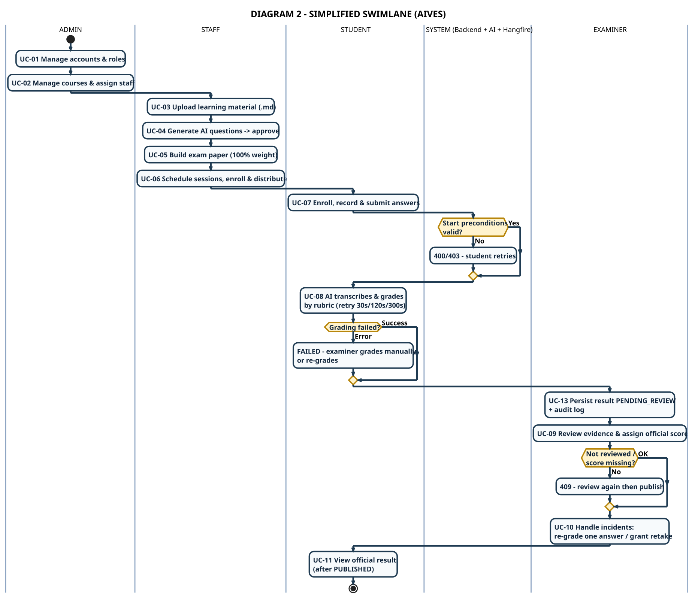

# DIAGRAM 2-EN – Simplified Swimlane (one box = one flow)

**Part of work:** Member 5 – Diagram documentation (presentation version)
**Detailed version:** [`swimlane-02-exam-grading-publish_en.md`](../swimlane-02-exam-grading-publish_en.md) (6 lanes, 8 detailed error branches)
**Source of truth:** SRS 07/11/2026 + actual source code

| | |
|---|---|
| **PlantUML source** | `diagram_02_swimlane_en.puml` |
| **Images** | `DIAGRAM_02_SWIMLANE_EN.svg` / `.png` (1855x1594) |
| **Vietnamese version** | [`diagram-02-swimlane.md`](./diagram-02-swimlane.md) |

---

## Simplification rules

| Detailed version | Simplified version |
|---|---|
| Each box = 1 small action (e.g. *"Press Start → POST /api/…/start"*) | **Each box = 1 business flow** (e.g. *"UC-07 Enroll, record & submit answers"*) |
| 6 lanes, ~40 boxes | **5 lanes, 13 boxes** |
| 8 detailed error branches | **3 main error branches** (start precondition / grading failure / not reviewed) |
| API details, retry backoff, audit log | Keeps the single most important note per box |

**Purpose:** a one-slide overview; dive into the detailed version whenever handovers or error branches must be explained.

---

## 5 lanes

| Lane | Meaning | Real role |
|---|---|---|
| **ADMIN** | Accounts, courses, staff assignment | `ADMIN` |
| **STAFF** | Material → questions → paper → schedule | `STAFF` |
| **STUDENT** | Enroll, record, submit, view result | `STUDENT` |
| **SYSTEM (Backend + AI + Hangfire)** | Validate, STT, rubric grading, persistence | Internal services |
| **EXAMINER** | Review, official grading, incident handling | `EXAMINER` |

> **Lane order = the chronological order of the flow**: Admin → Staff → Student → System → Examiner → (back to) Student.

---

## 13 boxes = 13 flows

| # | Box | Lane | Short meaning |
|---|---|---|---|
| 1 | UC-01 Manage accounts & roles | Admin | Create users, assign roles |
| 2 | UC-02 Manage courses & assign staff | Admin | Course + assign teacher |
| 3 | UC-03 Upload learning material (.md) | Staff | Markdown + Learning Outcome |
| 4 | UC-04 Generate AI questions → approve | Staff | `PENDING_REVIEW` → approve/reject |
| 5 | UC-05 Build exam paper (100% weight) | Staff | Only `APPROVED` questions |
| 6 | UC-06 Schedule sessions, enroll & distribute | Staff | Period → Session → Slot → enroll |
| 7 | UC-07 Enroll, record & submit answers | Student | Start → record → submit → finish |
| 8 | *Start preconditions valid?* | System | **Error branch 1** → 400/403 |
| 9 | UC-08 AI transcribes & grades by rubric | System | Hangfire retry 30s/120s/300s |
| 10 | *Grading failed?* | System | **Error branch 2** → FAILED → manual grading |
| 11 | UC-13 Persist result PENDING_REVIEW + audit log | System | `AiScore` ≠ official score |
| 12 | UC-09 Review evidence & assign official score | Examiner | `FinalScore` + `TeacherComment` |
| 13 | *Not reviewed / score missing?* | Examiner | **Error branch 3** → 409 |
| 14 | UC-10 Handle incidents: re-grade one answer / grant retake | Examiner | Retry ≠ Retake |
| 15 | UC-11 View official result (after PUBLISHED) | Student | `GET /api/student/results/{sessionId}` |

---

## The 3 retained error branches

These are exactly the 3 error branches the assignment requires:

| Branch | Condition | Handling | Returns to lane |
|---|---|---|---|
| **Start preconditions** | Before the slot time / session not open / not enrolled | 400/403 → student retries | **Student** |
| **Grading failure** | STT broken / contract mismatch / retries exhausted | `FAILED` → examiner grades manually or re-grades | **Examiner** |
| **Not reviewed** | Official score missing / not `REVIEWED` | 409 → review again then publish | **Examiner** |

> The detailed version also has: STT failure (`EMPTY_AUDIO`/`TIMEOUT`), no answers submitted, overall score outside the valid range, retake not started/expired — see [SWL-2A-EN](../swimlane-02a-exam-delivery-grading_en.md) & [SWL-2B-EN](../swimlane-02b-review-publish-incident_en.md).

---

## Key points for the presentation

- **Every box = one use case** from [DIAGRAM 1-EN](./diagram-01-usecase_en.md) → this diagram is the translation of the use cases into swimlanes.
- **Every lane change carries one responsibility**: Student → System (submit), System → Examiner (AI score), Examiner → Student (publish).
- **The AI never publishes** — the `PUBLISHED` state belongs to the examiner only.
- **All 3 error branches return to the lane that owns the handling**; none just die mid-flow.

---

[[← DIAGRAM 1-EN – Use Case](./diagram-01-usecase_en.md)] · [[Simplified diagram index](./simplified-index-en.md)] · [[DIAGRAM 3-EN – Context →](./diagram-03-context_en.md)]
