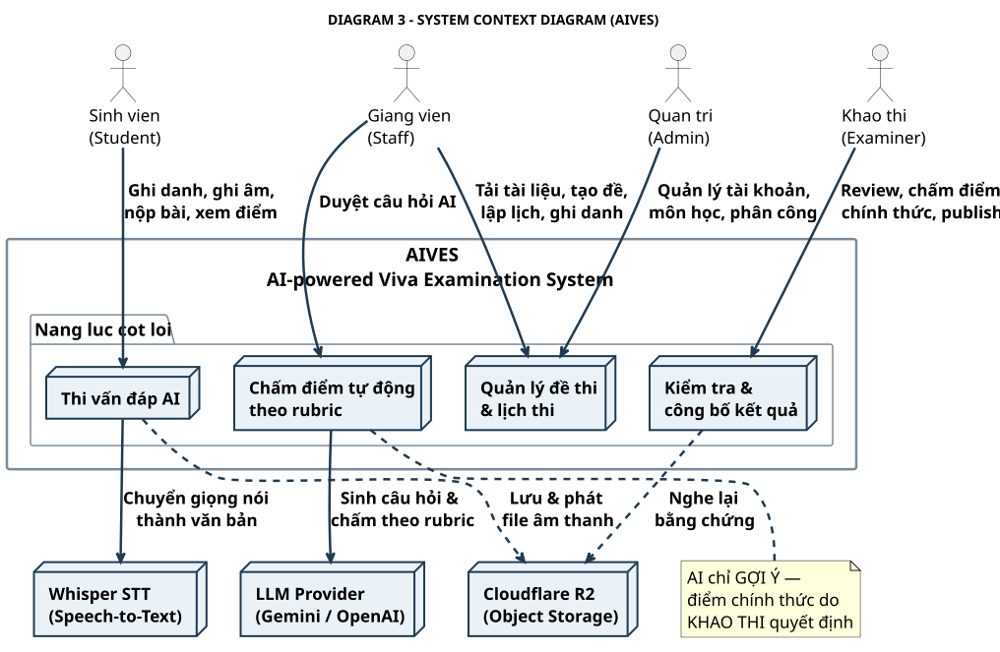

# DIAGRAM 3 – System Context Diagram (bản rút gọn)

**Phần công việc:** Thành viên 5 – Tài liệu đồ thị (bản dùng để thuyết trình)
**Bản C4 gốc (chi tiết):** [`../c0_context.puml`](../c0_context.puml) và [`../architecture.md`](../architecture.md) §1
**Nguồn đối chiếu:** SRS 07/11/2026 + `backend/Aives.Api`, `ai-service/app`

| | |
|---|---|
| **Nguồn PlantUML** | `diagram_03_context.puml` |
| **Ảnh** | `DIAGRAM_03_CONTEXT.svg` / `.png` (1016x663) |
| **Bản tiếng Anh** | [`diagram-03-context_en.md`](./diagram-03-context_en.md) |



---

## Mục đích

Trả lời câu hỏi **"ai dùng hệ thống này và hệ thống này dùng cái gì?"** — không đi sâu vào công nghệ bên trong.

Ranh giới hệ thống (khung đậm) là **AIVES**. Mọi thứ nằm ngoài khung là **hệ thống bên ngoài**.

---

## 4 actor — người dùng hệ thống

| Actor | Tương tác với AIVES |
|---|---|
| **Sinh viên (Student)** | Ghi danh, ghi âm, nộp bài, xem điểm đã công bố |
| **Giảng viên (Staff)** | Tải tài liệu, tạo đề, lập lịch, ghi danh, duyệt câu hỏi AI |
| **Khảo thí (Examiner)** | Review bằng chứng, chấm điểm chính thức, publish |
| **Quản trị (Admin)** | Quản lý tài khoản, môn học, phân công giảng viên |

---

## 4 năng lực cốt lõi (nằm trong khung AIVES)

| Node | Năng lực | Use case liên quan |
|---|---|---|
| **Thi vấn đáp AI** | Điều phối ca thi, ghi âm, nộp bài, xem kết quả | UC-07, UC-11 |
| **Chấm điểm tự động theo rubric** | Sinh câu hỏi, STT, chấm theo rubric, sinh follow-up | UC-04, UC-08 |
| **Quản lý đề thi & lịch thi** | Tài liệu, ngân hàng câu hỏi, đề, kỳ thi, ca, kíp, ghi danh | UC-01…UC-06 |
| **Kiểm tra & công bố kết quả** | Review, chấm điểm chính thức, publish, xử lý sự cố | UC-09, UC-10 |

---

## 3 hệ thống bên ngoài

| Hệ thống | Vai trò | Công nghệ thực tế |
|---|---|---|
| **Cloudflare R2** | Lưu trữ & phát file âm thanh bài thi (bucket riêng tư) | S3-compatible Object Storage, presigned URL |
| **LLM Provider** | Sinh câu hỏi từ tài liệu, chấm điểm theo rubric, gợi ý follow-up | Gemini / OpenAI API |
| **Whisper STT** | Chuyển giọng nói thành văn bản để rubric chấm trên text | Faster-Whisper trong `ai-service` |

---

## Luồng dữ liệu chính (đọc theo hình)

```
Sinh viên ──ghi âm──► AIVES ──audio──► R2
                            │
                            ├──► Whisper STT ──transcript──► LLM ──rubric──► AI score
                            │
Giảng viên ──tài liệu──► AIVES ──prompt──► LLM ──câu hỏi──► duyệt ──► đề thi
                            │
Khảo thí ──review──► AIVES ◄──audio từ R2──► công bố điểm ──► Sinh viên
```

---

## Ranh giới trách nhiệm — điểm quan trọng nhất

| Ranh giới | Ý nghĩa |
|---|---|
| **AIVES bên trong khung** | Toàn bộ logic nghiệp vụ, RBAC, trạng thái kết quả, audit log |
| **AI/LLM bên ngoài** | Chỉ là *công cụ*. Nó **không giữ** trạng thái nghiệp vụ, không tự công bố điểm |
| **R2 bên ngoài** | Chỉ là *kho lưu trữ*. Backend quyết định quyền truy cập qua presigned URL |
| **Khảo thí (Examiner)** | Người duy nhất chịu trách nhiệm cho điểm chính thức |

> **Điểm hay nhấn khi thuyết trình:** AI nằm **ngoài** ranh giới hệ thống → nếu AI trả về sai, AIVES vẫn an toàn vì điểm cuối cùng do Khảo thí chịu trách nhiệm và có audit log.

---

## Quan hệ với bản chi tiết

| Sơ đồ | Mức | File |
|---|---|---|
| **DIAGRAM 3 (bản này)** | C0 – System Context | `diagram_03_context.puml` |
| C1 – Container | Chi tiết thành phần | [`../c1_container.puml`](../c1_container.puml) |
| Swimlane chi tiết | Luồng nghiệp vụ | [SWL-1](../swimlane-01-preparation-scheduling.md) · [SWL-2A](../swimlane-02a-exam-delivery-grading.md) · [SWL-2B](../swimlane-02b-review-publish-incident.md) |

---

[[← DIAGRAM 2 – Swimlane rút gọn](./diagram-02-swimlane.md)] · [[Danh mục diagram rút gọn](./simplified-index.md)]
