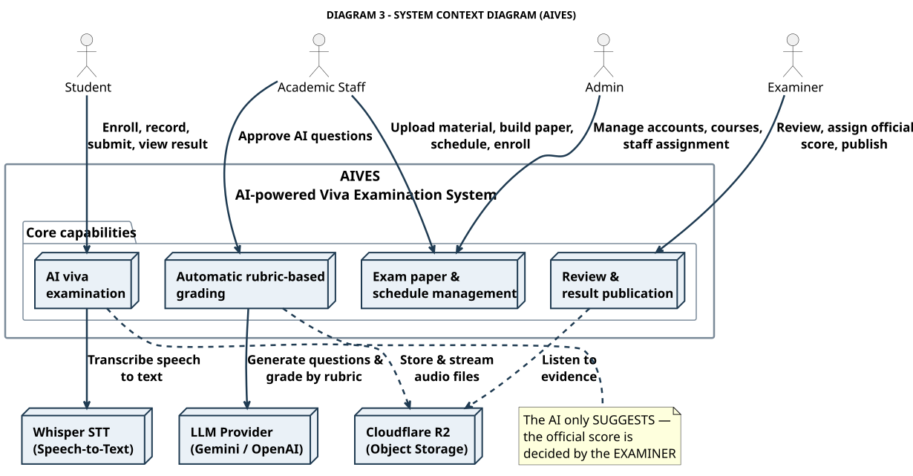

# DIAGRAM 3-EN – System Context Diagram (simplified)

**Part of work:** Member 5 – Diagram documentation (presentation version)
**Original C4 (detailed):** [`../c0_context.puml`](../c0_context.puml) and [`../architecture.md`](../architecture.md) §1
**Source of truth:** SRS 07/11/2026 + `backend/Aives.Api`, `ai-service/app`

| | |
|---|---|
| **PlantUML source** | `diagram_03_context_en.puml` |
| **Images** | `DIAGRAM_03_CONTEXT_EN.svg` / `.png` (1230x641) |
| **Vietnamese version** | [`diagram-03-context.md`](./diagram-03-context.md) |



---

## Purpose

Answers the question **"who uses this system and what does this system use?"** — without diving into internal technology.

The system boundary (the bold frame) is **AIVES**. Everything outside the frame is an **external system**.

---

## 4 actors — system users

| Actor | Interaction with AIVES |
|---|---|
| **Student** | Enroll, record, submit, view the published result |
| **Academic Staff** | Upload material, build the paper, schedule, enroll, approve AI questions |
| **Examiner** | Review evidence, assign the official score, publish |
| **Admin** | Manage accounts, courses, staff assignment |

---

## 4 core capabilities (inside the AIVES frame)

| Node | Capability | Related use case |
|---|---|---|
| **AI viva examination** | Session orchestration, recording, submission, result view | UC-07, UC-11 |
| **Automatic rubric-based grading** | Question generation, STT, rubric grading, follow-ups | UC-04, UC-08 |
| **Exam paper & schedule management** | Material, question bank, paper, period, session, slot, enrollment | UC-01…UC-06 |
| **Review & result publication** | Review, official grading, publication, incident handling | UC-09, UC-10 |

---

## 3 external systems

| System | Role | Real technology |
|---|---|---|
| **Cloudflare R2** | Stores & streams the exam audio files (private bucket) | S3-compatible Object Storage, presigned URL |
| **LLM Provider** | Generates questions from material, grades by rubric, suggests follow-ups | Gemini / OpenAI API |
| **Whisper STT** | Transcribes speech so the rubric can grade the **text** | Faster-Whisper inside `ai-service` |

---

## Main data flow (read from the diagram)

```
Student ──record──► AIVES ──audio──► R2
                          │
                          ├──► Whisper STT ──transcript──► LLM ──rubric──► AI score
                          │
Staff ──material──► AIVES ──prompt──► LLM ──questions──► approve ──► exam paper
                          │
Examiner ──review──► AIVES ◄──audio from R2──► publish score ──► Student
```

---

## The responsibility boundary — the most important point

| Boundary | Meaning |
|---|---|
| **AIVES inside the frame** | All business logic, RBAC, result state, audit log |
| **AI/LLM outside** | Just a *tool*. It holds **no** business state and never publishes a score |
| **R2 outside** | Just a *storage*. The backend controls access via presigned URLs |
| **Examiner** | The only party accountable for the official score |

> **A good point to make while presenting:** the AI sits **outside** the system boundary → even if the AI returns a wrong score, AIVES stays safe because the final score is the examiner's responsibility and every action is audit-logged.

---

## Relation to the detailed version

| Diagram | Level | File |
|---|---|---|
| **DIAGRAM 3 (this one)** | C0 – System Context | `diagram_03_context_en.puml` |
| C1 – Container | Component detail | [`../c1_container.puml`](../c1_container.puml) |
| Detailed swimlane | Business flows | [SWL-1-EN](../swimlane-01-preparation-scheduling_en.md) · [SWL-2A-EN](../swimlane-02a-exam-delivery-grading_en.md) · [SWL-2B-EN](../swimlane-02b-review-publish-incident_en.md) |

---

[[← DIAGRAM 2-EN – Simplified Swimlane](./diagram-02-swimlane_en.md)] · [[Simplified diagram index](./simplified-index-en.md)]
