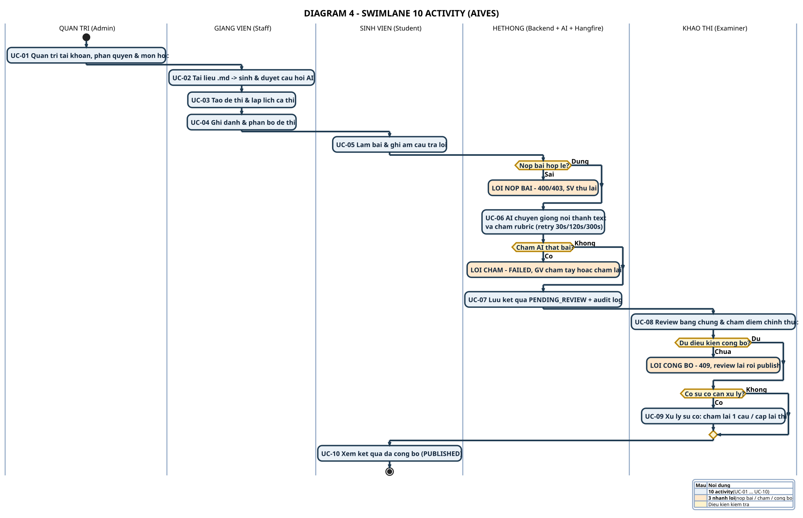

# DIAGRAM 4 – Swimlane 10 Activity

**Phần công việc:** Thành viên 5 – Tài liệu đồ thị
**Mục đích:** Bản swimlane **cô đọng nhất** — đúng **10 activity** + 3 nhánh lỗi, vừa 1 slide.
**Nguồn đối chiếu:** SRS 07/11/2026 + mã nguồn thực tế

| | |
|---|---|
| **Nguồn PlantUML** | `diagram_04_swimlane_10.puml` |
| **Ảnh** | `DIAGRAM_04_SWIMLANE_10.svg` / `.png` (2347×1517) |
| **Bản tiếng Anh** | [`diagram-04-swimlane-10_en.md`](./diagram-04-swimlane-10_en.md) |

---

## Đặc điểm

| | |
|---|---|
| **Số activity** | **Đúng 10** — UC-01 … UC-10 |
| **Số lane** | 5 (Admin · Staff · Student · System · Examiner) |
| **Nhánh lỗi** | 3 — nộp bài lỗi · chấm lỗi · công bố lỗi |
| **Font / nét** | 19pt bold · mũi tên 2.6px · khung activity 2.2px |

> Đây là bản **nhỏ gọn nhất** trong toàn bộ bộ sơ đồ. Khi slide cần hình nhỏ gọn mà vẫn nêu đủ luồng + lỗi → dùng bản này.

---

## 5 lane

| Lane | Ý nghĩa | Vai trò thật |
|---|---|---|
| **QUẢN TRỊ (Admin)** | Tài khoản, phân quyền, môn học | `ADMIN` |
| **GIẢNG VIÊN (Staff)** | Tài liệu → câu hỏi → đề thi → lịch thi | `STAFF` |
| **SINH VIÊN (Student)** | Làm bài, nộp bài, xem điểm | `STUDENT` |
| **HỆ THỐNG (Backend + AI + Hangfire)** | Kiểm tra điều kiện, STT, chấm rubric, lưu kết quả | Dịch vụ nội bộ |
| **KHẢO THÍ (Examiner)** | Review, chấm điểm chính thức, xử lý sự cố | `EXAMINER` |

---

## 10 activity

| # | Activity | Lane | Nội dung |
|---|---|---|---|
| **UC-01** | Quản trị tài khoản, phân quyền & môn học | Admin | Tạo user, gán role, tạo course, assign GV |
| **UC-02** | Tải tài liệu .md → sinh & duyệt câu hỏi AI | Staff | Markdown + Learning Outcome → `PENDING_REVIEW` → approve |
| **UC-03** | Tạo đề thi & lập lịch ca thi | Staff | Chỉ nhận câu `APPROVED`; tạo period → session → slot |
| **UC-04** | Ghi danh & phân bổ đề thi | Staff | Enroll sinh viên, gán đề + kíp |
| **UC-05** | Làm bài & ghi âm câu trả lời | Student | Start → record → submit → finish |
| **UC-06** | AI chuyển giọng nói thành text & chấm rubric | System | Hangfire retry 30s/120s/300s |
| **UC-07** | Lưu kết quả PENDING_REVIEW + audit log | System | `AiScore` ≠ điểm chính thức |
| **UC-08** | Review bằng chứng & chấm điểm chính thức | Examiner | `FinalScore` + `TeacherComment` |
| **UC-09** | Xử lý sự cố: chấm lại 1 câu / cấp lại thi | Examiner | Retry ≠ Retake |
| **UC-10** | Xem kết quả đã công bố (PUBLISHED) | Student | `GET /api/student/results/{sessionId}` |

---

## 3 nhánh lỗi

| Nhánh | Điều kiện | Xử lý | Màu |
|---|---|---|---|
| **NỘP BÀI LỖI** | Nộp bài không hợp lệ (chưa tới giờ kíp / ca chưa mở / chưa ghi danh) | 400/403 → SV thử lại | 🟠 |
| **CHẤM LỖI** | STT hỏng / contract sai / hết lượt retry | `FAILED` → GV chấm tay hoặc chấm lại | 🟠 |
| **CÔNG BỐ LỖI** | Thiếu điểm chính thức / chưa `REVIEWED` | 409 → review lại rồi publish | 🟠 |

> Mỗi nhánh lỗi **dừng riêng** (không nối tiếp) → người xem tập trung được vào đường chính.

---

## Điểm cần nhấn mạnh khi thuyết trình

- **10 activity = 10 use case** → ánh xạ 1–1 với [DIAGRAM 1 – Use Case](./diagram-01-usecase.md).
- **Chuyển lane luôn gắn 1 trách nhiệm**: Student → System (gửi bài) → System → Examiner (AI score) → Examiner → Student (công bố).
- **AI không bao giờ công bố** — trạng thái `PUBLISHED` chỉ nằm trong tay Khảo thí.
- **3 nhánh lỗi đều nằm ở đúng điểm kiểm tra** trong luồng, không "chết" giữa chừng.

---

## So sánh với các bản swimlane khác

| Bản | Số activity | Lane | Dùng khi |
|---|---|---|---|
| **DIAGRAM 4 (bản này)** | **10** | 5 | Slide cần hình nhỏ gọn nhất |
| [DIAGRAM 2](./diagram-02-swimlane.md) | 13 | 5 | Slide tổng quan + 3 nhánh lỗi |
| [SWL-2A](../swimlane-02a-exam-delivery-grading.md) | ~20 | 5 | GV hỏi sâu về thi & chấm AI |
| [SWL-2B](../swimlane-02b-review-publish-incident.md) | ~15 | 4 | GV hỏi sâu về review & publish |
| [SWL-2](../swimlane-02-exam-grading-publish.md) | ~40 | 6 | Tham khảo đầy đủ nhất |

---

[[← Bộ rút gọn](./simplified-index.md)] · [[📄 Toàn bộ trong 1 trang →](../all-diagrams.md)] · [[DIAGRAM 3 – Context](./diagram-03-context.md)]
