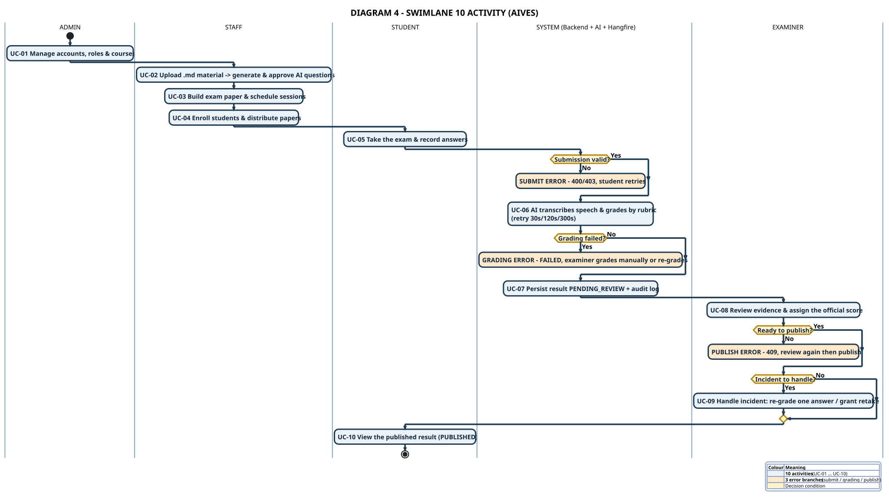

# DIAGRAM 4-EN – Swimlane 10 Activity

**Part of work:** Member 5 – Diagram documentation
**Purpose:** The **most compact** swimlane — exactly **10 activities** + 3 error branches, fits one slide.
**Source of truth:** SRS 07/11/2026 + actual source code

| | |
|---|---|
| **PlantUML source** | `diagram_04_swimlane_10_en.puml` |
| **Images** | `DIAGRAM_04_SWIMLANE_10_EN.svg` / `.png` (2699×1517) |
| **Vietnamese version** | [`diagram-04-swimlane-10.md`](./diagram-04-swimlane-10.md) |

---

## Characteristics

| | |
|---|---|
| **Activities** | **Exactly 10** — UC-01 … UC-10 |
| **Lanes** | 5 (Admin · Staff · Student · System · Examiner) |
| **Error branches** | 3 — submit error · grading error · publish error |
| **Font / lines** | 19pt bold · 2.6px arrows · 2.2px activity borders |

> This is the **smallest** diagram in the whole set. When a slide needs a compact image that still shows the full flow and the errors → use this one.

---

## 5 lanes

| Lane | Meaning | Real role |
|---|---|---|
| **ADMIN** | Accounts, RBAC, courses | `ADMIN` |
| **ACADEMIC STAFF** | Material → questions → paper → schedule | `STAFF` |
| **STUDENT** | Take the exam, submit, view result | `STUDENT` |
| **SYSTEM (Backend + AI + Hangfire)** | Validate, STT, rubric grading, persistence | Internal services |
| **EXAMINER** | Review, official grading, incident handling | `EXAMINER` |

---

## 10 activities

| # | Activity | Lane | Content |
|---|---|---|---|
| **UC-01** | Manage accounts, roles & courses | Admin | Create users, assign roles, create course, assign staff |
| **UC-02** | Upload .md material → generate & approve AI questions | Staff | Markdown + Learning Outcome → `PENDING_REVIEW` → approve |
| **UC-03** | Build exam paper & schedule sessions | Staff | Only `APPROVED` questions; period → session → slot |
| **UC-04** | Enroll students & distribute papers | Staff | Enroll students, assign paper + slot |
| **UC-05** | Take the exam & record answers | Student | Start → record → submit → finish |
| **UC-06** | AI transcribes speech & grades by rubric | System | Hangfire retry 30s/120s/300s |
| **UC-07** | Persist result PENDING_REVIEW + audit log | System | `AiScore` ≠ the official score |
| **UC-08** | Review evidence & assign the official score | Examiner | `FinalScore` + `TeacherComment` |
| **UC-09** | Handle incident: re-grade one answer / grant retake | Examiner | Retry ≠ Retake |
| **UC-10** | View the published result (PUBLISHED) | Student | `GET /api/student/results/{sessionId}` |

---

## 3 error branches

| Branch | Condition | Handling | Colour |
|---|---|---|---|
| **SUBMIT ERROR** | Invalid submission (before the slot time / session not open / not enrolled) | 400/403 → student retries | 🟠 |
| **GRADING ERROR** | STT broken / contract mismatch / retries exhausted | `FAILED` → examiner grades manually or re-grades | 🟠 |
| **PUBLISH ERROR** | Official score missing / not `REVIEWED` | 409 → review again then publish | 🟠 |

> Each error branch **detaches on its own** (not chained) → the viewer's eye stays on the main path.

---

## Key points for the presentation

- **10 activities = 10 use cases** → a 1–1 mapping with [DIAGRAM 1-EN](./diagram-01-usecase_en.md).
- **Every lane change carries one responsibility**: Student → System (submit) → System → Examiner (AI score) → Examiner → Student (publish).
- **The AI never publishes** — the `PUBLISHED` state belongs to the examiner only.
- **All 3 error branches sit exactly at the decision points** in the flow, none die mid-way.

---

## Compared with the other swimlanes

| Version | Activities | Lanes | Used for |
|---|---|---|---|
| **DIAGRAM 4 (this one)** | **10** | 5 | When the slide needs the smallest image |
| [DIAGRAM 2-EN](./diagram-02-swimlane_en.md) | 13 | 5 | Overview slide + 3 error branches |
| [SWL-2A-EN](../swimlane-02a-exam-delivery-grading_en.md) | ~20 | 5 | Deep questions on delivery & AI grading |
| [SWL-2B-EN](../swimlane-02b-review-publish-incident_en.md) | ~15 | 4 | Deep questions on review & publication |
| [SWL-2-EN](../swimlane-02-exam-grading-publish_en.md) | ~40 | 6 | The most complete reference |

---

[[← Simplified set](./simplified-index-en.md)] · [[📄 All on one page →](../all-diagrams-en.md)] · [[DIAGRAM 3-EN – Context](./diagram-03-context_en.md)]
