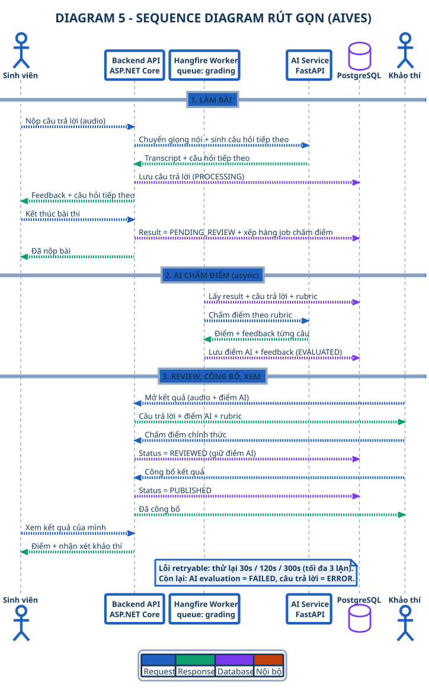

# DIAGRAM 5 – Sequence Diagram rút gọn

**Phần công việc:** Thành viên 5 – Tài liệu đồ thị
**Mục đích:** Sequence **cô đọng nhất** — thứ tự gọi thực tế giữa các thành phần, vừa 1 slide.
**Nguồn chân lý:** SRS 07/11/2026 + mã nguồn thực tế

| | |
|---|---|
| **PlantUML source** | `diagram_05_sequence.puml` |
| **Ảnh** | `DIAGRAM_05_SEQUENCE.svg` / `.png` (1810×2915 @2.5×) |
| **Bản tiếng Anh** | [`diagram-05-sequence_en.md`](./diagram-05-sequence_en.md) |
| **Bộ sequence chi tiết** | [`../sequence/sequence-index.md`](../sequence/sequence-index.md) |



---

## Đặc điểm

| | |
|---|---|
| **Participant** | 6 — Sinh viên · Backend API · Hangfire Worker · AI Service · PostgreSQL · Khảo thí |
| **Giai đoạn** | 3 — làm bài · AI chấm điểm (async) · review, công bố, xem điểm |
| **Nhánh lỗi** | 1 note — chính sách retry của AI (30s / 120s / 300s, tối đa 3 lḀn) thay cho 3 khung `alt` lồng nhau |
| **Kiểu** | **Mã màu theo ngữ nghĩa — chỉ 4 ý**: <span style="color:#1F5FBF">■ xanh liền = request</span> · <span style="color:#0E9F6E">■ xanh lá nét đứt = response</span> · <span style="color:#7C3AED">■ tím = database</span> · <span style="color:#C2410C">■ cam = nội bộ / retry</span> · <span style="color:#8FA6C4">■ xám xanh = lifeline</span> (chỉ là đường dẫn, không có mũi tên). Tất cả khối participant dùng chung 1 kiểu nền trắng; note & khung alt màu xanh nhạt |
| **Kích thước** | SVG 724×1166 · **PNG 1810×2915 (2.5×)** — vừa 1 slide 16:9 mà không cần thu nhỏ |
| **Cách diễn đạt** | **Không ghi endpoint thô** — mỗi message nêu rõ *điều gì xảy ra* ("Nộp câu trả lời", "Chấm điểm chính thức"), không phải URL. Hợp đồng API chi tiết nằm ở bộ sequence chi tiết |

> Swimlane cho biết **ai phụ trách**; sequence này cho biết **ai gọi ai, theo thứ tự nào** — hai góc nhìn bổ trợ nhau trên cùng một slide.

---

## 6 participant

| Participant | Vai trò trong luồng này | Thành phần thật |
|---|---|---|
| **Sinh viên (Student)** | Ghi âm, nộp từng câu trả lời, kết thúc, xem điểm | Người dùng front-end (SPA / app Windows) |
| **Backend API (ASP.NET Core)** | Điều phối STT, follow-up, lưu trữ, xếp hàng, công bố | `VivaSessionController` → `VivaSessionService` |
| **Hangfire Worker** *(queue `grading`)* | Nhận job và chạy chấm điểm AI ngoài request | `SessionGradingJob` → `SessionGradingService` |
| **AI Service (FastAPI)** | STT, sinh follow-up, chấm rubric | `/ai/speech/transcribe`, `/ai/interview/follow-up`, `/ai/evaluate/session` |
| **PostgreSQL (Neon)** | Lưu câu trả lời, kết quả, audit log | `answers`, `results`, `audit_logs` |
| **Khảo thí (Examiner)** | Nghe bằng chứng, chấm điểm chính thức, công bố | `ResultsController` |

---

## 3 giai đoạn

| Giai đoạn | Diễn ra gì | Lệnh then chốt |
|---|---|---|
| **1. Làm bài** | Ghi âm → nộp → STT → follow-up → lưu Answer → tăng chỉ số câu hỏi → kết thúc | `POST /api/student/viva-sessions/{id}/submit-answer` |
| **2. AI chấm điểm** *(async)* | Worker Hangfire nạp kết quả, gọi AI một lần cho toàn bộ bài, rồi lưu điểm AI | `POST /ai/evaluate/session` |
| **3. Review, công bố, xem** | Bằng chứng → review (điểm chính thức) → công bố → sinh viên xem điểm | `PUT /api/results/{id}/review` **rồi** `POST /api/results/{id}/publish` |

---

## 3 nhánh lỗi

| Nhánh lỗi | Điều kiện | Xử lý |
|---|---|---|
| **CHẤM LỖI RETRYABLE** | Lệnh đánh giá AI lỗi với mã retryable | Hangfire thử lại 30s / 120s / 300s (tối đa 3 lượt) |
| **CHẤM LỖI KHÔNG RETRYABLE / HẾT LƯỢT** | Mã lỗi không retryable, hoặc lượt cuối cùng vẫn lỗi | `AiEvaluationStatus = FAILED`, `Answer.Status = ERROR` |
| **CÔNG BỐ KHI CHƯA CÓ ĐIỂM** | Chưa câu trả lời nào có điểm AI hoặc điểm của khảo thí, hoặc trạng thái không hợp lệ | 400 / 409 → khảo thí phải chấm điểm trước rồi mới công bố |

> **Lưu ý về lệnh của sinh viên:** `GET /api/student/results/{sessionId}` trả về **200 OK** trong cả hai trường hợp — khi chưa `PUBLISHED` thì payload mang `IsPublished = false` kèm thông báo; chỉ khi `PUBLISHED` mới trả về điểm chính thức và nhận xét của khảo thí.

---

## Điểm nhấn cho phần thuyết trình

- **AI không bao giờ công bố** — trạng thái `PUBLISHED` thuộc về khảo thí, và sinh viên chỉ đọc được điểm sau đó.
- **Review và publish là hai bước riêng biệt** — `PUT /api/results/{id}/review` đưa kết quả sang `REVIEWED`, `POST /api/results/{id}/publish` đưa sang `PUBLISHED`.
- **Điểm AI và điểm chính thức lưu riêng** — `AiScore` không bao giờ bị ghi đè bởi `FinalScore` (BR-15).
- **Việc chấm chạy ngoài request** — một worker Hangfire duy nhất trên queue `grading`, có khoá phân tán 12 giờ.
- **Mọi nhánh lỗi nằm đúng tại điểm ra quyết định** của luồng, không nhánh nào chết giữa chừng.

---

## So sánh với bộ sequence chi tiết

| Phiên bản | Giai đoạn | Participant | Dùng để |
|---|---|---|---|
| **DIAGRAM 5 (bản này)** | **3** | 6 | Tổng quan thứ tự gọi trong 1 slide |
| [SEQ 1](../sequence/seq-01-viva-flow.md) | 3 | 8 | Đi sâu luồng thi Viva |
| [SEQ 2](../sequence/seq-02-grading.md) | 5 | 7 | Đi sâu chấm điểm AI & chính sách retry |
| [SEQ 3](../sequence/seq-03-review-publish.md) | 6 | 7 | Đi sâu review, công bố & xử lý sự cố |
| [SEQ 4](../sequence/seq-04-admin-prep.md) | 7 | 9 | Đi sâu chuẩn bị & tổ chức thi |

---

## Chỉnh sửa trong Visual Paradigm (tuỳ chọn)

Bản **UML XMI 2.1** của cùng sơ đồ này được cung cấp để bạn tiếp tục chỉnh sửa trong công cụ UML:

| | |
|---|---|
| **Tiếng Anh** | `DIAGRAM_05_SEQUENCE_EN.xmi` |
| **Tiếng Việt** | `DIAGRAM_05_SEQUENCE.xmi` |
| **Nội dung** | 1 `uml:Model` → 1 `uml:Collaboration` (6 role) + 1 `uml:Interaction` (6 lifeline, 21 message, 1 note) |

**Các bước import**

1. Mở Visual Paradigm → **File ▸ Import…**
2. Chọn loại file **XMI**, trỏ tới `DIAGRAM_05_SEQUENCE.xmi`
3. Trong *Model Explorer* sẽ có `AIVES ▸ VivaCollaboration` và `AIVES ▸ DIAGRAM 5 – …`
4. Double-click Interaction → mở ra dưới dạng **Sequence Diagram**
5. Nếu canvas trống: kéo Interaction sang 1 Sequence Diagram mới, rồi chuột phải ▸ **Auto-layout** / **Arrange Shapes**
6. Mọi lifeline và message đều là phần tử UML thật → đổi tên, sắp xếp lại, thêm khung `alt`/`loop`, xuất PNG/PDF

> File XMI mang **mô hình** (lifeline + message). Mã màu 4 ý được áp lại bên trong VP trên chính sơ đồ — đặt **line style** cho từng message (xanh liền = request, xanh lá đứt = response, tím = database, cam = nội bộ).

**Sinh lại file**

```powershell
python ..\..\..\ops\_make_vp_xmi.py
```

---

## Cách render lại

```powershell
# 1. PlantUML -> SVG   (chỉ dùng skinparam `sequence*` ở cấp cao nhất!)
java -jar ..\..\..\ops\tools\plantuml.jar -tsvg -charset UTF-8 diagram_05_sequence.puml

# 2. Làm rõ SVG (lifeline liền, note & khung alt màu xanh)
python ..\..\..\ops\_sharpen_svg.py DIAGRAM_05_SEQUENCE.svg

# 3. SVG -> PNG độ phân giải cao (2.5x)
python ..\..\..\ops\_svg2png_hi.py DIAGRAM_05_SEQUENCE.svg --scale 2.5
```

> **Vì sao cần thêm 2 bước:** PlantUML bỏ qua phần lớn các khóa nằm trong khối lồng `sequence { ... }` — note giữ màu vàng mặc định, khung alt giữ màu xám mặc định, và lifeline được vẽ thành đường đứt 0.5px. `_sharpen_svg.py` chuẩn hoá bảng màu + độ đậm nét, `_svg2png_hi.py` rasterise ở mức 2.5× để nét không bị loang khi phóng lên slide.

---

[[← Bộ rút gọn](./simplified-index.md)] · [[📄 Toàn bộ trong 1 trang →](../all-diagrams.md)] · [[🔄 Bộ sequence chi tiết →](../sequence/sequence-index.md)]
