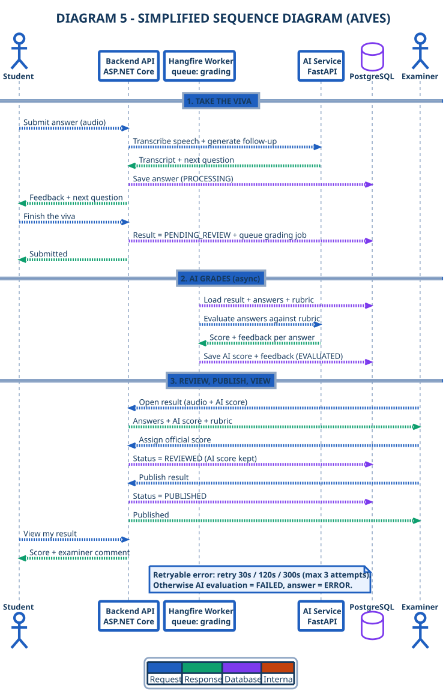

# DIAGRAM 5-EN – Simplified Sequence Diagram

**Part of work:** Member 5 – Diagram documentation
**Purpose:** The **most compact sequence** — the real call order between the components, fits one slide.
**Source of truth:** SRS 07/11/2026 + actual source code

| | |
|---|---|
| **PlantUML source** | `diagram_05_sequence_en.puml` |
| **Images** | `DIAGRAM_05_SEQUENCE_EN.svg` / `.png` (1858×2915 @2.5×) |
| **Vietnamese version** | [`diagram-05-sequence.md`](./diagram-05-sequence.md) |
| **Detailed sequence set** | [`../sequence/sequence-index-en.md`](../sequence/sequence-index-en.md) |



---

## Characteristics

| | |
|---|---|
| **Participants** | 6 — Student · Backend API · Hangfire Worker · AI Service · PostgreSQL · Examiner |
| **Phases** | 3 — take the viva · AI grades (async) · review, publish, view |
| **Error branches** | 1 note — the AI retry policy (30s / 120s / 300s, max 3 attempts) instead of 3 nested `alt` frames |
| **Style** | **Semantic colour code — 4 meanings only**: <span style="color:#1F5FBF">■ blue solid = request</span> · <span style="color:#0E9F6E">■ green dashed = response</span> · <span style="color:#7C3AED">■ purple = database</span> · <span style="color:#C2410C">■ orange = internal / retry</span> · <span style="color:#8FA6C4">■ grey-blue = life line</span> (a guide, no arrow head). All participant boxes share one white style; notes & alt-frames light blue |
| **Size** | SVG 743×1166 · **PNG 1858×2915 (2.5×)** — fits one 16:9 slide without shrinking |
| **Wording** | **No raw endpoints** — every message states *what happens* ("Submit answer", "Assign official score"), not the URL. The exact API contract lives in the detailed sequence set |

> Swimlanes show **who is responsible**; this diagram shows **what calls what, and in which order** — the two views complement each other on the same slide.

---

## 6 participants

| Participant | Role in this flow | Real component |
|---|---|---|
| **Student** | Records, submits each answer, finishes, views the score | Front-end user (SPA / Windows app) |
| **Backend API (ASP.NET Core)** | Orchestrates STT, follow-up, persistence, queueing, publication | `VivaSessionController` → `VivaSessionService` |
| **Hangfire Worker** *(queue `grading`)* | Picks the job up and runs the AI grading outside the request | `SessionGradingJob` → `SessionGradingService` |
| **AI Service (FastAPI)** | STT, follow-up generation, rubric grading | `/ai/speech/transcribe`, `/ai/interview/follow-up`, `/ai/evaluate/session` |
| **PostgreSQL (Neon)** | Stores answers, results, audit log | `answers`, `results`, `audit_logs` |
| **Examiner** | Listens to the evidence, assigns the official score, publishes | `ResultsController` |

---

## 3 phases

| Phase | What happens | Key call |
|---|---|---|
| **1. Take the viva** | Record → submit → STT → follow-up → save answer → advance index → finish | `POST /api/student/viva-sessions/{id}/submit-answer` |
| **2. AI grades** *(async)* | The Hangfire worker loads the result, calls the AI once for the whole submission, then persists the AI score | `POST /ai/evaluate/session` |
| **3. Review, publish, view** | Evidence → review (official score) → publish → student reads the result | `PUT /api/results/{id}/review` **then** `POST /api/results/{id}/publish` |

---

## 3 error branches

| Branch | Condition | Handling |
|---|---|---|
| **GRADING RETRYABLE** | The AI evaluation call fails with a retryable code | Hangfire retries 30s / 120s / 300s (max 3 attempts total) |
| **GRADING NON-RETRYABLE / ATTEMPTS EXHAUSTED** | A non-retryable code, or the last attempt fails | `AiEvaluationStatus = FAILED`, `Answer.Status = ERROR` |
| **PUBLISH WITHOUT A SCORE** | No answer has an AI score or an examiner score, or the status is invalid | 400 / 409 → the examiner assigns a score first, then publishes |

> **Note on the student call:** `GET /api/student/results/{sessionId}` returns **200 OK** in both cases — when the result is not `PUBLISHED` the payload carries `IsPublished = false` and a message, and only the `PUBLISHED` state returns the official score and the examiner comment.

---

## Key points for the presentation

- **The AI never publishes** — the `PUBLISHED` state belongs to the examiner only, and the student only reads the score after that.
- **Review and publish are two separate steps** — `PUT /api/results/{id}/review` moves the result to `REVIEWED`, `POST /api/results/{id}/publish` moves it to `PUBLISHED`.
- **The AI score and the official score are stored separately** — `AiScore` is never overwritten by `FinalScore` (BR-15).
- **Grading happens outside the request** — a single Hangfire worker on the `grading` queue, guarded by a 12-hour distributed lock.
- **Every error branch sits at a decision point** in the flow, none die mid-way.

---

## Compared with the detailed sequence set

| Version | Phases | Participants | Used for |
|---|---|---|---|
| **DIAGRAM 5-EN (this one)** | **3** | 6 | One-slide overview of the call order |
| [SEQ 1-EN](../sequence/seq-01-viva-flow_en.md) | 3 | 8 | Deep dive on the viva flow |
| [SEQ 2-EN](../sequence/seq-02-grading_en.md) | 5 | 7 | Deep dive on AI grading & the retry policy |
| [SEQ 3-EN](../sequence/seq-03-review-publish_en.md) | 6 | 7 | Deep dive on review, publication & incidents |
| [SEQ 4-EN](../sequence/seq-04-admin-prep_en.md) | 7 | 9 | Deep dive on preparation & scheduling |

---

## Edit it in Visual Paradigm (optional)

A **UML XMI 2.1** version of the same diagram is provided so you can keep editing it in a real UML tool:

| | |
|---|---|
| **English** | `DIAGRAM_05_SEQUENCE_EN.xmi` |
| **Vietnamese** | `DIAGRAM_05_SEQUENCE.xmi` |
| **Contents** | 1 `uml:Model` → 1 `uml:Collaboration` (6 roles) + 1 `uml:Interaction` (6 lifelines, 21 messages, 1 note) |

**Import steps**

1. Open Visual Paradigm → **File ▸ Import…**
2. File type **XMI**, pick `DIAGRAM_05_SEQUENCE_EN.xmi`
3. In *Model Explorer* you get `AIVES ▸ VivaCollaboration` + `AIVES ▸ DIAGRAM 5 – …`
4. Double-click the Interaction → it opens as a **Sequence Diagram**
5. If the canvas is empty: drag the Interaction onto a new Sequence Diagram, then right-click ▸ **Auto-layout** / **Arrange Shapes**
6. Every lifeline and message is a normal UML element → rename, reorder, add `alt`/`loop` frames, export PNG/PDF

> The XMI carries the **model** (lifelines + messages). The 4-colour code is re-applied inside VP on the diagram — set a **line style** per message (blue solid = request, green dashed = response, purple = database, orange = internal).

**Generate it again**

```powershell
python ..\..\..\ops\_make_vp_xmi.py
```

---

## How to re-render

```powershell
# 1. PlantUML -> SVG   (top-level `sequence*` skinparams only!)
java -jar ..\..\..\ops\tools\plantuml.jar -tsvg -charset UTF-8 diagram_05_sequence_en.puml

# 2. Sharpen the SVG (solid lifelines, blue notes & alt-frames)
python ..\..\..\ops\_sharpen_svg.py DIAGRAM_05_SEQUENCE_EN.svg

# 3. SVG -> high-resolution PNG (2.5x)
python ..\..\..\ops\_svg2png_hi.py DIAGRAM_05_SEQUENCE_EN.svg --scale 2.5
```

> **Why the extra steps:** PlantUML ignores most keys inside a nested `sequence { ... }` block — notes keep the default yellow, alt-frames keep the default grey, and lifelines are drawn as 0.5px dashed hairlines. `_sharpen_svg.py` normalises the palette and the line weights, and `_svg2png_hi.py` rasterises at 2.5× so the strokes stay solid when the image is enlarged on a slide.

---

[[← Simplified set](./simplified-index-en.md)] · [[📄 All on one page →](../all-diagrams-en.md)] · [[🔄 Detailed sequence set →](../sequence/sequence-index-en.md)]
