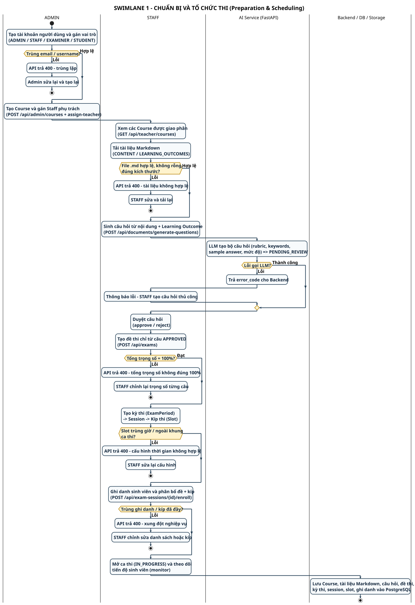

# SWL-1 – Chuẩn bị & Tổ chức thi (Preparation & Exam Scheduling)

**Phần công việc:** Thành viên 5 – Swimlane Diagram
**Nguồn đối chiếu:** `AIVES_Software_Requirements_Specification.docx` (07/11/2026) + mã nguồn `backend/Aives.Api` (`AdminUserController`, `AdminCourseController`, `TeacherDocumentController`, `QuestionBankController`, `ExamsController`, `ExamPeriodsController`, `ExamSessionsController`).
**Quy ước:** Mỗi **lane** = một đơn vị giữ *thông tin trách nhiệm*. Các nhánh lỗi luôn quay về đúng lane chịu trách nhiệm xử lý.

| | |
|---|---|
| **Nguồn PlantUML** | `swimlane_01_preparation_scheduling.puml` |
| **Ảnh** | `SWIMLANE_01_PREPARATION.svg` / `.png` |
| **Bản tiếng Anh** | [`swimlane-01-preparation-scheduling_en.md`](./swimlane-01-preparation-scheduling_en.md) |

---

## Các lane và thông tin trách nhiệm

| Lane | Giữ thông tin/trách nhiệm gì | Tham chiếu SRS |
|---|---|---|
| **ADMIN** | Danh tính người dùng, vai trò, phân công Staff cho Course | UC-02, FR-ADM-01/02, BR-03 |
| **STAFF** | Học liệu, ngân hàng câu hỏi, đề thi, kỳ thi/session/kíp, ghi danh & phân bổ | UC-03…UC-06, FR-STF-01…07 |
| **AI Service (FastAPI)** | Sinh câu hỏi từ Markdown + Learning Outcome (rubric, keywords, sample answer) | FR-STF-03, BR-05/06 |
| **Backend / DB / Storage** | Dữ liệu chuẩn hóa: Course, Markdown, QuestionBank, Exam, Period, Session, Slot, Enrollment | FR-DATA-04, NFR-REL-03 |

---

## Các điểm chuyển trách nhiệm (handover)

1. **ADMIN → STAFF** — `POST /api/admin/courses` + `assign-teacher` là điều kiện tiên quyết để STAFF có "Course context" (BR-04). Không có bước này thì các API content/question/paper của STAFF sẽ trả 403.
2. **STAFF → AI Service** — STAFF gửi *nội dung Markdown + Learning Outcome* (không phải câu hỏi) để AI sinh câu hỏi. AI **không** tự quyết định câu hỏi nào hợp lệ – kết quả trả về ở trạng thái `PENDING_REVIEW` (BR-06).
3. **AI Service → STAFF** — Đây là điểm chuyển **quyền quyết định**: STAFF approve/reject. Chỉ câu `APPROVED` mới được đưa vào đề thi (BR-07).
4. **STAFF → Backend** — Đề thi chỉ được lưu khi tổng trọng số = 100% (BR-08). `QuestionBank.MaxScore` là *thang rubric của câu hỏi*, **không phải** trọng số của đề – cần phân biệt rõ khi trình bày.
5. **STAFF → Backend (Scheduling)** — Period → Session → Slot là chuỗi phụ thuộc thời gian; Slot phải nằm trong khung Session, Session thuộc một Course.
6. **Backend → STAFF (Monitoring)** — Sau khi `IN_PROGRESS`, STAFF theo dõi tiến độ qua `GET /api/exam-sessions/{id}/monitor`.

---

## Các nhánh lỗi

| Nhánh | Điều kiện | Xử lý | Lane chịu trách nhiệm |
|---|---|---|---|
| Trùng email/username | BR-03 | API 400, Admin sửa & tạo lại | ADMIN |
| Tài liệu `.md` không hợp lệ | FR-STF-01 | API 400, STAFF sửa & tải lại | STAFF |
| LLM sinh câu hỏi lỗi | FR-STF-03 | Nhận `error_code`, STAFF tạo câu hỏi thủ công | STAFF (fallback tay) |
| Tổng trọng số ≠ 100% | BR-08 | API 400, STAFF chỉnh lại từng câu | STAFF |
| Slot trùng giờ / ngoài khung ca | BR-10 | API 400, STAFF sửa cấu hình | STAFF |
| Trùng ghi danh / kíp đầy | BR-11 | API 400, STAFF chỉnh danh sách/kíp | STAFF |

---

## Traceability

| Yêu cầu SRS | Thể hiện ở đâu |
|---|---|
| FR-ADM-01/02, BR-03 | ADMIN – tạo tài khoản / Course, nhánh lỗi trùng lặp |
| FR-STF-01/02/03 | STAFF + AI Service – tải Markdown, sinh & duyệt câu hỏi |
| FR-STF-04, BR-07/08 | STAFF – đề thi từ câu APPROVED, tổng trọng số 100% |
| FR-STF-05/06/07, BR-10 | STAFF – Period/Session/Slot, ghi danh, monitor |

---

## Điểm cần nhấn mạnh khi thuyết trình

- Sơ đồ bám **mã nguồn thực tế**, mọi API được ghi trong ngoặc trong hộp hành động.
- **AI chỉ đề xuất, STAFF mới quyết định** – câu hỏi sinh bằng AI luôn ở `PENDING_REVIEW`.
- **Rubric scale ≠ paper weight** – `QuestionBank.MaxScore` (thang của câu) khác trọng số câu trong đề (tổng = 100%).
- **Không có bước "sinh câu hỏi" nào bỏ qua duyệt** – nhánh lỗi LLM quay về đúng lane STAFF.

---

[[← Danh mục Swimlane](./swimlane-index.md)] · [[SWL-2A – Làm bài & Chấm AI →](./swimlane-02a-exam-delivery-grading.md)]
