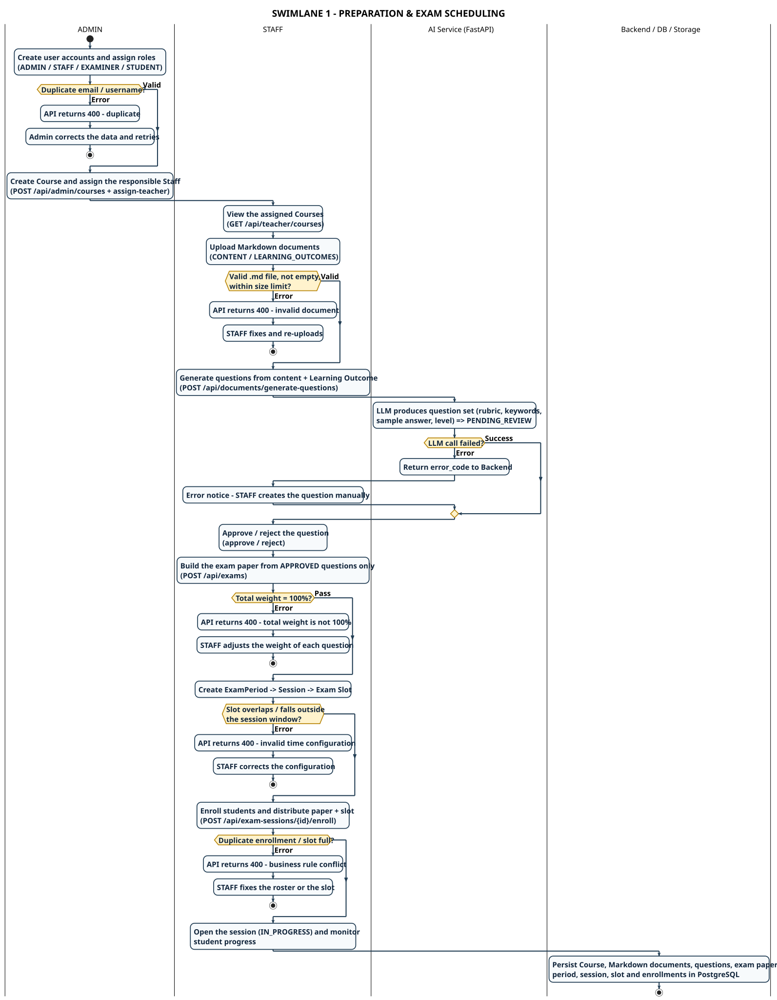

# SWL-1-EN – Preparation & Exam Scheduling

**Part of work:** Member 5 – Swimlane Diagram
**Source of truth:** `AIVES_Software_Requirements_Specification.docx` (07/11/2026) + implementation in `backend/Aives.Api` (`AdminUserController`, `AdminCourseController`, `TeacherDocumentController`, `QuestionBankController`, `ExamsController`, `ExamPeriodsController`, `ExamSessionsController`).
**Convention:** Each **lane** = the unit that holds responsibility. Every error branch returns to the lane that owns the handling.

| | |
|---|---|
| **PlantUML source** | `swimlane_01_preparation_scheduling_en.puml` |
| **Images** | `SWIMLANE_01_PREPARATION_EN.svg` / `.png` |
| **Vietnamese version** | [`swimlane-01-preparation-scheduling.md`](./swimlane-01-preparation-scheduling.md) |

---

## Lanes and responsibility boundaries

| Lane | Holds responsibility for | SRS reference |
|---|---|---|
| **ADMIN** | User identity, roles, Staff assignment per Course | UC-02, FR-ADM-01/02, BR-03 |
| **STAFF** | Learning material, question bank, exam paper, period/session/slot, enrollment & distribution | UC-03…UC-06, FR-STF-01…07 |
| **AI Service (FastAPI)** | Generating questions from Markdown + Learning Outcome (rubric, keywords, sample answer) | FR-STF-03, BR-05/06 |
| **Backend / DB / Storage** | Normalised data: Course, Markdown, QuestionBank, Exam, Period, Session, Slot, Enrollment | FR-DATA-04, NFR-REL-03 |

---

## Handover points

1. **ADMIN → STAFF** — `POST /api/admin/courses` + `assign-teacher` is the precondition for STAFF to hold a Course context (BR-04). Without it the STAFF content/question/paper APIs return 403.
2. **STAFF → AI Service** — STAFF submits *Markdown content + Learning Outcome* (not questions). The AI **does not** decide which questions are valid – results return as `PENDING_REVIEW` (BR-06).
3. **AI Service → STAFF** — this is the **decision handover**: STAFF approves/rejects. Only `APPROVED` questions may enter an exam paper (BR-07).
4. **STAFF → Backend** — an exam paper is saved only when total weight = 100% (BR-08). `QuestionBank.MaxScore` is the *question rubric scale*, **not** the paper weight – this distinction must be stated when presenting.
5. **STAFF → Backend (scheduling)** — Period → Session → Slot is a time-dependent chain; the Slot must sit inside the Session window and the Session belongs to one Course.
6. **Backend → STAFF (monitoring)** — once `IN_PROGRESS`, STAFF tracks progress via `GET /api/exam-sessions/{id}/monitor`.

---

## Error branches

| Branch | Condition | Handling | Responsible lane |
|---|---|---|---|
| Duplicate email/username | BR-03 | API 400, Admin corrects and retries | ADMIN |
| Invalid `.md` document | FR-STF-01 | API 400, STAFF fixes and re-uploads | STAFF |
| LLM generation failure | FR-STF-03 | `error_code` returned, STAFF creates the question manually | STAFF (manual fallback) |
| Total weight ≠ 100% | BR-08 | API 400, STAFF adjusts each question weight | STAFF |
| Slot overlap / outside session window | BR-10 | API 400, STAFF corrects the configuration | STAFF |
| Duplicate enrollment / slot full | BR-11 | API 400, STAFF fixes the roster or the slot | STAFF |

---

## Traceability

| SRS requirement | Where it appears |
|---|---|
| FR-ADM-01/02, BR-03 | ADMIN – create accounts / Course, duplicate error branch |
| FR-STF-01/02/03 | STAFF + AI Service – upload Markdown, generate & approve questions |
| FR-STF-04, BR-07/08 | STAFF – exam paper from APPROVED questions, total weight 100% |
| FR-STF-05/06/07, BR-10 | STAFF – Period/Session/Slot, enrollment, monitoring |

---

## Key points for the presentation

- The diagram follows the **actual implementation**; every API endpoint is written inside the action box.
- **The AI only proposes, STAFF decides** – AI-generated questions always return as `PENDING_REVIEW`.
- **Rubric scale ≠ paper weight** – `QuestionBank.MaxScore` (per-question scale) differs from the paper weighting (total = 100%).
- **No question-generation path skips approval** – the LLM error branch returns to the STAFF lane.

---

[[← Swimlane index](./swimlane-index-en.md)] · [[SWL-2A-EN – Exam Delivery & AI Grading →](./swimlane-02a-exam-delivery-grading_en.md)]
