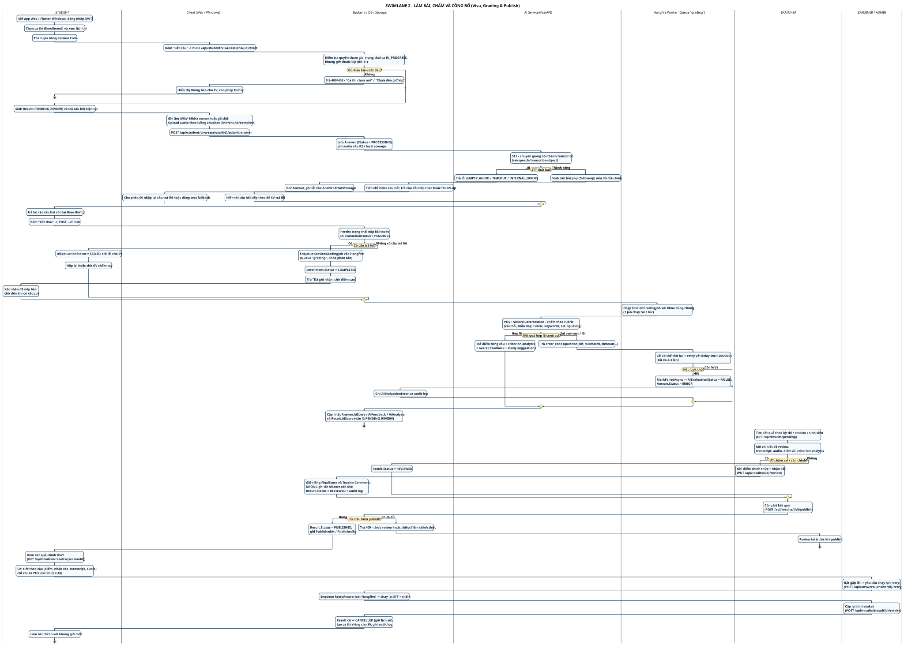

# SWL-2 – Làm bài, Chấm & Công bố (bản đầy đủ / full version)

**Phần công việc:** Thành viên 5 – Swimlane Diagram
**Nguồn đối chiếu:** SRS 07/11/2026 + `VivaSessionService`, `SessionGradingJob`, `SessionGradingService`, `ResultService`, `RetakeService`, `RetryAnswerController`, `StudentResultController`, `ai-service/app/api/*`.
**Phạm vi:** toàn bộ vòng đời từ lúc SV bắt đầu làm bài đến khi kết quả được công bố, gồm cả các nhánh xử lý sự cố.

> ⚠️ **Bản này có 6 lane nên rất rộng (6411px).** Khi nhét ảnh vào slide nên ưu tiên 2 bản tách:
> [SWL-2A – Làm bài & Chấm AI](./swimlane-02a-exam-delivery-grading.md) và [SWL-2B – Review, Công bố & Xử lý sự cố](./swimlane-02b-review-publish-incident.md).

| | |
|---|---|
| **Nguồn PlantUML** | `swimlane_02_exam_grading_publish.puml` |
| **Ảnh** | `SWIMLANE_02_EXAM_GRADING_PUBLISH.svg` / `.png` |
| **Bản tiếng Anh** | [`swimlane-02-exam-grading-publish_en.md`](./swimlane-02-exam-grading-publish_en.md) |
| **Bản tách A** | [`swimlane-02a-exam-delivery-grading.md`](./swimlane-02a-exam-delivery-grading.md) |
| **Bản tách B** | [`swimlane-02b-review-publish-incident.md`](./swimlane-02b-review-publish-incident.md) |

---

## Các lane và thông tin trách nhiệm

| Lane | Giữ thông tin/trách nhiệm gì | Tham chiếu SRS |
|---|---|---|
| **STUDENT** | Quyết định tham gia, trả lời tuần tự, xem kết quả đã công bố | UC-07, UC-11, FR-STU-01…07 |
| **Client (Web / Windows)** | Thu âm (WAV 16 kHz mono), upload chunked, hiển thị câu hỏi/follow-up, giữ bản nháp cục bộ | FR-STU-03, FR-STU-08, NFR-REL-02 |
| **Backend / DB / Storage** | Kiểm tra luật nghiệp vụ, lưu Answer/Result, audio R2, audit log | FR-DATA-01/02, BR-11/12/18 |
| **AI Service (FastAPI)** | STT, sinh follow-up, chấm theo rubric | FR-AI-01/02, BR-13 |
| **Hangfire Worker (Queue "grading")** | Chấm cả bài theo hàng đợi, retry có backoff, khóa phân tán 1 job/lần | FR-STU-06, BR-15, NFR-PERF-03 |
| **EXAMINER / ADMIN** | Review bằng chứng, chấm điểm chính thức, publish, retry, cấp lại thi | UC-09, UC-10, FR-EXA-01…06 |

---

## Các điểm chuyển trách nhiệm (handover)

1. **STUDENT → Backend (Start)** — `POST /api/student/viva-sessions/{id}/start` kiểm tra đồng thời: có enrollment, ca `IN_PROGRESS`, `now >= session.StartTime`, `now < session.EndTime`, và nằm trong kíp (`BR-11`). Sai → 400/403 và SV phải thử lại.
2. **Client → Backend (Submit)** — Audio đi qua luồng chunked (`init` → `chunk` → `complete`) để giảm rủi ro mất dữ liệu file lớn; Backend **không tin** object key do client gửi mà tra `media_uploads` để đối chiếu `SessionId/StudentId/QuestionId` + trạng thái `COMPLETED`.
3. **Backend → AI Service (STT)** — AI trả transcript; **audio là bằng chứng, rubric chấm trên TEXT** (BR-13). AI **không** chấm phát âm, cảm xúc hay hình ảnh.
4. **AI Service → Backend (Follow-up)** — Nếu AI sinh follow-up, index câu hỏi **không tăng** – SV phải trả lời câu phụ trước khi sang câu chính tiếp theo.
5. **Backend → Hangfire** — `finish` **persist trạng thái nộp bài trước**, rồi mới enqueue. Nếu queue lỗi, bài vẫn còn để nộp lại (thiết kế an toàn khi queue sập).
6. **Hangfire → AI Service → Hangfire** — Lỗi *retryable* được retry với backoff 30s/120s/300s; lỗi *non-retryable* (sai contract, `question_ids_mismatch`) dừng ngay. Hết lượt → `AiEvaluationStatus = FAILED`, `Answer.Status = ERROR`.
7. **Backend → EXAMINER** — Kết quả chỉ ở `PENDING_REVIEW`. **Điểm AI và điểm chính thức là hai trường khác nhau** – `FinalScore` không ghi đè `AiScore` (BR-09). AI **không bao giờ** tự công bố.
8. **EXAMINER → STUDENT** — Chỉ khi `Result.Status = PUBLISHED`, SV mới xem được chi tiết (điểm, nhận xét, transcript, audio) qua `GET /api/student/results/{sessionId}` (BR-18).
9. **EXAMINER → Backend (Incident)** — *Retry answer* (chạy lại STT + chấm) khác hẳn *Retake* (cấp lại thi). Retake đưa Result cũ về `CANCELLED` nhưng **giữ nguyên lịch sử** answer/audio/transcript và ghi `AuditLog` (BR-16, BR-17).

---

## Các nhánh lỗi

| Nhánh | Điều kiện | Xử lý | Lane chịu trách nhiệm |
|---|---|---|---|
| Chưa đủ điều kiện bắt đầu | BR-11 | 400/403, Client hiển thị thông báo, SV thử lại | Client → STUDENT |
| STT thất bại | FR-AI-03 (Partial) | `EMPTY_AUDIO` / `TIMEOUT` / `INTERNAL_ERROR`, lưu lỗi vào Answer, SV nhập lại hoặc dùng text fallback | Client → STUDENT |
| Không có câu trả lời nào | FR-STU-04 | `AiEvaluationStatus = FAILED`, SV nộp lại hoặc GV chấm tay | STUDENT |
| Chấm AI lỗi (retryable) | BR-15, NFR-PERF-03 | Hangfire retry tối đa 3 lḀn, backoff 30s/120s/300s | Hangfire Worker |
| Chấm AI lỗi (non-retryable) / hết lượt | FR-AI-02 | `FAILED` + `Answer.Status = ERROR` + audit log, GV chấm tay hoặc retry | Hangfire → Backend |
| Publish khi chưa review / thiếu điểm | BR-10 | API 409, Examiner review lại rồi publish | EXAMINER |
| Yêu cầu xem lại (retry answer) | FR-EXA-05 | `POST /api/answers/{answerId}/retry` → enqueue `RetryAnswerJob` chạy lại STT + chấm | EXAMINER/ADMIN |
| Sự cố cần thi lại (retake) | FR-EXA-06, BR-16/17 | Result cũ → `CANCELLED`, tạo ca thi riêng cho SV, giữ lịch sử, ghi audit log | EXAMINER/ADMIN |

---

## Traceability

| Yêu cầu SRS | Thể hiện ở đâu |
|---|---|
| FR-STU-01/02, BR-11 | STUDENT/Backend – Start session & nhánh lỗi điều kiện |
| FR-STU-03/04/08 | Client – ghi âm, upload chunked, giữ bản nháp |
| FR-STU-05, BR-14 | AI/Backend – follow-up gộp vào Answer gốc |
| FR-STU-06, BR-15 | Backend/Hangfire – finish → enqueue → retry backoff |
| FR-AI-01/02, BR-13 | AI Service – STT + chấm rubric trên text, validate contract |
| FR-EXA-01/02/03, BR-09 | EXAMINER – review bằng chứng, điểm chính thức tách khỏi điểm AI |
| FR-EXA-04, BR-10 | EXAMINER – publish có điều kiện, 409 nếu chưa review |
| FR-EXA-05/06, BR-16/17 | EXAMINER – retry answer & cấp lại thi |
| FR-STU-07, BR-18 | STUDENT – xem kết quả chỉ khi PUBLISHED |
| FR-DATA-01/02 | Backend – audit log, audio tách metadata, playback URL |

---

## Điểm cần nhấn mạnh khi thuyết trình

- Sơ đồ bám **mã nguồn thực tế**, không phải mô hình lý thuyết: mọi API được ghi trong ngoặc trong hộp hành động.
- **AI không bao giờ công bố điểm** – quyết định chính thức thuộc EXAMINER (`Result.Status`: PENDING_REVIEW → REVIEWED → PUBLISHED).
- **Nộp bài ≠ chấm xong**: `finish` chỉ persist + enqueue; chấm thật diễn ra ở worker, có thể retry nhiều lần.
- **Retry ≠ Retake**: retry là chạy lại pipeline chấm; retake là cấp lại lượt thi và vô hiệu hóa kết quả cũ (có giữ lịch sử).
- **Audio là bằng chứng, rubric chấm trên văn bản** – không có chấm phát âm/cảm xúc.
- **Các nhánh lỗi luôn quay về đúng lane chịu trách nhiệm**, không phải "chết" ở giữa luồng.

---

[[← Danh mục Swimlane](./swimlane-index.md)] · [[SWL-1 – Chuẩn bị & Tổ chức thi ←](./swimlane-01-preparation-scheduling.md) · [[SWL-2A ←](./swimlane-02a-exam-delivery-grading.md) · [[SWL-2B ←](./swimlane-02b-review-publish-incident.md)]
