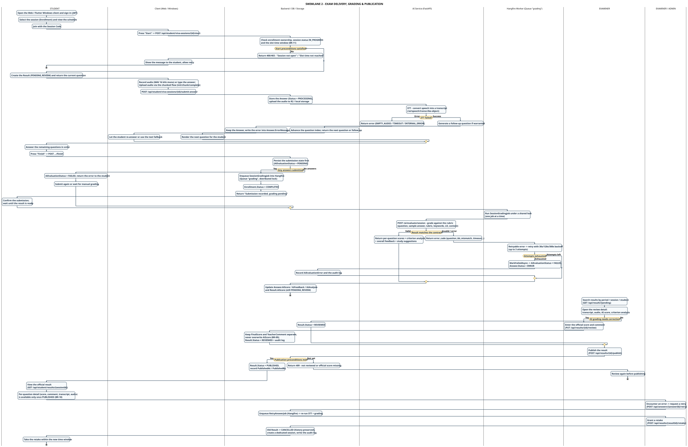

# SWL-2-EN – Exam Delivery, Grading & Publication (full version)

**Part of work:** Member 5 – Swimlane Diagram
**Source of truth:** SRS 07/11/2026 + `VivaSessionService`, `SessionGradingJob`, `SessionGradingService`, `ResultService`, `RetakeService`, `RetryAnswerController`, `StudentResultController`, `ai-service/app/api/*`.
**Scope:** the whole cycle from the student starting the exam through publication, including the incident-handling branches.

> ⚠️ **This version has 6 lanes and is therefore very wide (7042px).** When dropping it into a slide, prefer the two split versions:
> [SWL-2A-EN – Exam Delivery & AI Grading](./swimlane-02a-exam-delivery-grading_en.md) and [SWL-2B-EN – Review, Publication & Incident Handling](./swimlane-02b-review-publish-incident_en.md).

| | |
|---|---|
| **PlantUML source** | `swimlane_02_exam_grading_publish_en.puml` |
| **Images** | `SWIMLANE_02_EXAM_GRADING_PUBLISH_EN.svg` / `.png` |
| **Vietnamese version** | [`swimlane-02-exam-grading-publish.md`](./swimlane-02-exam-grading-publish.md) |
| **Split A** | [`swimlane-02a-exam-delivery-grading_en.md`](./swimlane-02a-exam-delivery-grading_en.md) |
| **Split B** | [`swimlane-02b-review-publish-incident_en.md`](./swimlane-02b-review-publish-incident_en.md) |

---

## Lanes and responsibility boundaries

| Lane | Holds responsibility for | SRS reference |
|---|---|---|
| **STUDENT** | Deciding to participate, answering sequentially, viewing published results | UC-07, UC-11, FR-STU-01…07 |
| **Client (Web / Windows)** | Audio capture (WAV 16 kHz mono), chunked upload, rendering questions/follow-ups, local drafts | FR-STU-03, FR-STU-08, NFR-REL-02 |
| **Backend / DB / Storage** | Business-rule checks, persisting Answer/Result, R2 audio, audit log | FR-DATA-01/02, BR-11/12/18 |
| **AI Service (FastAPI)** | STT, follow-up generation, rubric-based grading | FR-AI-01/02, BR-13 |
| **Hangfire Worker (Queue "grading")** | Whole-session grading from a queue, backoff retry, distributed lock (one job at a time) | FR-STU-06, BR-15, NFR-PERF-03 |
| **EXAMINER / ADMIN** | Evidence review, official grading, publication, retry, retake grant | UC-09, UC-10, FR-EXA-01…06 |

---

## Handover points

1. **STUDENT → Backend (Start)** — `POST /api/student/viva-sessions/{id}/start` checks at once: enrollment exists, session `IN_PROGRESS`, `now >= session.StartTime`, `now < session.EndTime`, and the student is inside the slot window (`BR-11`). Failure → 400/403 and the student must retry.
2. **Client → Backend (Submit)** — audio travels through the chunked flow (`init` → `chunk` → `complete`) to reduce the risk of losing large files; the backend **does not trust** the object key sent by the client and instead looks up `media_uploads` to match `SessionId/StudentId/QuestionId` + `COMPLETED` status.
3. **Backend → AI Service (STT)** — the AI returns a transcript; **audio is evidence, the rubric grades TEXT** (BR-13). The AI **does not** score pronunciation, emotion or imagery.
4. **AI Service → Backend (follow-up)** — when the AI produces a follow-up the question index **does not advance** – the student must answer the follow-up before moving on.
5. **Backend → Hangfire** — `finish` **persists the submission state first**, then enqueues. If the queue rejects the job the submission is still safe and can be sent again.
6. **Hangfire → AI Service → Hangfire** — *retryable* errors are retried with 30s/120s/300s backoff; *non-retryable* errors (contract mismatch, `question_ids_mismatch`) stop immediately. After the last attempt → `AiEvaluationStatus = FAILED`, `Answer.Status = ERROR`.
7. **Backend → EXAMINER** — the result sits in `PENDING_REVIEW`. **The AI score and the official score are two separate fields** – `FinalScore` never overwrites `AiScore` (BR-09). The AI **never publishes by itself**.
8. **EXAMINER → STUDENT** — only once `Result.Status = PUBLISHED` can the student see the details (score, comment, transcript, audio) via `GET /api/student/results/{sessionId}` (BR-18).
9. **EXAMINER → Backend (incident)** — *Retry answer* (re-run STT + grading) is entirely different from *Retake* (grant a new attempt). A retake moves the old Result to `CANCELLED` while **preserving the full history** of answers/audio/transcripts and writes an `AuditLog` (BR-16, BR-17).

---

## Error branches

| Branch | Condition | Handling | Responsible lane |
|---|---|---|---|
| Start preconditions not met | BR-11 | 400/403, client shows the message, student retries | Client → STUDENT |
| STT failure | FR-AI-03 (Partial) | `EMPTY_AUDIO` / `TIMEOUT` / `INTERNAL_ERROR`, error stored on the Answer, student re-answers or uses the text fallback | Client → STUDENT |
| No answers submitted | FR-STU-04 | `AiEvaluationStatus = FAILED`, student resubmits or the examiner grades manually | STUDENT |
| Grading error (retryable) | BR-15, NFR-PERF-03 | Hangfire retries up to 3 times, backoff 30s/120s/300s | Hangfire Worker |
| Grading error (non-retryable) / attempts exhausted | FR-AI-02 | `FAILED` + `Answer.Status = ERROR` + audit log, examiner grades manually or retries | Hangfire → Backend |
| Publish before review / official score missing | BR-10 | API 409, examiner reviews again then publishes | EXAMINER |
| Request a re-check (retry answer) | FR-EXA-05 | `POST /api/answers/{answerId}/retry` → enqueues `RetryAnswerJob` to re-run STT + grading | EXAMINER/ADMIN |
| Incident requiring a new attempt (retake) | FR-EXA-06, BR-16/17 | Old Result → `CANCELLED`, a dedicated session is created, history preserved, audit log written | EXAMINER/ADMIN |

---

## Traceability

| SRS requirement | Where it appears |
|---|---|
| FR-STU-01/02, BR-11 | STUDENT/Backend – start session & precondition error branch |
| FR-STU-03/04/08 | Client – record audio, chunked upload, local drafts |
| FR-STU-05, BR-14 | AI/Backend – follow-up merged into the original Answer |
| FR-STU-06, BR-15 | Backend/Hangfire – finish → enqueue → retry backoff |
| FR-AI-01/02, BR-13 | AI Service – STT + rubric grading on text, contract validation |
| FR-EXA-01/02/03, BR-09 | EXAMINER – evidence review, official score kept separate from the AI score |
| FR-EXA-04, BR-10 | EXAMINER – conditional publication, 409 when not reviewed |
| FR-EXA-05/06, BR-16/17 | EXAMINER – retry answer & retake grant |
| FR-STU-07, BR-18 | STUDENT – results visible only once PUBLISHED |
| FR-DATA-01/02 | Backend – audit log, audio metadata separated, playback URL |

---

## Key points for the presentation

- The diagram follows the **actual implementation**, not a theoretical model: every API endpoint is written inside the action box.
- **The AI never publishes a score** – the official decision belongs to the examiner (`Result.Status`: PENDING_REVIEW → REVIEWED → PUBLISHED).
- **Submitting is not grading**: `finish` only persists and enqueues; real grading happens in the worker and may be retried several times.
- **Retry ≠ Retake**: a retry re-runs the grading pipeline; a retake grants a new attempt and invalidates the old result (history preserved).
- **Audio is evidence, the rubric grades text** – no pronunciation, emotion or image scoring.
- **Every error branch returns to the lane that owns the handling**, it never just dies mid-flow.

---

[[← Swimlane index](./swimlane-index-en.md)] · [[SWL-1-EN – Preparation & Scheduling ←](./swimlane-01-preparation-scheduling_en.md) · [[SWL-2A-EN ←](./swimlane-02a-exam-delivery-grading_en.md) · [[SWL-2B-EN ←](./swimlane-02b-review-publish-incident_en.md)]
