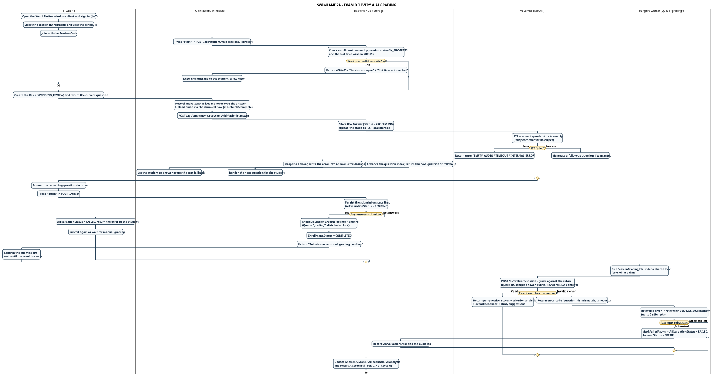

# SWL-2A-EN – Exam Delivery & AI Grading

**Part of work:** Member 5 – Swimlane Diagram (part 1/2 of SWL-2)
**Source of truth:** SRS 07/11/2026 + `VivaSessionService`, `SessionGradingJob`, `SessionGradingService`, `ChunkedAudioController`, `ai-service/app/api/speech.py`, `ai-service/app/api/evaluation.py`.
**Scope:** from `Start` → precondition check → record & upload → STT + follow-up → `finish` → enqueue Hangfire → worker grades against the rubric (with the retry branch) → `AiScore` is written. The result stays in `PENDING_REVIEW` — review and publication are in [SWL-2B-EN](./swimlane-02b-review-publish-incident_en.md).

| | |
|---|---|
| **PlantUML source** | `swimlane_02a_exam_delivery_grading_en.puml` |
| **Images** | `SWIMLANE_02A_EXAM_DELIVERY_GRADING_EN.svg` / `.png` |
| **Vietnamese version** | [`swimlane-02a-exam-delivery-grading.md`](./swimlane-02a-exam-delivery-grading.md) |
| **Full version** | [`swimlane-02-exam-grading-publish_en.md`](./swimlane-02-exam-grading-publish_en.md) |

---

## Lanes and responsibility boundaries

| Lane | Holds responsibility for | SRS reference |
|---|---|---|
| **STUDENT** | Deciding to participate, answering sequentially | UC-07, FR-STU-01…06 |
| **Client (Web / Windows)** | Audio capture (WAV 16 kHz mono), chunked upload, rendering questions/follow-ups, local drafts | FR-STU-03, FR-STU-08, NFR-REL-02 |
| **Backend / DB / Storage** | Business-rule checks, persisting Answer/Result, R2 audio | FR-DATA-01/02, BR-11/12 |
| **AI Service (FastAPI)** | STT, follow-up generation, rubric-based grading | FR-AI-01/02, BR-13 |
| **Hangfire Worker (Queue "grading")** | Whole-session grading from a queue, backoff retry, distributed lock (one job at a time) | FR-STU-06, BR-15, NFR-PERF-03 |

---

## Handover points

1. **STUDENT → Backend (Start)** — `POST /api/student/viva-sessions/{id}/start` checks at once: enrollment exists, session `IN_PROGRESS`, `now >= session.StartTime`, `now < session.EndTime`, and the student is inside the slot window (`BR-11`). Failure → 400/403 and the student must retry.
2. **Client → Backend (Submit)** — audio travels through the chunked flow (`init` → `chunk` → `complete`) to reduce the risk of losing large files; the backend **does not trust** the object key sent by the client and instead looks up `media_uploads` to match `SessionId/StudentId/QuestionId` + `COMPLETED` status.
3. **Backend → AI Service (STT)** — the AI returns a transcript; **audio is evidence, the rubric grades TEXT** (BR-13). The AI **does not** score pronunciation, emotion or imagery.
4. **AI Service → Backend (follow-up)** — when the AI produces a follow-up the question index **does not advance** – the student must answer the follow-up before moving on.
5. **Backend → Hangfire** — `finish` **persists the submission state first**, then enqueues. If the queue rejects the job the submission is still safe and can be sent again.
6. **Hangfire → AI Service → Hangfire** — *retryable* errors are retried with 30s/120s/300s backoff; *non-retryable* errors (contract mismatch, `question_ids_mismatch`) stop immediately. After the last attempt → `AiEvaluationStatus = FAILED`, `Answer.Status = ERROR`.

---

## Error branches

| Branch | Condition | Handling | Responsible lane |
|---|---|---|---|
| Start preconditions not met | BR-11 | 400/403, client shows the message, student retries | Client → STUDENT |
| STT failure | FR-AI-03 (Partial) | `EMPTY_AUDIO` / `TIMEOUT` / `INTERNAL_ERROR`, error stored on the Answer, student re-answers or uses the text fallback | Client → STUDENT |
| No answers submitted | FR-STU-04 | `AiEvaluationStatus = FAILED`, student resubmits or the examiner grades manually | STUDENT |
| Grading error (retryable) | BR-15, NFR-PERF-03 | Hangfire retries up to 3 times, backoff 30s/120s/300s | Hangfire Worker |
| Grading error (non-retryable) / attempts exhausted | FR-AI-02 | `FAILED` + `Answer.Status = ERROR` + audit log, examiner grades manually or retries | Hangfire → Backend |

---

## Traceability

| SRS requirement | Where it appears |
|---|---|
| FR-STU-01/02, BR-11 | STUDENT/Backend – start session & precondition error branch |
| FR-STU-03/04/08 | Client – record audio, chunked upload, local drafts |
| FR-STU-05, BR-14 | AI/Backend – follow-up merged into the original Answer |
| FR-STU-06, BR-15 | Backend/Hangfire – finish → enqueue → retry backoff |
| FR-AI-01/02, BR-13 | AI Service – STT + rubric grading on text, contract validation |

---

## Key points for the presentation

- **Submitting is not grading** — `finish` only persists and enqueues; real grading happens in the worker and may be retried several times.
- **Audio is evidence, the rubric grades text** — no pronunciation, emotion or image scoring.
- **A follow-up freezes the index** — the student answers the follow-up before moving to the next main question.
- **Persist first, enqueue second** — if the queue is down the submission survives and can be sent again.
- **Distinguishing an STT failure from a blank answer is a proposed target** (FR-AI-03) – today it is only recorded in `Answer.ErrorMessage`.

---

[[← Swimlane index](./swimlane-index-en.md)] · [[SWL-1-EN – Preparation & Scheduling ←](./swimlane-01-preparation-scheduling_en.md) · [[SWL-2B-EN – Review & Publication →](./swimlane-02b-review-publish-incident_en.md)]
