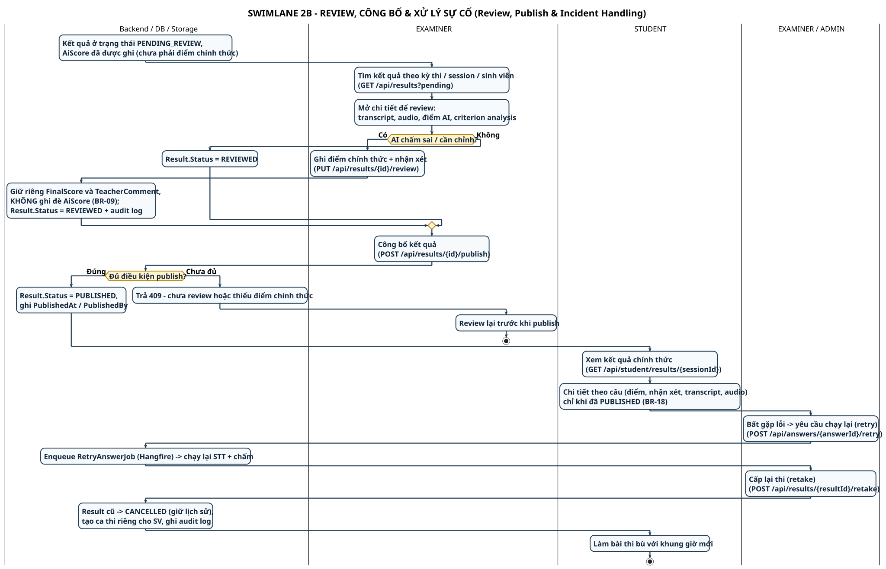

# SWL-2B – Review, Công bố & Xử lý sự cố (Review, Publication & Incident Handling)

**Phần công việc:** Thành viên 5 – Swimlane Diagram (phần 2/2 của SWL-2)
**Nguồn đối chiếu:** SRS 07/11/2026 + `ResultService` (Search / ReviewResultAsync / PublishResultAsync), `RetakeService`, `RetryAnswerController`, `StudentResultController`.
**Phạm vi:** từ `PENDING_REVIEW` → Examiner review & chấm điểm chính thức → publish → SV xem kết quả → nhánh **yêu cầu xem lại** (retry answer) → nhánh **cấp lại thi** (retake). Phần làm bài & chấm AI nằm ở [SWL-2A](./swimlane-02a-exam-delivery-grading.md).

| | |
|---|---|
| **Nguồn PlantUML** | `swimlane_02b_review_publish_incident.puml` |
| **Ảnh** | `SWIMLANE_02B_REVIEW_PUBLISH_INCIDENT.svg` / `.png` |
| **Bản tiếng Anh** | [`swimlane-02b-review-publish-incident_en.md`](./swimlane-02b-review-publish-incident_en.md) |
| **Bản đầy đủ** | [`swimlane-02-exam-grading-publish.md`](./swimlane-02-exam-grading-publish.md) |

---

## Các lane và thông tin trách nhiệm

| Lane | Giữ thông tin/trách nhiệm gì | Tham chiếu SRS |
|---|---|---|
| **Backend / DB / Storage** | Trạng thái Result, điểm chính thức, audit log, lịch sử bài thi bị vô hiệu hóa | FR-DATA-01, BR-09/10/16/17 |
| **EXAMINER** | Review bằng chứng (transcript/audio/AI score), chấm điểm chính thức, publish | UC-09, FR-EXA-01…04 |
| **EXAMINER / ADMIN** | Xử lý sự cố: retry answer, cấp lại thi (retake) | UC-10, FR-EXA-05/06 |
| **STUDENT** | Xem kết quả chi tiết sau khi đã công bố; làm bài thi bù | UC-11, FR-STU-07, BR-18 |

---

## Các điểm chuyển trách nhiệm (handover)

1. **Backend → EXAMINER** — Kết quả chỉ ở `PENDING_REVIEW`. **Điểm AI và điểm chính thức là hai trường khác nhau** – `FinalScore` không ghi đè `AiScore` (BR-09). AI **không bao giờ** tự công bố.
2. **EXAMINER → Backend (Review)** — `PUT /api/results/{id}/review` ghi `FinalScore` + `TeacherComment` cho từng câu và cho cả bài, kèm audit log. Điểm tổng được kiểm tra nằm trong khoảng `[0, tổng trọng số]` – không dùng thang 10 cố định (NFR-DATA-03).
3. **EXAMINER → Backend (Publish)** — `POST /api/results/{id}/publish` yêu cầu: đã `REVIEWED`, mọi câu đã có điểm (chính thức hoặc AI đã `EVALUATED`). Nếu thiếu → **409** và Examiner phải review lại (BR-10).
4. **Backend → STUDENT** — Chỉ khi `Result.Status = PUBLISHED`, SV mới xem được chi tiết (điểm, nhận xét, transcript, audio) qua `GET /api/student/results/{sessionId}` (BR-18). Chưa publish → API trả về payload rỗng.
5. **EXAMINER → Backend (Incident: retry)** — `POST /api/answers/{answerId}/retry` chạy lại STT + chấm cho **một câu**; `RetryAnswerJob` được enqueue vào Hangfire. Đây là "yêu cầu xem lại", **không** phải cấp lại thi.
6. **EXAMINER → Backend (Retake)** — `POST /api/results/{resultId}/retake` đưa Result cũ về `CANCELLED` nhưng **giữ nguyên lịch sử** answer/audio/transcript, tạo ca thi riêng cho SV với khung giờ mới, ghi `AuditLog` (`RETAKE_GRANTED`) (BR-16, BR-17).
7. **Backend → STUDENT (Retake)** — SV làm bài thi bù trong ca mới; mọi bước kiểm tra cửa sổ thời gian của retake vẫn áp dụng.

---

## Các nhánh lỗi

| Nhánh | Điều kiện | Xử lý | Lane chịu trách nhiệm |
|---|---|---|---|
| Publish khi chưa review / thiếu điểm chính thức | BR-10, FR-EXA-04 | API 409, Examiner review lại rồi publish | EXAMINER |
| Điểm tổng nằm ngoài khoảng hợp lệ | NFR-DATA-03 | API 400, Examiner chỉnh lại điểm từng câu | EXAMINER |
| Yêu cầu xem lại (retry answer) | FR-EXA-05 | `POST /api/answers/{answerId}/retry` → enqueue `RetryAnswerJob` chạy lại STT + chấm | EXAMINER/ADMIN |
| Sự cố cần thi lại (retake) | FR-EXA-06, BR-16/17 | Result cũ → `CANCELLED`, tạo ca thi riêng cho SV, giữ lịch sử, ghi audit log | EXAMINER/ADMIN |
| Retake chưa bắt đầu / đã dùng / hết hạn | BR-17 | API 400/403, SV phải báo GV | STUDENT |

---

## Traceability

| Yêu cầu SRS | Thể hiện ở đâu |
|---|---|
| FR-EXA-01/02/03, BR-09 | EXAMINER – review bằng chứng, điểm chính thức tách khỏi điểm AI |
| FR-EXA-04, BR-10 | EXAMINER – publish có điều kiện, 409 nếu chưa review |
| FR-EXA-05/06, BR-16/17 | EXAMINER/ADMIN – retry answer & cấp lại thi |
| FR-STU-07, BR-18 | STUDENT – xem kết quả chỉ khi PUBLISHED |
| FR-DATA-01 | Backend – audit log cho mọi hành động review/publish/retake |

---

## Điểm cần nhấn mạnh khi thuyết trình

- **AI không bao giờ công bố điểm** – quyết định chính thức thuộc EXAMINER (`PENDING_REVIEW → REVIEWED → PUBLISHED`).
- **Review ≠ Publish** – hai bước tách biệt; publish bị chặn (409) nếu chưa review hoặc thiếu điểm chính thức.
- **Retry ≠ Retake** – retry là chạy lại pipeline chấm **một câu**; retake là cấp lại **lượt thi** và vô hiệu hóa kết quả cũ (có giữ lịch sử).
- **Không có thang điểm cố định** – tổng điểm = tổng trọng số của đề, không giả định thang 10 (NFR-DATA-03).
- **Retake không xóa dữ liệu** – lịch sử bài cũ vẫn còn để đối soát.

---

[[← Danh mục Swimlane](./swimlane-index.md)] · [[SWL-2A – Làm bài & Chấm AI ←](./swimlane-02a-exam-delivery-grading.md) · [[SWL-1 – Chuẩn bị & Tổ chức thi ←](./swimlane-01-preparation-scheduling.md)]
