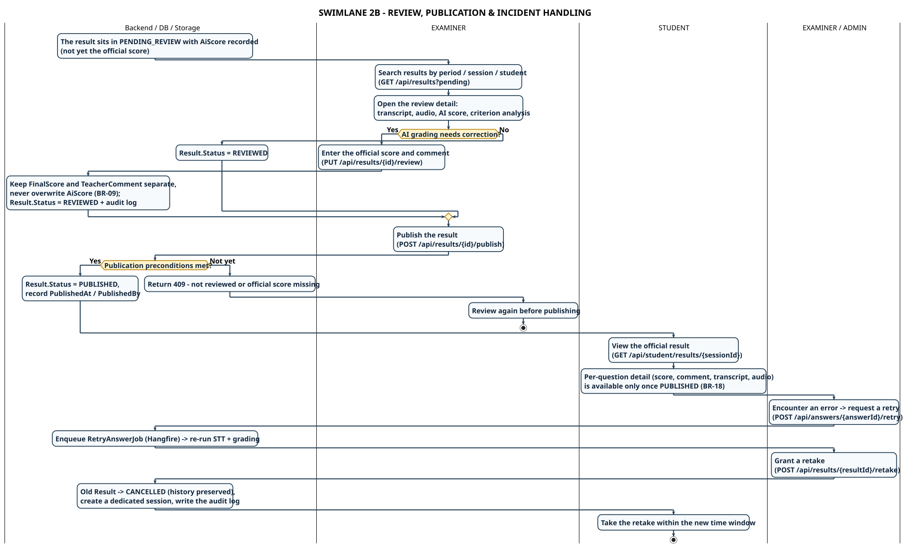

# SWL-2B-EN – Review, Publication & Incident Handling

**Part of work:** Member 5 – Swimlane Diagram (part 2/2 of SWL-2)
**Source of truth:** SRS 07/11/2026 + `ResultService` (Search / ReviewResultAsync / PublishResultAsync), `RetakeService`, `RetryAnswerController`, `StudentResultController`.
**Scope:** from `PENDING_REVIEW` → examiner review & official grading → publish → student views the result → the **request a re-check** branch (retry answer) → the **retake** branch. Exam delivery and AI grading are in [SWL-2A-EN](./swimlane-02a-exam-delivery-grading_en.md).

| | |
|---|---|
| **PlantUML source** | `swimlane_02b_review_publish_incident_en.puml` |
| **Images** | `SWIMLANE_02B_REVIEW_PUBLISH_INCIDENT_EN.svg` / `.png` |
| **Vietnamese version** | [`swimlane-02b-review-publish-incident.md`](./swimlane-02b-review-publish-incident.md) |
| **Full version** | [`swimlane-02-exam-grading-publish_en.md`](./swimlane-02-exam-grading-publish_en.md) |

---

## Lanes and responsibility boundaries

| Lane | Holds responsibility for | SRS reference |
|---|---|---|
| **Backend / DB / Storage** | Result state, official score, audit log, history of invalidated attempts | FR-DATA-01, BR-09/10/16/17 |
| **EXAMINER** | Evidence review (transcript/audio/AI score), official grading, publication | UC-09, FR-EXA-01…04 |
| **EXAMINER / ADMIN** | Incident handling: retry answer, retake grant | UC-10, FR-EXA-05/06 |
| **STUDENT** | Viewing detailed results after publication; taking the retake | UC-11, FR-STU-07, BR-18 |

---

## Handover points

1. **Backend → EXAMINER** — the result sits in `PENDING_REVIEW`. **The AI score and the official score are two separate fields** – `FinalScore` never overwrites `AiScore` (BR-09). The AI **never** publishes by itself.
2. **EXAMINER → Backend (review)** — `PUT /api/results/{id}/review` writes `FinalScore` + `TeacherComment` per answer and for the whole attempt, with an audit log. The overall score is validated against `[0, total weight]` – no fixed 10-point scale is assumed (NFR-DATA-03).
3. **EXAMINER → Backend (publish)** — `POST /api/results/{id}/publish` requires: already `REVIEWED`, and every answer has a score (official, or AI `EVALUATED`). If anything is missing → **409** and the examiner must review again (BR-10).
4. **Backend → STUDENT** — only once `Result.Status = PUBLISHED` can the student see the details (score, comment, transcript, audio) via `GET /api/student/results/{sessionId}` (BR-18). Before publication the API returns an empty payload.
5. **EXAMINER → Backend (incident: retry)** — `POST /api/answers/{answerId}/retry` re-runs STT + grading for **one answer**; a `RetryAnswerJob` is enqueued into Hangfire. This is a "request a re-check", **not** a retake.
6. **EXAMINER → Backend (retake)** — `POST /api/results/{resultId}/retake` moves the old Result to `CANCELLED` while **preserving the full history** of answers/audio/transcripts, creates a dedicated session for the student with a new time window, and writes an `AuditLog` (`RETAKE_GRANTED`) (BR-16, BR-17).
7. **Backend → STUDENT (retake)** — the student takes the retake in the new session; all retake time-window checks still apply.

---

## Error branches

| Branch | Condition | Handling | Responsible lane |
|---|---|---|---|
| Publish before review / official score missing | BR-10, FR-EXA-04 | API 409, examiner reviews again then publishes | EXAMINER |
| Overall score outside the valid range | NFR-DATA-03 | API 400, examiner corrects the per-answer scores | EXAMINER |
| Request a re-check (retry answer) | FR-EXA-05 | `POST /api/answers/{answerId}/retry` → enqueues `RetryAnswerJob` to re-run STT + grading | EXAMINER/ADMIN |
| Incident requiring a new attempt (retake) | FR-EXA-06, BR-16/17 | Old Result → `CANCELLED`, a dedicated session is created, history preserved, audit log written | EXAMINER/ADMIN |
| Retake not started / already consumed / expired | BR-17 | API 400/403, the student must contact the examiner | STUDENT |

---

## Traceability

| SRS requirement | Where it appears |
|---|---|
| FR-EXA-01/02/03, BR-09 | EXAMINER – evidence review, official score kept separate from the AI score |
| FR-EXA-04, BR-10 | EXAMINER – conditional publication, 409 when not reviewed |
| FR-EXA-05/06, BR-16/17 | EXAMINER/ADMIN – retry answer & retake grant |
| FR-STU-07, BR-18 | STUDENT – results visible only once PUBLISHED |
| FR-DATA-01 | Backend – audit log for every review / publish / retake action |

---

## Key points for the presentation

- **The AI never publishes a score** – the official decision belongs to the examiner (`PENDING_REVIEW → REVIEWED → PUBLISHED`).
- **Review ≠ Publish** – two separate steps; publication is blocked (409) when the attempt was not reviewed or the official score is missing.
- **Retry ≠ Retake** – a retry re-runs the grading pipeline for **one answer**; a retake grants a **new attempt** and invalidates the old result (history preserved).
- **No fixed score scale** – the total equals the paper weight; a universal 10-point scale is not assumed (NFR-DATA-03).
- **A retake never deletes data** – the previous attempt stays available for reconciliation.

---

[[← Swimlane index](./swimlane-index-en.md)] · [[SWL-2A-EN – Exam Delivery & AI Grading ←](./swimlane-02a-exam-delivery-grading_en.md) · [[SWL-1-EN – Preparation & Scheduling ←](./swimlane-01-preparation-scheduling_en.md)]
