# AIVES - TỔNG QUAN HỆ THỐNG VÀ CHI TIẾT CÁC LUỒNG HOẠT ĐỘNG
**AI-powered Viva Examination System (SWD392)**
*Phiên bản: 2.0 (Kiến trúc Bất đồng bộ, Cloudflare R2 & Phân quyền Tách biệt Khảo thí - SoD)*

---

## 1. TỔNG QUAN HỆ THỐNG (SYSTEM OVERVIEW)

### 1.1. Mục tiêu & Sứ mệnh
**AIVES** (*AI-powered Viva Examination System*) là nền tảng thi vấn đáp trực tuyến ứng dụng Trí tuệ Nhân tạo thế hệ mới. Hệ thống giải quyết các thách thức lớn của phương pháp thi vấn đáp truyền thống:
* **Tính đồng bộ & Chuẩn hóa**: Tự động sinh câu hỏi và thang chấm (Rubric) bám sát nội dung học liệu (`CONTENT`) và Chuẩn đầu ra môn học (`LEARNING_OUTCOMES`).
* **Tiết kiệm nguồn lực**: Giảm tải áp lực tổ chức phỏng vấn trực tiếp cho giảng viên nhờ trợ lý ảo AI hỏi thi tương tác bằng giọng nói (Voice-based Viva).
* **Minh bạch & Khả năng kiểm toán (Audit Trail)**: Ghi lại đầy đủ âm thanh gốc trên Cloudflare R2, bản gỡ băng (transcript), đánh giá tiêu chí của AI và nhận xét phúc khảo của cán bộ Khảo thí ([BR-15](file:///d:/FPT/GitHub/AIVES_FPT/docs/documentation/AIVES_SRS_Sheet_VI_v3%20-%202.%20Busiess%20Rules.csv#L16)).
* **Phân tách nhiệm vụ (Separation of Duties - SoD)**: Độc lập hóa vai trò Chuyên môn (`STAFF` - tạo đề, quản lý lớp) và Khảo thí (`EXAMINER` - thẩm định, duyệt và công bố bảng điểm chính thức).

---

### 1.2. Kiến trúc Kỹ thuật (Architecture & Tech Stack)

Hệ thống được thiết kế theo mô hình **Microservices phân tầng kết hợp Kiến trúc Bất đồng bộ (Asynchronous Event/Job Queue)**, tuân thủ nguyên tắc [BR-14](file:///d:/FPT/GitHub/AIVES_FPT/docs/documentation/AIVES_SRS_Sheet_VI_v3%20-%202.%20Busiess%20Rules.csv#L15): *Frontend không bao giờ gọi trực tiếp AI Service hoặc Storage; mọi yêu cầu đều được điều phối qua Backend API*.

```
[ Frontend: React 19 SPA ]
          │ (HTTPS / JSON / JWT Bearer)
          ▼
[ Backend: ASP.NET Core 8 Web API ] ◄──► [ Neon Serverless PostgreSQL 16 ]
   ├── S3 SDK Stream ──► [ Cloudflare R2 Storage (Private Audio Bucket) ]
   └── Enqueue Job   ──► [ Message Queue / Background Job Storage (Hangfire/Redis) ]
                               │
                               ▼ (Pull Task)
                 [ AI Worker Microservice: Python FastAPI / Worker ]
                    ├── Faster-Whisper (Speech-to-Text - Local/GPU)
                    └── Google Gemini 1.5 Flash / OpenAI (Rubric Evaluation)
```

* **Frontend Web Application**: React 19, TypeScript, Vite, Tailwind CSS, Web Audio API (`MediaRecorder`).
* **Backend Web API**: ASP.NET Core 8, C#, Entity Framework Core, Npgsql, AWSSDK.S3 (kết nối R2), Hangfire (quản lý hàng đợi tác vụ ngầm).
* **Cloudflare R2 Object Storage**: Lưu trữ an toàn toàn bộ file âm thanh bài thi sinh viên (`.webm`/`.wav`) theo chuẩn S3 API, chế độ Private Bucket, cấp phát bằng Presigned URL.
* **Message Queue / Job Broker**: Điều phối tác vụ bóc băng (STT) và chấm điểm Rubric (Background Worker), đảm bảo tính sẵn sàng cao và không gây nghẽn kết nối HTTP.
* **AI Worker Microservice**: Python 3.11+, FastAPI, Faster-Whisper (STT), Edge-TTS (TTS), Google Gemini 1.5 Flash SDK.
* **Database**: Neon Serverless PostgreSQL 16 (PgBouncer Connection Pooling cho runtime API, Direct Connection cho EF Migrations).

---

### 1.3. Mô hình Kiến trúc C4 Đơn giản hóa

#### A. C0 - Sơ đồ Ngữ cảnh Hệ thống (System Context Diagram)
*Mục đích: Trả lời câu hỏi "Hệ thống này cho ai dùng, làm được việc gì, và kết nối với AI/Cloud bên ngoài như thế nào?"*

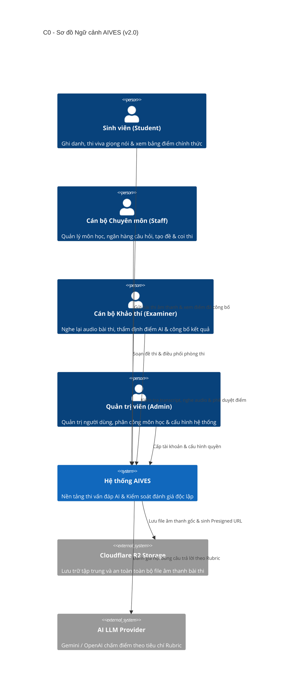

| Thành phần | Vai trò thực tế | Nhiệm vụ chính trong mô hình mới |
|---|---|---|
| **Sinh viên (Student)** | Thí sinh | Đeo tai nghe, bật mic trả lời câu hỏi trực tiếp trên web; nhận kết quả khi đã được duyệt. |
| **Cán bộ Chuyên môn (Staff)** | Giảng viên bộ môn | Soạn tài liệu chuẩn (`.md`), ngân hàng câu hỏi, tạo ca thi và giám sát gian lận lúc thi. |
| **Cán bộ Khảo thí (Examiner)** | Phòng Khảo thí & Đảm bảo CL | Độc lập thẩm định điểm AI, nghe lại ghi âm gốc, điều chỉnh điểm phúc khảo và bấm **Công bố kết quả (`PUBLISH`)**. |
| **Quản trị viên (Admin)** | Quản trị IT | Cấp quyền cho Staff/Examiner, tạo danh mục môn học, bảo trì hệ thống. |
| **Cloudflare R2** | Kho âm thanh số an toàn | Lưu toàn bộ file ghi âm giọng nói của sinh viên, bảo vệ quyền riêng tư sinh trắc học. |
| **Hệ thống AI Worker** | Giám khảo & Thư ký ảo | Bóc băng âm thanh ngầm (Faster-Whisper) và chấm điểm chi tiết theo Rubric (LLM). |

---

#### B. C1 - Sơ đồ Khối Thành phần (Container Diagram)
*Mục đích: Phác họa cấu trúc chi tiết bên trong hệ thống với cơ chế lưu trữ Cloudflare R2 và Hàng đợi tác vụ.*

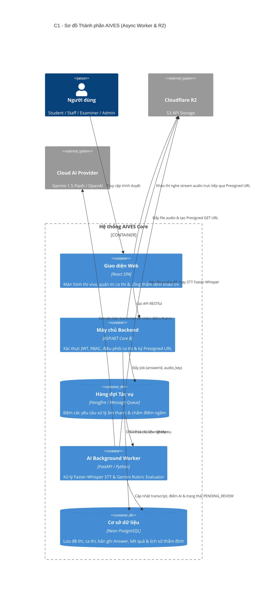

##### 🏢 Bảng đối chiếu mô hình trường học đại học tiêu chuẩn:
| Bộ phận kỹ thuật | Tương đương trong thực tế | Vai trò cụ thể |
|---|---|---|
| **1. Cổng Web React** | **Phòng thi & Bàn làm việc** | Nơi sinh viên nói vào mic và cán bộ làm việc theo phân quyền. |
| **2. Backend .NET 8** | **Ban Thư ký kỳ thi** | Điều phối ca thi, kiểm tra tư cách dự thi, tiếp nhận bài thi và đóng dấu mã đề. |
| **3. Cloudflare R2** | **Kho Lưu trữ Băng ghi âm Bài thi** | Bảo quản an toàn bằng chứng bài thi vấn đáp, không thể thất lạc, phân quyền chặt chẽ. |
| **4. Hàng đợi & AI Worker** | **Tổ Chấm thi Tự động** | Tự động nghe lại băng ghi âm, chép lời thành văn bản và chấm điểm khách quan theo Rubric. |
| **5. Cơ sở dữ liệu Neon** | **Sổ bộ Bảng điểm Trung tâm** | Lưu giữ trạng thái bài thi, đề thi, lịch sử phúc tra điểm của cán bộ Khảo thí. |
| **6. Cán bộ Khảo thí** | **Hội đồng Thẩm định & Công bố điểm** | Kiểm tra bài thi có điểm nghi vấn, nghe lại băng ghi âm và chính thức ký duyệt xuất điểm. |

---

### 1.4. Ma trận Phân quyền Người dùng (RBAC Matrix)

Áp dụng chặt chẽ nguyên tắc **Phân tách nhiệm vụ (Separation of Duties - SoD)**: `STAFF` và `EXAMINER` là hai thực thể quyền lực độc lập.

| Nhóm Chức năng / Hành động | ADMIN | STAFF | EXAMINER | STUDENT |
| :--- | :---: | :---: | :---: | :---: |
| **Quản trị người dùng & Phân vai (Roles)** | **CRUD** | ❌ | ❌ | ❌ |
| **Quản lý Môn học (`Course`)** | **CRUD** | View | View | View |
| **Upload Tài liệu học liệu chuẩn (`.md`)** | View | **CRUD** | View | ❌ |
| **Quản lý Ngân hàng câu hỏi (`QuestionBank`)** | View | **CRUD** | View | ❌ |
| **Tạo Đề thi (`Exam`) & Lên lịch Ca thi (`ExamSession`)** | View | **CRUD** | View | ❌ |
| **Mở phòng thi & Giám sát ca thi trực tuyến (Live Monitor)** | View | **Full** | View | ❌ |
| **Tham gia thi vấn đáp (Nộp Voice/Text)** | ❌ | ❌ | ❌ | **Execute** |
| **Xem danh sách bài thi chờ thẩm định (`PENDING_REVIEW`)** | View | View | **Full** | ❌ |
| **Nghe lại file ghi âm bài thi (Audio Playback qua R2)** | View | View | **Full** | ❌ |
| **Điều chỉnh điểm phúc khảo (`FinalScore`, `TeacherComment`)** | ❌ | ❌ | **Full** | ❌ |
| **Phê duyệt & Công bố bảng điểm chính thức (`PUBLISH`)** | ❌ | ❌ | **Execute** | ❌ |
| **Tra cứu bảng điểm & nhận xét cá nhân** | View | View | View | **View (sau khi Publish)** |

---

## 2. CHI TIẾT TOÀN BỘ CÁC LUỒNG HOẠT ĐỘNG (DETAILED SYSTEM FLOWS)

---

### LUỒNG 1: Xác thực & Quản trị Hệ thống (Authentication & Administration)

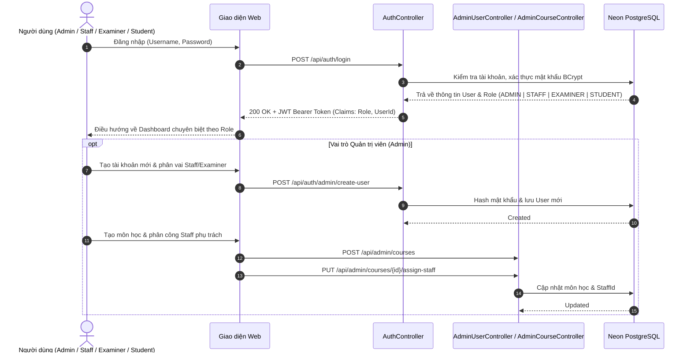

#### Quy trình chi tiết:
1. **Đăng nhập & Cấp phát JWT ([BR-13](file:///d:/FPT/GitHub/AIVES_FPT/docs/documentation/AIVES_SRS_Sheet_VI_v3%20-%202.%20Busiess%20Rules.csv#L14))**:
   - Xác thực danh tính qua `POST /api/auth/login`, mật khẩu mã hóa BCrypt.
   - JWT Token chứa Claims: `NameIdentifier`, `Role` (`ADMIN`, `STAFF`, `EXAMINER`, `STUDENT`).
2. **Quản trị người dùng & Phân công chuyên môn ([BR-01](file:///d:/FPT/GitHub/AIVES_FPT/docs/documentation/AIVES_SRS_Sheet_VI_v3%20-%202.%20Busiess%20Rules.csv#L2), [BR-02](file:///d:/FPT/GitHub/AIVES_FPT/docs/documentation/AIVES_SRS_Sheet_VI_v3%20-%202.%20Busiess%20Rules.csv#L3))**:
   - Admin quản trị tài khoản, chỉ định rõ nhân sự nào thuộc vai trò `STAFF` (giảng dạy/chuyên môn) và nhân sự nào thuộc vai trò `EXAMINER` (khảo thí độc lập).
   - Admin tạo môn học `POST /api/admin/courses` và gán `STAFF` phụ trách.

---

### LUỒNG 2: Quản lý Học liệu & Sinh Ngân hàng Câu hỏi (Staff Portal)

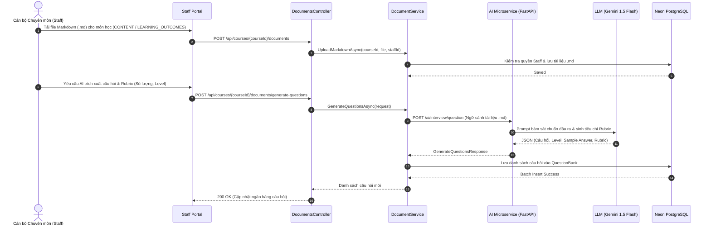

#### Quy trình chi tiết:
1. **Upload tài liệu chuẩn .md ([BR-03](file:///d:/FPT/GitHub/AIVES_FPT/docs/documentation/AIVES_SRS_Sheet_VI_v3%20-%202.%20Busiess%20Rules.csv#L4), [BR-04](file:///d:/FPT/GitHub/AIVES_FPT/docs/documentation/AIVES_SRS_Sheet_VI_v3%20-%202.%20Busiess%20Rules.csv#L5))**:
   - `STAFF` tải lên 2 file định dạng `.md`: `0 = CONTENT` và `1 = LEARNING_OUTCOMES`.
2. **AI sinh câu hỏi & Rubric tự động ([BR-05](file:///d:/FPT/GitHub/AIVES_FPT/docs/documentation/AIVES_SRS_Sheet_VI_v3%20-%202.%20Busiess%20Rules.csv#L6))**:
   - AI đối chiếu chuẩn đầu ra để sinh: câu hỏi, câu trả lời mẫu (`sample_answer`), từ khóa mong đợi (`expected_keywords`) và tiêu chí chấm điểm (`rubric`).
   - `STAFF` có quyền tinh chỉnh, thêm thủ công hoặc xóa câu hỏi chưa đưa vào đề thi.

---

### LUỒNG 3: Thiết kế Đề thi & Khởi tạo Ca thi (Exam & Session Flow)

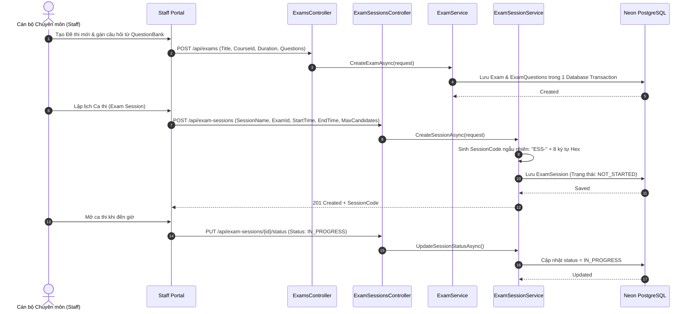

#### Quy trình chi tiết ([BR-06](file:///d:/FPT/GitHub/AIVES_FPT/docs/documentation/AIVES_SRS_Sheet_VI_v3%20-%202.%20Busiess%20Rules.csv#L7), [BR-16](file:///d:/FPT/GitHub/AIVES_FPT/docs/documentation/AIVES_SRS_Sheet_VI_v3%20-%202.%20Busiess%20Rules.csv#L17)):
1. `STAFF` chọn câu hỏi từ Ngân hàng câu hỏi, thiết lập điểm và thời lượng làm bài để tạo `Exam`.
2. `STAFF` lên lịch ca thi (`ExamSession`), hệ thống sinh mã phòng thi `ESS-XXXXXXXX`.
3. `STAFF` mở ca thi (`IN_PROGRESS`) và theo dõi tiến độ thi của thí sinh thời gian thực qua Live Monitor.

---

### LUỒNG 4: Ghi danh Ca thi (Student Enrollment Flow)

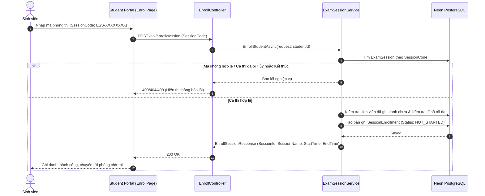

#### Quy trình chi tiết ([BR-07](file:///d:/FPT/GitHub/AIVES_FPT/docs/documentation/AIVES_SRS_Sheet_VI_v3%20-%202.%20Busiess%20Rules.csv#L8)):
1. Sinh viên nhập mã `SessionCode` hợp lệ để ghi danh vào ca thi.
2. Hệ thống kiểm soát tính toàn vẹn: không ghi danh trùng, không vượt quá sĩ số phòng, ca thi phải đang mở hoặc chưa bắt đầu.

---

### LUỒNG 5: Phòng thi Viva & Đường ống Xử lý Ngầm (Async Audio, R2 & AI Worker)

*Đây là luồng cải tiến trọng tâm: Tách biệt hoàn toàn việc nộp file âm thanh khỏi thời gian chờ xử lý STT/LLM.*

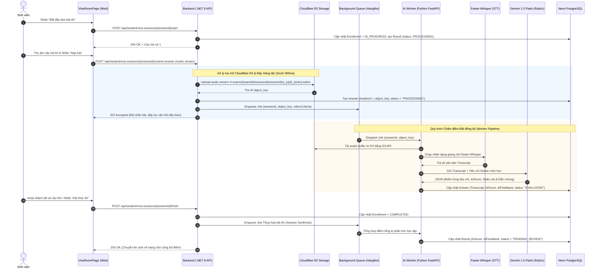

#### Quy trình chi tiết ([BR-08](file:///d:/FPT/GitHub/AIVES_FPT/docs/documentation/AIVES_SRS_Sheet_VI_v3%20-%202.%20Busiess%20Rules.csv#L9), [BR-12](file:///d:/FPT/GitHub/AIVES_FPT/docs/documentation/AIVES_SRS_Sheet_VI_v3%20-%202.%20Busiess%20Rules.csv#L13), [BR-15](file:///d:/FPT/GitHub/AIVES_FPT/docs/documentation/AIVES_SRS_Sheet_VI_v3%20-%202.%20Busiess%20Rules.csv#L16), [BR-17](file:///d:/FPT/GitHub/AIVES_FPT/docs/documentation/AIVES_SRS_Sheet_VI_v3%20-%202.%20Busiess%20Rules.csv#L18)):
1. **Nộp bài tức thì (Zero-blocking Upload)**:
   - File âm thanh thu âm từ trình duyệt (`.webm`) được stream trực tiếp lên Cloudflare R2 Private Bucket.
   - Bản ghi `Answer` lưu `audio_url` dạng S3 Object Key và trạng thái ban đầu là `PROCESSING`.
   - Backend phản hồi `202 Accepted` ngay cho trình duyệt, thí sinh không bị đơ gián đoạn để chuyển câu hỏi kế tiếp.
2. **Worker chạy ngầm bóc băng & chấm Rubric**:
   - Background Worker lấy file âm thanh từ R2, chạy Faster-Whisper trích xuất text transcript tiếng Việt.
   - Gửi text sang Gemini/OpenAI kèm bảng Rubric chuẩn để chấm điểm khách quan.
   - Cập nhật kết quả vào cơ sở dữ liệu và chuyển trạng thái bài thi thành **`PENDING_REVIEW`**.

---

### LUỒNG 6: Khảo thí Thẩm định, Nghe lại Audio & Công bố Điểm (Examiner Review & Publish)

*Luồng độc quyền dành riêng cho vai trò `EXAMINER` nhằm đảm bảo nguyên tắc Separation of Duties.*

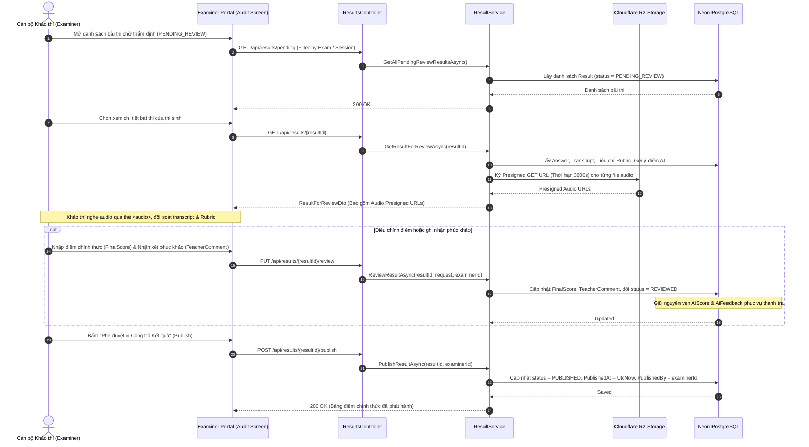

#### Quy trình chi tiết ([BR-09](file:///d:/FPT/GitHub/AIVES_FPT/docs/documentation/AIVES_SRS_Sheet_VI_v3%20-%202.%20Busiess%20Rules.csv#L10), [BR-10](file:///d:/FPT/GitHub/AIVES_FPT/docs/documentation/AIVES_SRS_Sheet_VI_v3%20-%202.%20Busiess%20Rules.csv#L11), [BR-15](file:///d:/FPT/GitHub/AIVES_FPT/docs/documentation/AIVES_SRS_Sheet_VI_v3%20-%202.%20Busiess%20Rules.csv#L16)):
1. **Chỉ `EXAMINER` được thẩm định**: Giảng viên bộ môn (`STAFF`) không được quyền bấm duyệt điểm hay xuất bảng điểm chính thức.
2. **Nghe lại Audio an toàn qua Presigned URL**: Trình duyệt nhận đường dẫn Presigned GET URL có chữ ký điện tử từ Cloudflare R2 (hết hạn sau 60 phút), cho phép Khảo thí nghe lại trực tiếp từng câu trả lời gốc.
3. **Phê duyệt & Công bố (`PUBLISH`)**: Khảo thí xác nhận điểm cuối, hệ thống chuyển trạng thái `PUBLISHED`, mở quyền xem điểm cho sinh viên.

---

### LUỒNG 7: Sinh viên Tra cứu Bảng điểm Chính thức (Student Published Results)

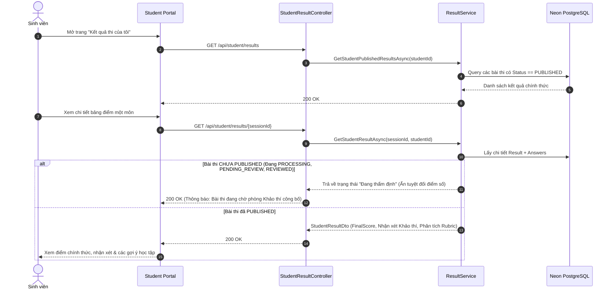

#### Quy trình chi tiết ([BR-11](file:///d:/FPT/GitHub/AIVES_FPT/docs/documentation/AIVES_SRS_Sheet_VI_v3%20-%202.%20Busiess%20Rules.csv#L12)):
1. Sinh viên chỉ thấy điểm khi bài thi có trạng thái `PUBLISHED`.
2. Tránh hiện tượng sinh viên hoang mang khi thấy điểm AI tạm thời chưa qua thẩm định của Khảo thí.

---

## 3. SƠ ĐỒ CHUYỂN ĐỔI TRẠNG THÁI (STATE MACHINE DIAGRAMS)

### 3.1. Vòng đời Ca thi (`ExamSession`) ([BR-16](file:///d:/FPT/GitHub/AIVES_FPT/docs/documentation/AIVES_SRS_Sheet_VI_v3%20-%202.%20Busiess%20Rules.csv#L17))

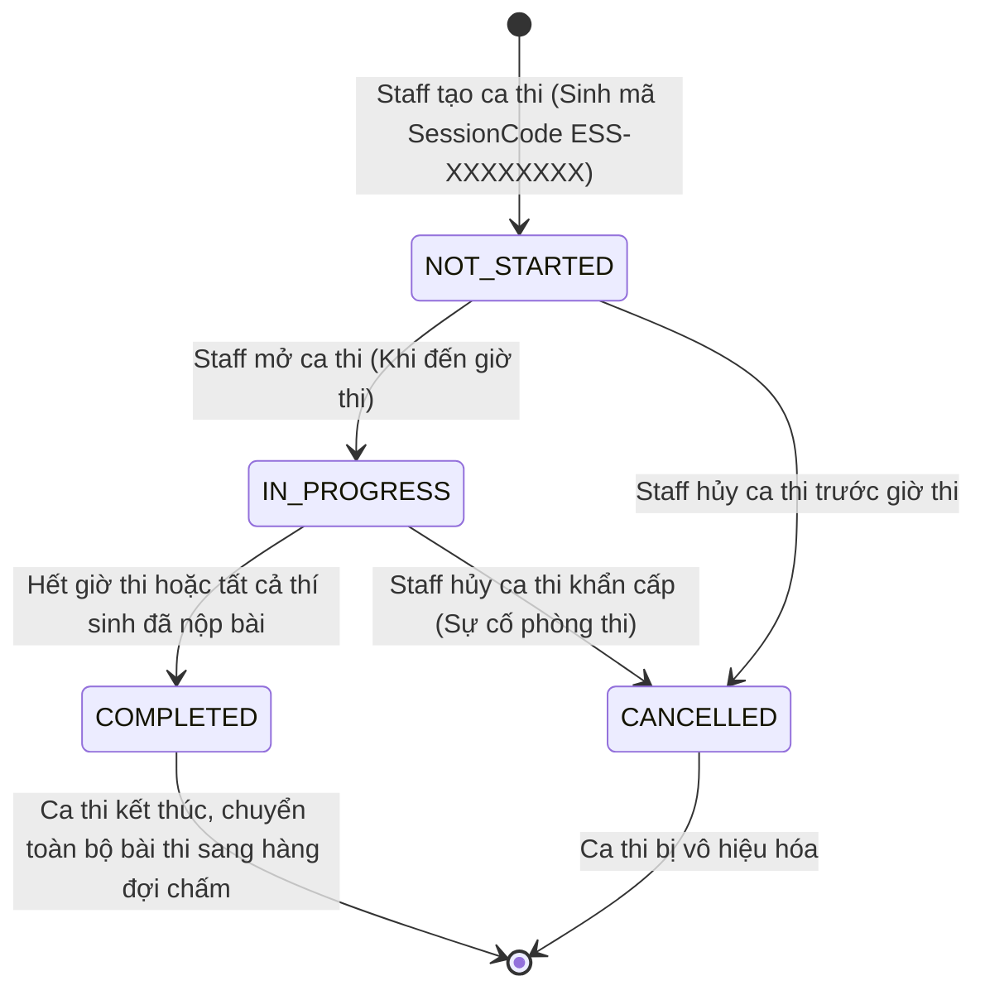

---

### 3.2. Vòng đời Kết quả bài thi (`Result`) & Câu trả lời (`Answer`)

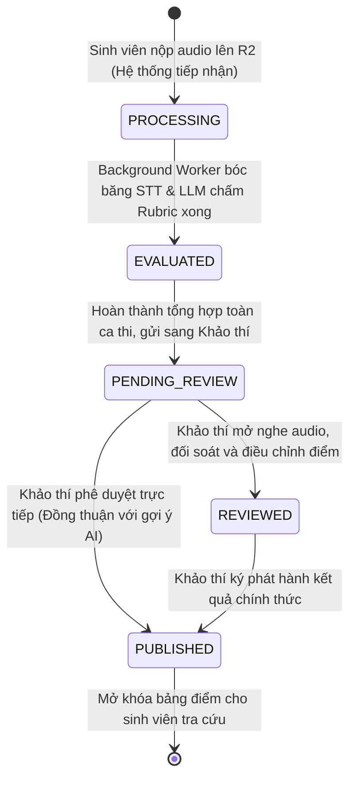

---

## 4. MA TRẬN BUSINESS RULES ĐÃ ĐỒNG BỘ (BR-01 ĐẾN BR-17)

| Mã BR | Phân nhóm | Nội dung Business Rule (v2.0) | Vị trí cài đặt mã nguồn |
| :--- | :--- | :--- | :--- |
| **BR-01** | **Phân quyền** | Hệ thống gồm **4 vai trò (Actors)**: `ADMIN`, `STAFF`, `EXAMINER`, `STUDENT`. Vai trò `STAFF` và `EXAMINER` bắt buộc phải độc lập để tuân thủ nguyên tắc Phân tách nhiệm vụ (Separation of Duties). | `UserRole.cs`, JWT Claim `ClaimTypes.Role` |
| **BR-02** | Môn học | Admin là người tạo Course; phân công `STAFF` làm giảng viên phụ trách chuyên môn. | [AdminCourseController.cs](file:///d:/FPT/GitHub/AIVES_FPT/backend/Aives.Api/Controllers/AdminCourseController.cs), `CourseService.cs` |
| **BR-03** | Tài liệu | `STAFF` upload đúng 2 loại file `.md` cho Course: `CONTENT` và `LEARNING_OUTCOMES`. | [TeacherDocumentController.cs](file:///d:/FPT/GitHub/AIVES_FPT/backend/Aives.Api/Controllers/TeacherDocumentController.cs), [DocType.cs](file:///d:/FPT/GitHub/AIVES_FPT/backend/Aives.Domain/Enums/DocType.cs) |
| **BR-04** | Tài liệu | Mỗi file tài liệu `.md` bắt buộc phải thuộc về đúng một Course. | `MarkdownDocument.cs`, `DocumentService.cs` |
| **BR-05** | Đề thi | Một Course chứa nhiều Exam; Exam tổng hợp câu hỏi từ Question Bank do `STAFF` quản lý. | `Exam.cs`, `ExamQuestion.cs`, [QuestionBankController.cs](file:///d:/FPT/GitHub/AIVES_FPT/backend/Aives.Api/Controllers/QuestionBankController.cs) |
| **BR-06** | Kỳ thi | `STAFF` tạo Exam và lên lịch Exam Session (phòng thi, thời lượng, khung giờ, sĩ số). | [ExamsController.cs](file:///d:/FPT/GitHub/AIVES_FPT/backend/Aives.Api/Controllers/ExamsController.cs), [ExamSessionsController.cs](file:///d:/FPT/GitHub/AIVES_FPT/backend/Aives.Api/Controllers/ExamSessionsController.cs) |
| **BR-07** | Ghi danh | Student nhập mã phòng thi (`ESS-XXXXXXXX`) hợp lệ để ghi danh vào ca thi. | [EnrollController.cs](file:///d:/FPT/GitHub/AIVES_FPT/backend/Aives.Api/Controllers/EnrollController.cs), `ExamSessionService.cs` |
| **BR-08** | **Nộp bài & R2** | Sinh viên nộp bài thi âm thanh được Backend lưu trữ trực tiếp vào **Cloudflare R2**, khởi tạo trạng thái `PROCESSING` và đẩy Job vào Queue, không block luồng thi. | [VivaSessionService.cs](file:///d:/FPT/GitHub/AIVES_FPT/backend/Aives.Application/Viva/Services/VivaSessionService.cs), `R2StorageService.cs` |
| **BR-09** | **Thẩm định** | Kết quả thi do AI chấm xong bắt buộc phải gửi cho **`EXAMINER` (Khảo thí)** để xem xét, nghe lại âm thanh gốc và phúc tra. `STAFF` chỉ có quyền xem, không được duyệt. | [ResultsController.cs](file:///d:/FPT/GitHub/AIVES_FPT/backend/Aives.Api/Controllers/ResultsController.cs), `ResultService.cs` |
| **BR-10** | **Công bố** | **Chỉ duy nhất `EXAMINER`** mới có quyền phê duyệt (`Approve`) và công bố (`Publish`) kết quả thi chính thức. | [ResultsController.cs](file:///d:/FPT/GitHub/AIVES_FPT/backend/Aives.Api/Controllers/ResultsController.cs), `ResultService.cs` |
| **BR-11** | Minh bạch | Kết quả chính thức chỉ hiển thị cho Student sau khi chuyển trạng thái `PUBLISHED`. | [StudentResultController.cs](file:///d:/FPT/GitHub/AIVES_FPT/backend/Aives.Api/Controllers/StudentResultController.cs), `ResultService.cs` |
| **BR-12** | Vấn đáp AI | Vấn đáp bằng giọng nói: AI đọc câu hỏi (TTS) → SV trả lời (Voice) → Đẩy R2 & Queue. | [VivaSessionService.cs](file:///d:/FPT/GitHub/AIVES_FPT/backend/Aives.Application/Viva/Services/VivaSessionService.cs) |
| **BR-13** | An toàn | Mật khẩu được mã hóa BCrypt; xác thực bằng JWT Bearer Token; phân quyền theo 4 Role. | [AuthController.cs](file:///d:/FPT/GitHub/AIVES_FPT/backend/Aives.Api/Controllers/AuthController.cs), `JwtTokenGenerator.cs` |
| **BR-14** | Kiến trúc | Frontend không được gọi trực tiếp AI Service hoặc Storage; mọi yêu cầu bắt buộc đi qua Backend. | [ai-service.md](file:///d:/FPT/GitHub/AIVES_FPT/docs/ai/ai-service.md), `AiServiceClient.cs` |
| **BR-15** | **Bảo mật Audio** | Mọi file ghi âm phải lưu trên **Cloudflare R2 (Private Bucket)**. Quyền nghe lại của Khảo thí được cấp qua Presigned GET URL có giới hạn thời gian (TTL ≤ 3600s). | `R2StorageService.cs`, `Answer.AudioUrl` |
| **BR-16** | Trạng thái ca thi | Exam Session chỉ được chuyển đổi qua lại giữa các trạng thái hợp lệ: `NOT_STARTED` → `IN_PROGRESS` → `COMPLETED` / `CANCELLED`. | `SessionStatus.cs`, `ExamSessionService.ValidateStatusTransition` |
| **BR-17** | **Async Worker** | Khâu gỡ băng âm thanh (STT) và chấm điểm Rubric được thực hiện bởi Background Worker tách rời, hỗ trợ cơ chế retry tự động 3 lần nếu lỗi API AI. | `AiWorkerService.py`, Hangfire / Message Queue |

---

## 5. KẾ HOẠCH HÀNH ĐỘNG CỤ THỂ (NEXT STEPS & ACTION PLAN)

Để đưa hệ thống chuyển đổi từ kiến trúc đồng bộ cũ sang kiến trúc mới đúng tiến độ và không làm gián đoạn các tính năng hiện có, nhóm phát triển cần tiến hành theo **5 giai đoạn (Phases)** sau:

```
[Phase 1: DB & RBAC Migration] ➔ [Phase 2: Cloudflare R2 Integration] ➔ [Phase 3: Background Worker Pipeline] ➔ [Phase 4: API & Frontend Updates] ➔ [Phase 5: Testing & Acceptance]
```

### 🎯 Giai đoạn 1: Tái cấu trúc Role & Migration Database (Ưu tiên số 1)
1. **Cập nhật Enum Role trong Backend**:
   * Sửa [UserRole.cs](file:///d:/FPT/GitHub/AIVES_FPT/backend/Aives.Domain/Enums/UserRole.cs): Thay thế `TEACHER` thành `STAFF`, bổ sung `EXAMINER`.
   * Định nghĩa lại enum: `ADMIN`, `STAFF`, `EXAMINER`, `STUDENT`.
2. **Cập nhật Schema Database (EF Core Migration)**:
   * Viết Migration cập nhật enum PostgreSQL `user_role` trên Neon: Đổi các bản ghi role cũ `'TEACHER'` ➔ `'STAFF'`, bổ sung giá trị `'EXAMINER'`.
   * Thêm trường `PublishedBy` (FK trỏ tới `Users.UserId`) vào bảng `results` để ghi nhận cán bộ Khảo thí nào đã công bố điểm.
   * Thêm enum `AnswerStatus` (`PROCESSING`, `EVALUATED`, `ERROR`) vào bảng `answers`.
3. **Cập nhật Database Seeder**:
   * Cập nhật [DatabaseSeeder.cs](file:///d:/FPT/GitHub/AIVES_FPT/backend/Aives.Infrastructure/Persistence/DatabaseSeeder.cs) để tạo sẵn tài khoản mẫu: `admin_01`, `staff_01`, `examiner_01`, `student_01`.

---

### 🎯 Giai đoạn 2: Tích hợp Cloudflare R2 Object Storage
1. **Thiết lập trên Cloudflare Dashboard**:
   * Tạo Bucket: `aives-exam-audios` (chế độ Private).
   * Cấu hình CORS cho phép origin frontend (`http://localhost:5173` và domain staging).
   * Tạo API Token với quyền `Object Read & Write`.
2. **Cài đặt thư viện & Service trong Backend (.NET)**:
   * Thêm package `AWSSDK.S3` vào `Aives.Infrastructure.csproj`.
   * Tạo interface `IStorageService` và class `CloudflareR2StorageService` chịu trách nhiệm:
     * `UploadAudioAsync(string objectKey, Stream audioStream, string contentType)`
     * `GeneratePresignedGetUrl(string objectKey, TimeSpan duration)`
   * Cấu hình thông số R2 trong [appsettings.json](file:///d:/FPT/GitHub/AIVES_FPT/backend/Aives.Api/appsettings.json) và biến môi trường.
3. **Refactor [VivaSessionService.cs](file:///d:/FPT/GitHub/AIVES_FPT/backend/Aives.Application/Viva/Services/VivaSessionService.cs)**:
   * Gỡ bỏ đoạn code ghi file cục bộ vào `Directory.GetCurrentDirectory()/wwwroot/uploads/audio`.
   * Chuyển sang gọi `_storageService.UploadAudioAsync` đẩy trực tiếp lên Cloudflare R2.

---

### 🎯 Giai đoạn 3: Xây dựng Hàng đợi (Message Queue) & AI Background Worker
1. **Lựa chọn & Tích hợp Message Queue**:
   * Cài đặt **Hangfire** (chạy ngay trên Neon PostgreSQL mà không cần dựng thêm Redis server) hoặc tạo bảng Queue đệm `ai_jobs` trong PostgreSQL (`SKIP LOCKED`).
2. **Cập nhật AI Microservice (Python FastAPI)**:
   * Tạo module Worker chạy ngầm bốc task từ Queue.
   * Tích hợp `boto3` để Worker tải buffer audio từ Cloudflare R2 bằng S3 API.
   * Gọi `Faster-Whisper` bóc băng âm thanh tiếng Việt thành `transcript`.
   * Gọi LLM chấm điểm theo tiêu chí Rubric và lưu điểm về Database.
3. **Cơ chế xử lý Ngoại lệ (Retry & Fallback)**:
   * Cấu hình cơ chế tự động thử lại tối đa 3 lần nếu Whisper hoặc LLM timeout.
   * Nếu thất bại sau 3 lần, đánh dấu `status = ERROR` để Khảo thí biết và chấm thủ công.

---

### 🎯 Giai đoạn 4: Cập nhật API Controllers & Giao diện Frontend
1. **Phân tách Controller theo Role**:
   * Đổi quyền truy cập các API Tạo môn/Tạo đề: Chỉ cho phép `STAFF` hoặc `ADMIN`.
   * Đổi quyền truy cập các API Duyệt điểm (`ResultsController`): Chỉ cấp quyền cho `EXAMINER` (Khảo thí).
   * Cung cấp API `GET /api/examiner/results/{id}/audio-url` trả về Presigned URL nghe file audio.
2. **Cập nhật Giao diện Frontend (React SPA)**:
   * **Menu điều hướng**: Phân chia màn hình rõ ràng giữa **Staff Portal** (Soạn đề, Ca thi) và **Examiner Portal** (Thẩm định điểm, Nghe ghi âm, Publish).
   * **Màn hình Review của Khảo thí**: Tích hợp trình phát âm thanh HTML5 `<audio controls src={presignedUrl}>` kèm thanh tiến trình waveform để nghe lại câu trả lời.
   * **Màn hình Sinh viên**: Đảm bảo bảng điểm chỉ hiển thị khi nhận cờ `PUBLISHED`.

---

### 🎯 Giai đoạn 5: Kiểm thử Toàn diện & Nghiệm thu Đồ án (Testing & Acceptance)
1. **Kiểm thử Tải nộp đồng thời (Stress Test Viva Room)**:
   * Giả lập 20–50 thí sinh cùng nộp âm thanh đồng thời để xác nhận Backend không bị nghẽn (nhờ offload sang Cloudflare R2 và Background Worker).
2. **Kiểm thử Bảo mật (Security & Permission Test)**:
   * Dùng tài khoản `STAFF` cố tình gọi API `/publish` ➔ Kiểm tra hệ thống có chặn đúng `403 Forbidden` không.
   * Dùng tài khoản `STUDENT` cố tình truy cập link audio gốc trên R2 ➔ Kiểm tra R2 chặn truy cập trái phép `401/403` khi không có chữ ký Presigned.
3. **Kiểm thử Kiểm toán (Audit Trail Verification)**:
   * Kiểm tra tính toàn vẹn: Điểm do AI sinh ra (`AiScore`) và điểm do Khảo thí chốt (`FinalScore`) được lưu trữ song song và hiển thị minh bạch trong biên bản thi.
