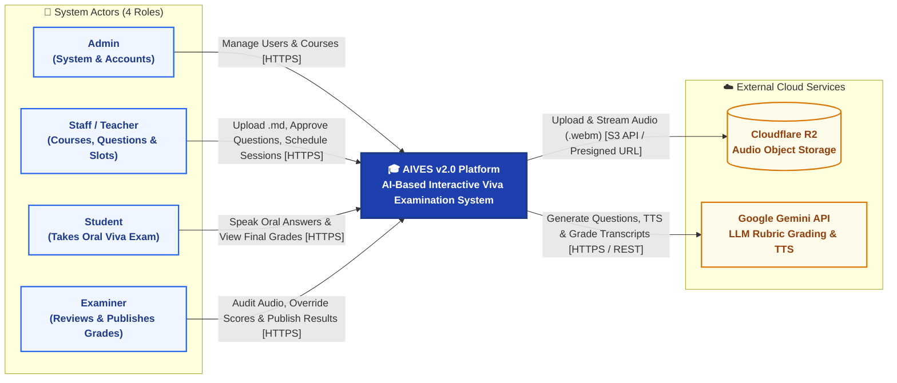
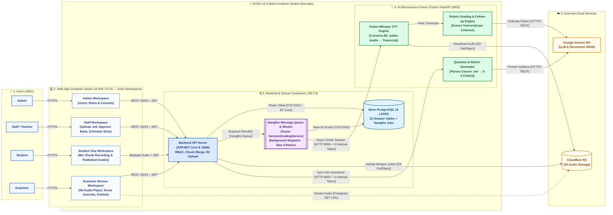

# AIVES v2.0 — C0 & C1 Architecture Diagrams (Left-to-Right)

## 1. C0 — System Context Diagram (Left-to-Right)

---

## 2. C1 — Multi-Container Architecture (Left-to-Right: Actor Workspaces → Backend & Queue → AI Processing Frame → Cloud)

