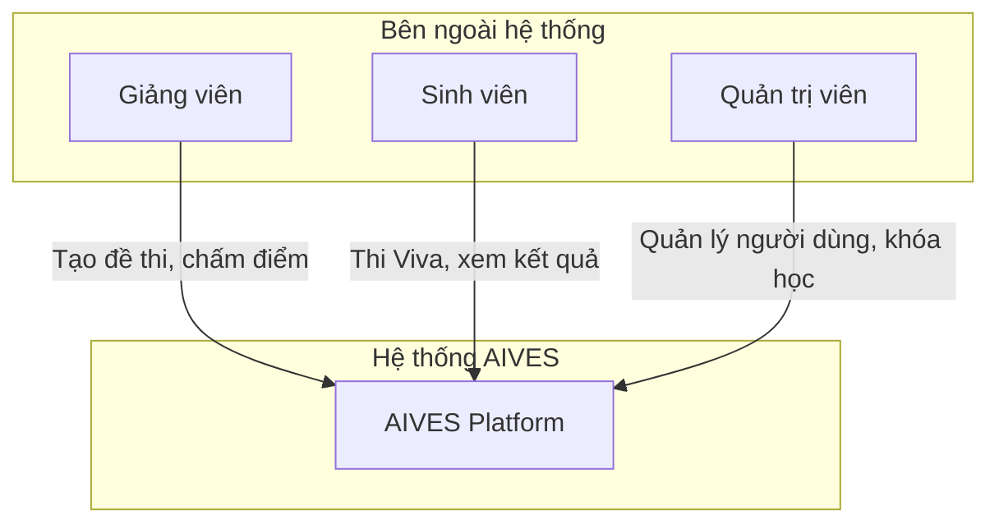
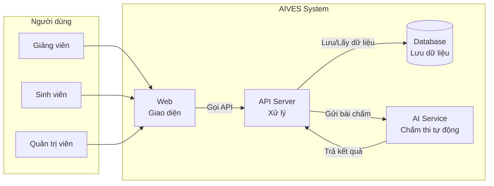

# Sơ đồ C0 và C1 - AIVES

## C0 - Sơ đồ tổng quan (Context Diagram)

Ai sử dụng hệ thống này?

**Giải thích đơn giản:**
- **Giảng viên**: Tạo đề thi, theo dõi thi, chấm điểm bài thi
- **Sinh viên**: Làm bài thi Viva, xem kết quả
- **Quản trị viên**: Quản lý tài khoản, khóa học

---

## C1 - Sơ đồ thành phần (Container Diagram)

Hệ thống được xây dựng từ những phần nào?

**Giải thích đơn giản:**

| Thành phần | Chức năng |
|-----------|-----------|
| **Web (Giao diện)** | Màn hình hiển thị cho người dùng |
| **API Server (Máy chủ)** | Xử lý logic, điều hướng yêu cầu |
| **Database (Cơ sở dữ liệu)** | Lưu trữ thông tin |
| **AI Service (Trí tuệ nhân tạo)** | Tự động chấm điểm bài thi |

**Luồng dữ liệu đơn giản:**
1. Người dùng thao tác trên Web
2. Web gửi yêu cầu đến API Server
3. API Server lưu/lấy dữ liệu từ Database
4. Khi cần chấm điểm → gửi cho AI xử lý → trả kết quả về

---

## Tóm tắt

- **C0**: Cho thấy Ai sử dụng hệ thống
- **C1**: Cho thấy Hệ thống được làm từ đâu
