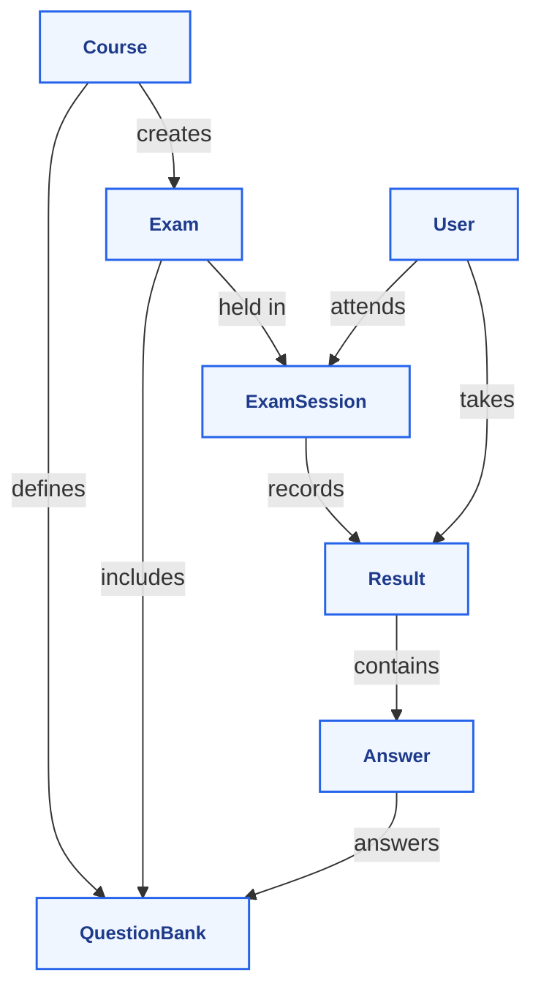
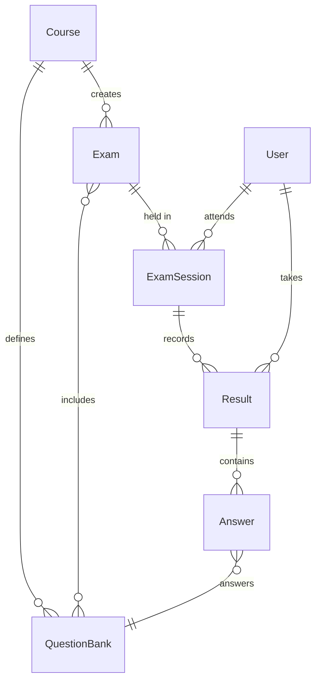
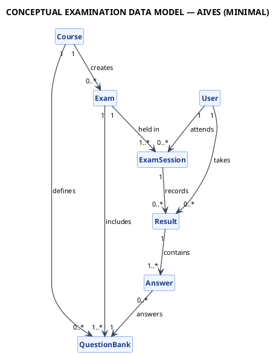

# AIVES V2.0 — Minimal Conceptual Examination Data Model

> Streamlined 7-entity examination data model showing strictly **Entity / Table Names** and **Business Relationships** following the exact criteria of **C0** and **C1**.

---

## 1. Overview of Core Entities

| Entity / Table | Conceptual Role | Plain English Description |
| :--- | :--- | :--- |
| **Course** | Academic Subject | Root course defining materials, questions, and exam papers (e.g. `PRN222`, `SWD392`). |
| **QuestionBank** | Question Catalog | Approved oral viva questions and rubric grading guidelines. |
| **Exam** | Exam Paper | Curated set of questions selected for a specific test paper. |
| **ExamSession** | Exam Schedule / Slot | Specific viva session and room where students sit for the oral exam. |
| **User** | System Actor | Account representing Student (candidate) or Examiner (reviewer). |
| **Result** | Exam Attempt Outcome | Overall student exam score and review status (`PENDING_REVIEW` / `PUBLISHED`). |
| **Answer** | Oral Voice Response | Student voice recording, transcription text, and question-level evaluation. |

---

## 2. Interactive HTML Viewer

The interactive HTML view with responsive, dynamically rendered diagrams and tab switching is available at:
👉 **[`docs/conceptual-data-model.html`](file:///d:/FPT/GitHub/AIVES_FPT/docs/conceptual-data-model.html)**

---

## 3. Streamlined Diagrams

### View 1: Entity Graph (Flowchart Style — Like C0 & C1)

---

### View 2: Conceptual ER Diagram (Crow's Feet Cardinality)

---

### View 3: PlantUML Source Code

