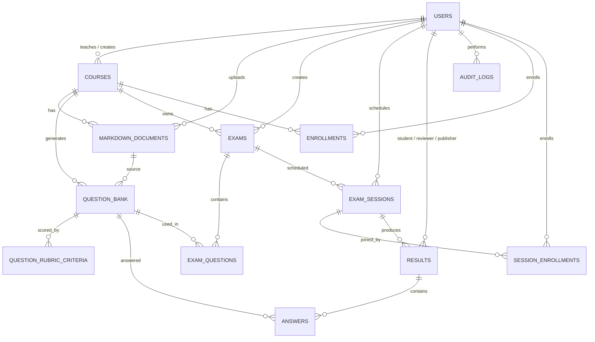

# AIVES — Data Dictionary

> **Version:** 2.2 · **Date:** 2026-10-23 · **Scope:** SWD392 — AIVES FPT
> **Source of truth:** `Aives.Domain.Entities/*` + `Aives.Infrastructure/Persistence/AivesDbContext.cs` + `Aives.Domain/Enums/*`
> **Database:** PostgreSQL 16 (Neon Serverless) · EF Core 8 · `UseIdentityAlwaysColumn()` PKs · enum types backed by native Postgres enums via `NpgsqlUpperCaseTranslator`.
>
> Every column in this document matches `OnModelCreating` in `AivesDbContext.cs` 100%. When the schema changes, update the doc + code in the same PR.
>
> **Verify date:** 2026-10-23 — latest migration is `20261023104325_AddExamIsActive`, which adds the soft-delete flag `exams.is_active`. Previous verification was on 2026-10-20 against `89f50b9` (merge PR #41: Faster-Whisper STT + R2 audio for the AI service), which touched only `ai-service/` and did not alter the schema.

---

## Table of Contents

1. [General conventions](#1-general-conventions)
2. [ER overview](#2-er-overview)
3. [users](#3-table-users)
4. [courses](#4-table-courses)
5. [enrollments](#5-table-enrollments)
6. [markdown_documents](#6-table-markdown_documents)
7. [question_bank](#7-table-question_bank)
8. [question_rubric_criteria](#8-table-question_rubric_criteria)
9. [exams](#9-table-exams)
10. [exam_questions](#10-table-exam_questions)
11. [exam_sessions](#11-table-exam_sessions)
12. [session_enrollments](#12-table-session_enrollments)
13. [results](#13-table-results)
14. [answers](#14-table-answers)
15. [audit_logs](#15-table-audit_logs)
16. [Enums](#16-enums-postgres-native-types)
17. [Index & Constraint summary](#17-index--constraint-summary)
18. [Hangfire tables](#18-system-tables-created-by-hangfire)
19. [ON DELETE rules](#19-on-delete-rules)

---

## 1. General conventions

| Item | Convention |
|---|---|
| Table naming | **snake_case**, singular for entities (`users`, `course`), plural for relationships (`enrollments`, `exam_questions`). Exception: `question_bank` (singular, following the code). |
| Primary key | `INT GENERATED ALWAYS AS IDENTITY`, named `*_id`. `audit_logs.log_id` is `BIGINT`. |
| Columns | snake_case (`course_id`, `created_at`). |
| Enum | Native Postgres enum with UPPER name and UPPER values (see [§16](#16-enums-postgres-native-types)). |
| Timestamp | `*_at` (nullable), defaulting to `CURRENT_TIMESTAMP` (UTC, Postgres timezone). |
| JSONB | `ai_analysis` (answers, results), `audit_logs.old_value`, `audit_logs.new_value`. |
| Check | `question_rubric_criteria` has 2 check constraints (see [§8](#8-table-question_rubric_criteria)). |
| Unique | Declared in `OnModelCreating` (see [§17](#17-index--constraint-summary)). |
| Soft delete | **Partial** — only `exams` uses a real soft-delete flag (`exams.is_active`). All other tables use a status column instead. |
| Audit | Every sensitive operation must write to `audit_logs`. |

## 3. Table: `users`

System accounts for the 4 roles (Admin / Staff / Examiner / Student).

| Column | Postgres type | Null | Default | Description |
|---|---|:---:|---|---|
| `user_id` | `INT GENERATED ALWAYS AS IDENTITY` | NO | — | PK |
| `username` | `VARCHAR(50)` | NO | — | Unique, used to log in |
| `full_name` | `VARCHAR(100)` | NO | — | Display name |
| `email` | `VARCHAR(100)` | YES | — | Unique when present |
| `password_hash` | `VARCHAR(255)` | NO | — | BCrypt hash |
| `role` | `user_role` (enum) | NO | — | Role — [§16](#16-enums-postgres-native-types) |
| `created_at` | `TIMESTAMP` | YES | `CURRENT_TIMESTAMP` | |

**Constraints:** PK `users_pkey`; UNIQUE `users_username_key`, `users_email_key`.

**Rule:**
- The Admin seed is created automatically by `DatabaseSeeder.SeedAdminAsync` on first boot.

## 4. Table: `courses`

Course unit — the root of every downstream relationship.

| Column | Postgres type | Null | Default | Description |
|---|---|:---:|---|---|
| `course_id` | `INT GENERATED ALWAYS AS IDENTITY` | NO | — | PK |
| `course_code` | `VARCHAR(20)` | NO | — | Course code (e.g. `SWD392`), unique |
| `course_name` | `VARCHAR(150)` | NO | — | Display name |
| `teacher_id` | `INT` | YES | — | FK→`users.user_id`, ON DELETE `SET NULL` |
| `created_by` | `INT` | YES | — | FK→`users.user_id`, ON DELETE `SET NULL` |
| `created_at` | `TIMESTAMP` | YES | `CURRENT_TIMESTAMP` | |

**Constraints:** PK `courses_pkey`; UNIQUE `courses_course_code_key`; FK `courses_teacher_id_fkey`, `courses_created_by_fkey`.

## 5. Table: `enrollments`

A student registers for a course (long-term, unlike `session_enrollments` which is for a single exam session).

| Column | Postgres type | Null | Default | Description |
|---|---|:---:|---|---|
| `enrollment_id` | `INT GENERATED ALWAYS AS IDENTITY` | NO | — | PK |
| `student_id` | `INT` | NO | — | FK→`users.user_id` |
| `course_id` | `INT` | NO | — | FK→`courses.course_id` |
| `enrolled_at` | `TIMESTAMP` | YES | `CURRENT_TIMESTAMP` | |

**Constraints:** PK `enrollments_pkey`; UNIQUE `unique_student_course (student_id, course_id)`; IDX `idx_enrollments_course`, `idx_enrollments_student`.

## 6. Table: `markdown_documents`

`.md` documents that a Teacher uploads for a Course. **Each Course has at most 2 files**: 1 CONTENT + 1 LEARNING_OUTCOMES (BR-04).

| Column | Postgres type | Null | Default | Description |
|---|---|:---:|---|---|
| `document_id` | `INT GENERATED ALWAYS AS IDENTITY` | NO | — | PK |
| `course_id` | `INT` | NO | — | FK→`courses.course_id` |
| `uploaded_by` | `INT` | NO | — | FK→`users.user_id` |
| `file_name` | `VARCHAR(255)` | NO | — | Original file name |
| `doc_type` | `doc_type` (enum) | NO | — | `CONTENT` \| `LEARNING_OUTCOMES` |
| `content` | `TEXT` | NO | — | Markdown content (stored inline, not uploaded to R2) |
| `uploaded_at` | `TIMESTAMP` | YES | `CURRENT_TIMESTAMP` | |

**Constraints:** PK `markdown_documents_pkey`; IDX `idx_markdown_documents_course`.

**Rule:** validate the `.md` extension and the size limit; each `course` gets only 1 `CONTENT` + 1 `LEARNING_OUTCOMES`.

## 7. Table: `question_bank`

Question bank containing AI-generated questions plus manually added ones from a Teacher, attached to a Course.

| Column | Postgres type | Null | Default | Description |
|---|---|:---:|---|---|
| `question_id` | `INT GENERATED ALWAYS AS IDENTITY` | NO | — | PK |
| `course_id` | `INT` | NO | — | FK→`courses.course_id` |
| `document_id` | `INT` | YES | — | FK→`markdown_documents.document_id`, ON DELETE `SET NULL` |
| `question_text` | `TEXT` | NO | — | Question body |
| `topic` | `TEXT` | YES | — | Topic / chapter |
| `sample_answer` | `TEXT` | YES | — | Reference sample answer |
| `learning_outcome` | `VARCHAR(2000)` | YES | — | LO mapping |
| `max_score` | `REAL` | YES | `1.0` | Default maximum score |
| `level` | `INT` | NO | — | Difficulty level |
| `expected_keywords` | `TEXT[]` | YES | — | Keyword array (EF maps `List<string>`) |
| `is_follow_up_allowed` | `BOOLEAN` | YES | `TRUE` | Whether follow-up questions are allowed |
| `approval_status` | `VARCHAR(20)` | NO | `'PENDING_REVIEW'` | `QuestionApprovalStatus` stored as string: `PENDING_REVIEW`/`APPROVED`/`REJECTED` |
| `reviewed_by` | `INT` | YES | — | Logical FK → `users.user_id` (Examiner) |
| `reviewed_at` | `TIMESTAMP` | YES | — | |
| `rejection_reason` | `VARCHAR(2000)` | YES | — | Reason for rejection |
| `created_at` | `TIMESTAMP` | YES | `CURRENT_TIMESTAMP` | |

**Constraints:** PK `question_bank_pkey`; IDX `idx_question_bank_course`; FK `question_bank_course_id_fkey`, `question_bank_document_id_fkey`.

**Approval workflow:** `PENDING_REVIEW` (AI-generated) → `APPROVED` (Examiner) / `REJECTED` (+ reason).

## 8. Table: `question_rubric_criteria`

Detailed grading criteria for a question.

| Column | Postgres type | Null | Default | Description |
|---|---|:---:|---|---|
| `criterion_id` | `INT GENERATED ALWAYS AS IDENTITY` | NO | — | PK |
| `question_id` | `INT` | NO | — | FK→`question_bank.question_id`, ON DELETE `CASCADE` |
| `position` | `INT` | NO | — | Display order |
| `description` | `VARCHAR(2000)` | NO | — | Criterion description |
| `max_score` | `NUMERIC(8,4)` | NO | — | Maximum score |

**Check constraints:**
- `ck_question_rubric_score`: `max_score > 0 AND max_score <= 100`
- `ck_question_rubric_position`: `position >= 0 AND position < 20`

**Constraints:** PK `question_rubric_criteria_pkey`; IDX `idx_question_rubric_question`; FK `question_rubric_question_id_fkey` (CASCADE).

## 9. Table: `exams`

An exam — the configuration for a Course. It generates an `exam_code` that students enter to start a test.

| Column | Postgres type | Null | Default | Description |
|---|---|:---:|---|---|
| `exam_id` | `INT GENERATED ALWAYS AS IDENTITY` | NO | — | PK |
| `course_id` | `INT` | NO | — | FK→`courses.course_id` |
| `created_by` | `INT` | NO | — | FK→`users.user_id` (Teacher) |
| `title` | `VARCHAR(255)` | NO | — | Exam title |
| `exam_code` | `VARCHAR(50)` | NO | — | Unique, entered by the student to join the exam |
| `duration_minutes` | `INT` | NO | — | Duration in minutes |
| `max_questions` | `INT` | NO | `10` | Maximum number of questions the AI will generate / select |
| `exam_status` | `exam_status` (enum) | YES | — | `DRAFT`/`SCHEDULED`/`OPEN`/`CLOSED`/`CANCELLED` (Postgres native enum) |
| `is_active` | `BOOLEAN` | NO | `TRUE` | Soft-delete flag. `FALSE` hides the exam from default reads (see the `includeInactive` query param on `GET /api/admin/exams`) while keeping the row in the DB |
| `created_at` | `TIMESTAMP` | YES | `CURRENT_TIMESTAMP` | |

**Constraints:** PK `exams_pkey`; UNIQUE `exams_exam_code_key`; FK `exams_course_id_fkey`, `exams_created_by_fkey`.

**Rule:** soft-delete is an UPDATE to `is_active = FALSE`, never a physical DELETE, so sessions and results that reference the exam remain intact.

## 10. Table: `exam_questions`

N-N join table between `exams` and `question_bank`, holding the per-question score within the exam.

| Column | Postgres type | Null | Default | Description |
|---|---|:---:|---|---|
| `exam_id` | `INT` | NO | — | PK (composite), FK→`exams.exam_id` |
| `question_id` | `INT` | NO | — | PK (composite), FK→`question_bank.question_id` |
| `question_score` | `REAL` | NO | — | Score of this question within the exam |

**Constraints:** PK `exam_questions_pkey (exam_id, question_id)`; FK `exam_questions_exam_id_fkey`, `exam_questions_question_id_fkey`.

## 11. Table: `exam_sessions`

A **concrete exam sitting** belonging to an Exam (e.g. session 1 at 9am, session 2 at 2pm). Students enroll with a `session_code` (P0).

| Column | Postgres type | Null | Default | Description |
|---|---|:---:|---|---|
| `session_id` | `INT GENERATED ALWAYS AS IDENTITY` | NO | — | PK |
| `exam_id` | `INT` | NO | — | FK→`exams.exam_id` |
| `scheduled_by` | `INT` | NO | — | FK→`users.user_id` (Staff/Teacher) |
| `session_name` | `VARCHAR(150)` | NO | — | Session name |
| `room` | `VARCHAR(150)` | YES | — | Exam room |
| `start_time` | `TIMESTAMP` | NO | — | Start time |
| `end_time` | `TIMESTAMP` | NO | — | End time |
| `status` | `session_status` (enum) | YES | — | `NOT_STARTED`/`IN_PROGRESS`/`COMPLETED`/`CANCELLED` |
| `created_at` | `TIMESTAMP` | YES | `CURRENT_TIMESTAMP` | |
| `session_code` | `VARCHAR(50)` | NO | — | Unique, entered by the student to enroll |
| `max_capacity` | `INT` | NO | `50` | Maximum number of students |
| `current_enrollment` | `INT` | NO | `0` | Denormalized counter |

**Constraints:** PK `exam_sessions_pkey`; UNIQUE `exam_sessions_session_code_key`; FK `exam_sessions_exam_id_fkey`, `exam_sessions_scheduled_by_fkey`.

**Rule:** `current_enrollment <= max_capacity` (checked in the service layer); `start_time < end_time` (validated in the app layer).

## 12. Table: `session_enrollments`

A student enrolls in a specific session (as opposed to `enrollments`, which covers the whole course).

| Column | Postgres type | Null | Default | Description |
|---|---|:---:|---|---|
| `session_enrollment_id` | `INT GENERATED ALWAYS AS IDENTITY` | NO | — | PK |
| `session_id` | `INT` | NO | — | FK→`exam_sessions.session_id` |
| `student_id` | `INT` | NO | — | FK→`users.user_id` |
| `status` | `session_status` (enum) | YES | — | Student's status within the session (enum reused, following the code) |
| `enrolled_at` | `TIMESTAMP` | YES | `CURRENT_TIMESTAMP` | |
| `started_at` | `TIMESTAMP` | YES | — | When the student actually started working |
| `last_activity_at` | `TIMESTAMP` | YES | — | Heartbeat for auto-save / disconnect watchdog |
| `current_question_index` | `INT` | YES | — | Current question position (0-based) |

**Constraints:** PK `session_enrollments_pkey`; UNIQUE `unique_student_session (student_id, session_id)`; IDX `idx_session_enrollments_session`, `idx_session_enrollments_student`.

## 13. Table: `results`

The **overall** result for one Student in one Session. 1 result ↔ 1 student ↔ 1 session, containing many child `answers`.

| Column | Postgres type | Null | Default | Description |
|---|---|:---:|---|---|
| `result_id` | `INT GENERATED ALWAYS AS IDENTITY` | NO | — | PK |
| `session_id` | `INT` | NO | — | FK→`exam_sessions.session_id` |
| `student_id` | `INT` | NO | — | FK→`users.user_id` |
| `ai_score` | `REAL` | YES | — | Total AI-assigned score |
| `ai_feedback` | `TEXT` | YES | — | Short AI feedback |
| `ai_analysis` | `JSONB` | YES | — | Detailed analysis (strong/weak questions) |
| `ai_evaluation_status` | `VARCHAR(20)` | YES | — | `AiEvaluationStatus` stored as string: `PENDING`/`SUCCEEDED`/`FAILED` |
| `ai_evaluation_error` | `TEXT` | YES | — | Error if AI grading failed |
| `final_score` | `REAL` | YES | — | Final score (Teacher override, or = ai_score) |
| `final_feedback` | `TEXT` | YES | — | Final feedback |
| `status` | `submission_status` (enum) | YES | — | `PENDING_REVIEW`/`SUBMITTED`/`REVIEWED`/`PUBLISHED`/`CANCELLED` |
| `submitted_at` | `TIMESTAMP` | YES | `CURRENT_TIMESTAMP` | |
| `reviewed_at` | `TIMESTAMP` | YES | — | Teacher clicked "Review complete" |
| `reviewed_by` | `INT` | YES | — | FK→`users.user_id`, ON DELETE `SET NULL` |
| `published_at` | `TIMESTAMP` | YES | — | Teacher clicked "Publish" |
| `published_by` | `INT` | YES | — | FK→`users.user_id`, ON DELETE `SET NULL` |

**Constraints:** PK `results_pkey`; UNIQUE `unique_result_student_session (student_id, session_id)`; IDX `idx_results_session`, `idx_results_student`.

**`status` lifecycle:**
```
PENDING_REVIEW (student just submitted / AI not finished)
        │
        ▼  AI done + Teacher has not reviewed
  SUBMITTED
        │
        ▼ Teacher reviews
  REVIEWED
        │
        ▼ Teacher publishes
  PUBLISHED     or CANCELLED (cancelled by admin)
```

Students only see their result when `status = PUBLISHED` (see FE 3.7).

## 14. Table: `answers`

A single answer within a Result — holds the R2 audio, transcript, AI score, and Teacher score.

| Column | Postgres type | Null | Default | Description |
|---|---|:---:|---|---|
| `answer_id` | `INT GENERATED ALWAYS AS IDENTITY` | NO | — | PK |
| `status` | `VARCHAR(20)` | NO | `'PROCESSING'` | `AnswerStatus` stored as string: `PROCESSING`/`EVALUATED`/`ERROR` |
| `result_id` | `INT` | NO | — | FK→`results.result_id` |
| `question_id` | `INT` | NO | — | FK→`question_bank.question_id` |
| `student_answer` | `TEXT` | YES | — | Transcript returned by the AI service (BR-15) |
| `transcript` | `TEXT` | YES | — | Raw output from STT (differs from `student_answer` after AI cleanup) |
| `audio_url` | `TEXT` | YES | — | Legacy / full URL (if needed) |
| `object_key` | `VARCHAR(500)` | YES | — | S3/R2 object key used to generate a presigned URL (BR-15). E.g. `exams/1/sessions/5/students/10/q_3_1729000000.webm`. Since PR #41 the AI service uses this key to download on its own via `transcribe-object`. |
| `job_id` | `VARCHAR(100)` | YES | — | Hangfire job id (BR-17) |
| `attempt_count` | `INT` | NO | `0` | Retry count (max 3 per BR-17) |
| `error_message` | `TEXT` | YES | — | STT/AI error (when `status = ERROR`) |
| `duration_seconds` | `REAL` | YES | — | Audio length from Faster-Whisper |
| `detected_language` | `VARCHAR(20)` | YES | — | Detected language (e.g. `vi`, `en`) |
| `is_follow_up` | `BOOLEAN` | YES | `FALSE` | Whether this is a follow-up question |
| `ai_score` | `REAL` | YES | — | AI score for this question |
| `ai_feedback` | `TEXT` | YES | — | Short AI feedback |
| `ai_analysis` | `JSONB` | YES | — | Detailed AI analysis |
| `final_score` | `REAL` | YES | — | Final score (Teacher override, or = ai_score) |
| `teacher_comment` | `TEXT` | YES | — | Teacher's own comment |
| `answered_at` | `TIMESTAMP` | YES | — | Timestamp when the student submitted |

**Constraints:** PK `answers_pkey`; UNIQUE `unique_result_question (result_id, question_id)` (each question is answered only once per result); IDX `idx_answers_result`; FK `answers_result_id_fkey`, `answers_question_id_fkey`.

**`status` state machine:**
```
PROCESSING (upload done, Hangfire job running)
    │
    ├──► EVALUATED (AI grading finished, has ai_score)
    │
    └──► ERROR (STT/AI failed, retry or finalize with error_message)
```

## 15. Table: `audit_logs`

Audit trail for every sensitive action: score review, result publication, answer retry (BR-15).

| Column | Postgres type | Null | Default | Description |
|---|---|:---:|---|---|
| `log_id` | `BIGINT GENERATED ALWAYS AS IDENTITY` | NO | — | PK |
| `entity_name` | `VARCHAR(100)` | NO | — | Name of the affected table (e.g. `Result`, `Answer`) |
| `entity_id` | `INT` | NO | — | Primary key of the record |
| `action` | `VARCHAR(100)` | NO | — | Action (e.g. `REVIEW_SCORE_OVERRIDE`, `PUBLISH_RESULT`, `RETRY_ANSWER`) |
| `old_value` | `JSONB` | YES | — | Snapshot of the old value |
| `new_value` | `JSONB` | YES | — | Snapshot of the new value |
| `reason` | `TEXT` | YES | — | Reason / explanation |
| `performed_by` | `INT` | YES | — | FK→`users.user_id`, ON DELETE `SET NULL` |
| `performed_at` | `TIMESTAMP` | YES | `CURRENT_TIMESTAMP` | Always UTC |
| `ip_address` | `VARCHAR(45)` | YES | — | IPv4/IPv6 (45 chars is enough for a full IPv6 address) |

**Constraints:** PK `audit_logs_pkey`; IDX `idx_audit_logs_entity (entity_name, entity_id)`, `idx_audit_logs_performed_by`.

**Note:** append-only, no updates or deletes. Used for tracing when a score is disputed.

## 16. Enums (Postgres native types)

Postgres stores these enum types as **native enum types** (not VARCHAR) thanks to `NpgsqlUpperCaseTranslator` (uppercases everything).

### `user_role`
| Value | Meaning |
|---|---|
| `ADMIN` | System administrator |
| `STAFF` | Staff member (scheduling, question approval) |
| `EXAMINER` | Examiner (view results, publish) |
| `STUDENT` | Student (take exams) |

### `exam_status`
| Value | Meaning |
|---|---|
| `DRAFT` | Being drafted |
| `SCHEDULED` | Scheduled |
| `OPEN` | Open, students can join |
| `CLOSED` | Closed |
| `CANCELLED` | Cancelled |

### `session_status`
| Value | Meaning |
|---|---|
| `NOT_STARTED` | The session has not started yet |
| `IN_PROGRESS` | Currently in progress |
| `COMPLETED` | Finished normally |
| `CANCELLED` | Cancelled |

### `submission_status` (results)
| Value | Meaning |
|---|---|
| `PENDING_REVIEW` | AI not finished, or the Teacher has not reviewed yet |
| `SUBMITTED` | Student just submitted, AI has graded |
| `REVIEWED` | Teacher has reviewed |
| `PUBLISHED` | Teacher published → students can see it |
| `CANCELLED` | Cancelled |

### `doc_type`
| Value | Meaning |
|---|---|
| `CONTENT` | Course content document |
| `LEARNING_OUTCOMES` | Learning outcomes table |

### Enums stored as VARCHAR(20)
The following enums use **string conversion** (not a Postgres enum) because their values may need to expand quickly:

| Enum | Values |
|---|---|
| `AnswerStatus` | `PROCESSING`, `EVALUATED`, `ERROR` |
| `AiEvaluationStatus` | `PENDING`, `SUCCEEDED`, `FAILED` |
| `QuestionApprovalStatus` | `PENDING_REVIEW`, `APPROVED`, `REJECTED` |

## 17. Index & Constraint summary

| Table | Index / Unique / Check | Column(s) | Name |
|---|---|---|---|
| `users` | UNIQUE | `username` | `users_username_key` |
| `users` | UNIQUE | `email` | `users_email_key` |
| `courses` | UNIQUE | `course_code` | `courses_course_code_key` |
| `enrollments` | UNIQUE | (`student_id`, `course_id`) | `unique_student_course` |
| `enrollments` | IDX | `course_id` | `idx_enrollments_course` |
| `enrollments` | IDX | `student_id` | `idx_enrollments_student` |
| `markdown_documents` | IDX | `course_id` | `idx_markdown_documents_course` |
| `question_bank` | IDX | `course_id` | `idx_question_bank_course` |
| `question_rubric_criteria` | IDX | `question_id` | `idx_question_rubric_question` |
| `question_rubric_criteria` | CHECK | `max_score` | `ck_question_rubric_score` |
| `question_rubric_criteria` | CHECK | `position` | `ck_question_rubric_position` |
| `exams` | UNIQUE | `exam_code` | `exams_exam_code_key` |
| `exam_sessions` | UNIQUE | `session_code` | `exam_sessions_session_code_key` |
| `session_enrollments` | UNIQUE | (`student_id`, `session_id`) | `unique_student_session` |
| `session_enrollments` | IDX | `session_id` | `idx_session_enrollments_session` |
| `session_enrollments` | IDX | `student_id` | `idx_session_enrollments_student` |
| `results` | UNIQUE | (`student_id`, `session_id`) | `unique_result_student_session` |
| `results` | IDX | `session_id` | `idx_results_session` |
| `results` | IDX | `student_id` | `idx_results_student` |
| `answers` | UNIQUE | (`result_id`, `question_id`) | `unique_result_question` |
| `answers` | IDX | `result_id` | `idx_answers_result` |
| `audit_logs` | IDX | (`entity_name`, `entity_id`) | `idx_audit_logs_entity` |
| `audit_logs` | IDX | `performed_by` | `idx_audit_logs_performed_by` |

> `exams.is_active` has no dedicated index: the column is only used as a boolean filter alongside the existing filters, and the exam count is small enough that a full scan is not a bottleneck. Add an index if that changes.

## 18. System tables (created by Hangfire)

Hangfire with `Hangfire.PostgreSql` automatically creates these tables in the `hangfire` schema (default, configurable via `Hangfire:SchemaName`):

| Table | Purpose |
|---|---|
| `hangfire.job` | Job definitions |
| `hangfire.jobqueue` | Queues (`default`, `answers`) |
| `hangfire.state` | Job state |
| `hangfire.jobparameter` | Parameters attached to a job |
| `hangfire.lock` | Distributed lock |
| `hangfire.counter` | Metrics (jobs run, failed) |
| `hangfire.aggregatecounter`, `hangfire.hash`, `hangfire.list`, `hangfire.set`, `hangfire.server` | Auxiliary structures |

Configuration: fixed queues `default` and `answers`, default worker count `5`.

## 19. ON DELETE rules

| Parent table | Column | Child table | FK column | ON DELETE | Reason |
|---|---|---|---|---|---|
| `users` | `user_id` | `courses` | `teacher_id` | `SET NULL` | Teacher leaves → keep the course |
| `users` | `user_id` | `courses` | `created_by` | `SET NULL` | Audit; keep the course |
| `users` | `user_id` | `results` | `reviewed_by` | `SET NULL` | Keep the audit chain |
| `users` | `user_id` | `results` | `published_by` | `SET NULL` | |
| `users` | `user_id` | `audit_logs` | `performed_by` | `SET NULL` | Logs are permanent |
| `markdown_documents` | `document_id` | `question_bank` | `document_id` | `SET NULL` | Questions stay usable even if the `.md` is deleted |
| `question_bank` | `question_id` | `question_rubric_criteria` | `question_id` | `CASCADE` | A rubric is meaningless once the question is deleted |

All other FKs default to `RESTRICT` (you cannot delete a parent while children still exist).

> **Soft-delete note:** deleting an `exams` row is not the way to remove an exam — set `exams.is_active = FALSE` instead. A physical DELETE is blocked by the `RESTRICT` FK from `exams_course_id_fkey` dependents anyway (sessions, results).

---

## Appendix — ER Diagram (Mermaid)



Original ERD (PNG): `docs/documentation/erd.drawio.png`.

## Appendix — Cross-check with Sprint 1 task 1.4

| Table name required by the SRS | Actual table | Status |
|---|---|---|
| `User` | `users` | ✅ |
| `Course` | `courses` | ✅ |
| `MarkdownDocument` | `markdown_documents` | ✅ |
| `Exam` | `exams` | ✅ |
| `ExamSession` | `exam_sessions` | ✅ |
| `Question` | `question_bank` | ✅ (table name normalised to `question_bank`) |
| `Answer` | `answers` | ✅ |
| `Transcript` | `answers.transcript` | ✅ (stored inside `answers`) |
| `Result` | `results` | ✅ |
| `QuestionScore` | `answers.ai_score` + `answers.final_score` | ✅ (flattened into `answers`) |
| `FinalResult` | `results.final_score` + `results.final_feedback` | ✅ (flattened into `results`) |
| (P0 additions) | `enrollments`, `session_enrollments`, `question_rubric_criteria`, `audit_logs`, `answers.ai_analysis`, `results.ai_analysis` (jsonb) | ✅ added |
| (2026-10-23) | `exams.is_active` | ✅ added for soft-delete |

## Appendix — Revision history

| Version | Date | Change |
|---|---|---|
| 1.0 | 2026-10-12 | Initialised from Sprint 1 task 1.4 |
| 2.0 | 2026-10-19 | Added `question_rubric_criteria`, `audit_logs`; detailed check constraints |
| 2.1 | 2026-10-20 | Verified after merge PR #41 (`89f50b9`) — schema unchanged. Added a PR #41 note: the AI service downloads from R2 via `transcribe-object`, using `answers.object_key` |
| **2.2** | **2026-10-23** | Added `exams.is_active` soft-delete flag (migration `AddExamIsActive`) with the `includeInactive` / `isDescending` query params on `GET /api/admin/exams`. Translated to English |

---

**Last updated:** 2026-10-23 · Author: Thịnh (per SWD392 Task Sheet)

---

## 2. ER overview

```text
users ──┬──< courses ──< markdown_documents
        │      │              └──< question_bank ──< question_rubric_criteria
        │      │                       │
        │      └──< exams ──< exam_questions ──┐
        │             │                       │
        │             └──< exam_sessions ──< session_enrollments
        │                          │              │
        │                          └──< results ──< answers ──> question_bank
        └──< audit_logs (PerformedBy)
```

**Key relationships:**

- `users` 1—N `courses` (CreatedBy, Teacher)
- `courses` 1—N `markdown_documents`, `question_bank`, `exams`, `enrollments`
- `markdown_documents` 1—N `question_bank` (optional)
- `question_bank` 1—N `question_rubric_criteria` (CASCADE), 1—N `answers`, M—N `exams` (via `exam_questions`)
- `exams` 1—N `exam_sessions` 1—N `results` 1—1 `session_enrollments`
- `results` 1—N `answers`, FK→`users` (student/reviewer/publisher)