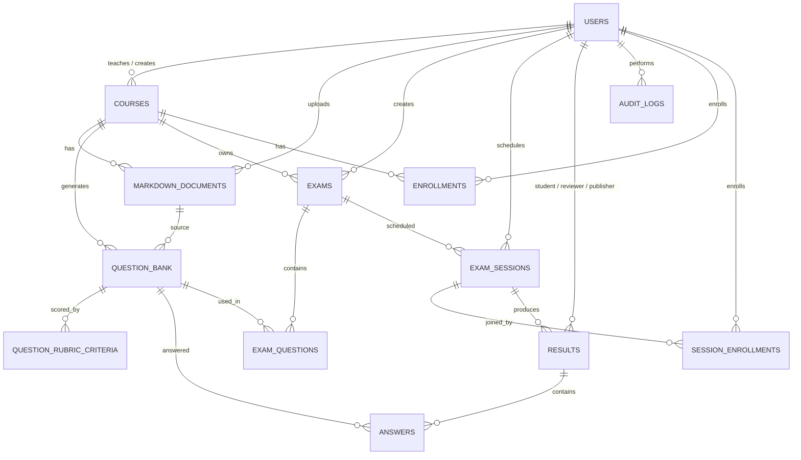

# AIVES — Data Dictionary

> **Version:** 2.1 · **Date:** 2026-10-20 · **Scope:** SWD392 — AIVES FPT
> **Source of truth:** `Aives.Domain.Entities/*` + `Aives.Infrastructure/Persistence/AivesDbContext.cs` + `Aives.Domain/Enums/*`
> **Database:** PostgreSQL 16 (Neon Serverless) · EF Core 8 · `UseIdentityAlwaysColumn()` PKs · enum types backed by native Postgres enums via `NpgsqlUpperCaseTranslator`.
>
> Mọi cột trong tài liệu này **khớp 100%** với `OnModelCreating` trong `AivesDbContext.cs`. Khi schema thay đổi, sửa doc + code trong cùng một PR.
>
> **Verify date:** 2026-10-20 — `git log -1` = `89f50b9` (merge PR #41: Faster-Whisper STT + R2 audio cho AI service). PR #41 chỉ thay đổi `ai-service/`, không động schema. Doc cập nhật.

---

## Mục lục

1. [Quy ước chung](#1-quy-ước-chung)
2. [ER overview](#2-er-overview)
3. [users](#3-bảng-users)
4. [courses](#4-bảng-courses)
5. [enrollments](#5-bảng-enrollments)
6. [markdown_documents](#6-bảng-markdown_documents)
7. [question_bank](#7-bảng-question_bank)
8. [question_rubric_criteria](#8-bảng-question_rubric_criteria)
9. [exams](#9-bảng-exams)
10. [exam_questions](#10-bảng-exam_questions)
11. [exam_sessions](#11-bảng-exam_sessions)
12. [session_enrollments](#12-bảng-session_enrollments)
13. [results](#13-bảng-results)
14. [answers](#14-bảng-answers)
15. [audit_logs](#15-bảng-audit_logs)
16. [Enums](#16-enums-postgres-native-types)
17. [Index & Constraint tổng hợp](#17-chỉ-mục--ràng-buộc-tổng-hợp)
18. [Hangfire tables](#18-bảng-hệ-thống-do-hangfire-tạo)
19. [ON DELETE rules](#19-quy-tắc-on-delete)

---

## 1. Quy ước chung

| Mục | Quy ước |
|---|---|
| Tên bảng | **snake_case**, số ít cho thực thể (`users`, `course`), số nhiều cho quan hệ (`enrollments`, `exam_questions`). Ngoại lệ: `question_bank` (số ít theo code). |
| Khoá chính | `INT GENERATED ALWAYS AS IDENTITY`, tên `*_id`. `audit_logs.log_id` là `BIGINT`. |
| Cột | snake_case (`course_id`, `created_at`). |
| Enum | Native Postgres enum tên UPPER, giá trị UPPER (xem [§16](#16-enums-postgres-native-types)). |
| Timestamp | `*_at` (nullable) mặc định `CURRENT_TIMESTAMP` (UTC, Postgres timezone). |
| JSONB | `ai_analysis` (answers, results), `audit_logs.old_value`, `audit_logs.new_value`. |
| Check | `question_rubric_criteria` có 2 check (xem [§8](#8-bảng-question_rubric_criteria)). |
| Unique | Khai báo trong `OnModelCreating` (xem [§17](#17-chỉ-mục--ràng-buộc-tổng-hợp)). |
| Soft delete | **Không có** — dùng cột trạng thái. |
| Audit | Mọi thao tác sensitive bắt buộc ghi `audit_logs`. |

## 3. Bảng: `users`

Tài khoản hệ thống cho 4 vai trò (Admin / Staff / Examiner / Student).

| Cột | Kiểu Postgres | Null | Mặc định | Mô tả |
|---|---|:---:|---|---|
| `user_id` | `INT GENERATED ALWAYS AS IDENTITY` | NO | — | PK |
| `username` | `VARCHAR(50)` | NO | — | Unique, đăng nhập |
| `full_name` | `VARCHAR(100)` | NO | — | Họ tên hiển thị |
| `email` | `VARCHAR(100)` | YES | — | Unique khi có |
| `password_hash` | `VARCHAR(255)` | NO | — | BCrypt hash |
| `role` | `user_role` (enum) | NO | — | Vai trò — [§16](#16-enums-postgres-native-types) |
| `created_at` | `TIMESTAMP` | YES | `CURRENT_TIMESTAMP` | |

**Constraint:** PK `users_pkey`; UNIQUE `users_username_key`, `users_email_key`.

**Rule:**
- Admin seed tự động bởi `DatabaseSeeder.SeedAdminAsync` ở lần boot đầu.

## 4. Bảng: `courses`

Đơn vị môn học — gốc cho mọi quan hệ downstream.

| Cột | Kiểu Postgres | Null | Mặc định | Mô tả |
|---|---|:---:|---|---|
| `course_id` | `INT GENERATED ALWAYS AS IDENTITY` | NO | — | PK |
| `course_code` | `VARCHAR(20)` | NO | — | Mã môn (vd `SWD392`), unique |
| `course_name` | `VARCHAR(150)` | NO | — | Tên hiển thị |
| `teacher_id` | `INT` | YES | — | FK→`users.user_id`, ON DELETE `SET NULL` |
| `created_by` | `INT` | YES | — | FK→`users.user_id`, ON DELETE `SET NULL` |
| `created_at` | `TIMESTAMP` | YES | `CURRENT_TIMESTAMP` | |

**Constraint:** PK `courses_pkey`; UNIQUE `courses_course_code_key`; FK `courses_teacher_id_fkey`, `courses_created_by_fkey`.

## 5. Bảng: `enrollments`

Student đăng ký học một Course (dài hạn, khác `session_enrollments` cho buổi thi).

| Cột | Kiểu Postgres | Null | Mặc định | Mô tả |
|---|---|:---:|---|---|
| `enrollment_id` | `INT GENERATED ALWAYS AS IDENTITY` | NO | — | PK |
| `student_id` | `INT` | NO | — | FK→`users.user_id` |
| `course_id` | `INT` | NO | — | FK→`courses.course_id` |
| `enrolled_at` | `TIMESTAMP` | YES | `CURRENT_TIMESTAMP` | |

**Constraint:** PK `enrollments_pkey`; UNIQUE `unique_student_course (student_id, course_id)`; IDX `idx_enrollments_course`, `idx_enrollments_student`.

## 6. Bảng: `markdown_documents`

Tài liệu `.md` Teacher upload cho Course. **Mỗi Course có tối đa 2 file**: 1 CONTENT + 1 LEARNING_OUTCOMES (BR-04).

| Cột | Kiểu Postgres | Null | Mặc định | Mô tả |
|---|---|:---:|---|---|
| `document_id` | `INT GENERATED ALWAYS AS IDENTITY` | NO | — | PK |
| `course_id` | `INT` | NO | — | FK→`courses.course_id` |
| `uploaded_by` | `INT` | NO | — | FK→`users.user_id` |
| `file_name` | `VARCHAR(255)` | NO | — | Tên file gốc |
| `doc_type` | `doc_type` (enum) | NO | — | `CONTENT` \| `LEARNING_OUTCOMES` |
| `content` | `TEXT` | NO | — | Nội dung markdown (lưu trực tiếp, không upload R2) |
| `uploaded_at` | `TIMESTAMP` | YES | `CURRENT_TIMESTAMP` | |

**Constraint:** PK `markdown_documents_pkey`; IDX `idx_markdown_documents_course`.

**Rule:** validate `.md`, size theo giới hạn; mỗi `course` chỉ 1 `CONTENT` + 1 `LEARNING_OUTCOMES`.

## 7. Bảng: `question_bank`

Ngân hàng câu hỏi AI sinh hoặc Teacher thêm tay, gắn với Course.

| Cột | Kiểu Postgres | Null | Mặc định | Mô tả |
|---|---|:---:|---|---|
| `question_id` | `INT GENERATED ALWAYS AS IDENTITY` | NO | — | PK |
| `course_id` | `INT` | NO | — | FK→`courses.course_id` |
| `document_id` | `INT` | YES | — | FK→`markdown_documents.document_id`, ON DELETE `SET NULL` |
| `question_text` | `TEXT` | NO | — | Nội dung câu hỏi |
| `topic` | `TEXT` | YES | — | Chủ đề / chương |
| `sample_answer` | `TEXT` | YES | — | Câu trả lời mẫu tham khảo |
| `learning_outcome` | `VARCHAR(2000)` | YES | — | Mapping LO |
| `max_score` | `REAL` | YES | `1.0` | Điểm tối đa mặc định |
| `level` | `INT` | NO | — | Độ khó |
| `expected_keywords` | `TEXT[]` | YES | — | Mảng từ khoá (EF map `List<string>`) |
| `is_follow_up_allowed` | `BOOLEAN` | YES | `TRUE` | Cho phép câu follow-up |
| `approval_status` | `VARCHAR(20)` | NO | `'PENDING_REVIEW'` | `QuestionApprovalStatus` lưu string: `PENDING_REVIEW`/`APPROVED`/`REJECTED` |
| `reviewed_by` | `INT` | YES | — | FK logic → `users.user_id` (Examiner) |
| `reviewed_at` | `TIMESTAMP` | YES | — | |
| `rejection_reason` | `VARCHAR(2000)` | YES | — | Lý do reject |
| `created_at` | `TIMESTAMP` | YES | `CURRENT_TIMESTAMP` | |

**Constraint:** PK `question_bank_pkey`; IDX `idx_question_bank_course`; FK `question_bank_course_id_fkey`, `question_bank_document_id_fkey`.

**Workflow duyệt:** `PENDING_REVIEW` (AI sinh) → `APPROVED` (Examiner) / `REJECTED` (+reason).

## 8. Bảng: `question_rubric_criteria`

Tiêu chí chấm điểm chi tiết cho câu hỏi.

| Cột | Kiểu Postgres | Null | Mặc định | Mô tả |
|---|---|:---:|---|---|
| `criterion_id` | `INT GENERATED ALWAYS AS IDENTITY` | NO | — | PK |
| `question_id` | `INT` | NO | — | FK→`question_bank.question_id`, ON DELETE `CASCADE` |
| `position` | `INT` | NO | — | Thứ tự hiển thị |
| `description` | `VARCHAR(2000)` | NO | — | Mô tả tiêu chí |
| `max_score` | `NUMERIC(8,4)` | NO | — | Điểm tối đa |

**Check constraints:**
- `ck_question_rubric_score`: `max_score > 0 AND max_score <= 100`
- `ck_question_rubric_position`: `position >= 0 AND position < 20`

**Constraint:** PK `question_rubric_criteria_pkey`; IDX `idx_question_rubric_question`; FK `question_rubric_question_id_fkey` (CASCADE).

## 9. Bảng: `exams`

Đề thi — cấu hình cho một Course. Sinh `exam_code` để Student nhập khi vào thi.

| Cột | Kiểu Postgres | Null | Mặc định | Mô tả |
|---|---|:---:|---|---|
| `exam_id` | `INT GENERATED ALWAYS AS IDENTITY` | NO | — | PK |
| `course_id` | `INT` | NO | — | FK→`courses.course_id` |
| `created_by` | `INT` | NO | — | FK→`users.user_id` (Teacher) |
| `title` | `VARCHAR(255)` | NO | — | Tiêu đề bài thi |
| `exam_code` | `VARCHAR(50)` | NO | — | Unique, Student nhập để vào thi |
| `duration_minutes` | `INT` | NO | — | Thời lượng (phút) |
| `max_questions` | `INT` | NO | `10` | Số câu tối đa AI sẽ sinh / chọn |
| `exam_status` | `exam_status` (enum) | YES | — | `DRAFT`/`SCHEDULED`/`OPEN`/`CLOSED`/`CANCELLED` (Postgres native enum) |
| `created_at` | `TIMESTAMP` | YES | `CURRENT_TIMESTAMP` | |

**Constraint:** PK `exams_pkey`; UNIQUE `exams_exam_code_key`; FK `exams_course_id_fkey`, `exams_created_by_fkey`.

## 10. Bảng: `exam_questions`

Bảng nối N-N giữa `exams` và `question_bank` + điểm riêng cho từng câu trong đề.

| Cột | Kiểu Postgres | Null | Mặc định | Mô tả |
|---|---|:---:|---|---|
| `exam_id` | `INT` | NO | — | PK (composite), FK→`exams.exam_id` |
| `question_id` | `INT` | NO | — | PK (composite), FK→`question_bank.question_id` |
| `question_score` | `REAL` | NO | — | Điểm câu này trong bài thi |

**Constraint:** PK `exam_questions_pkey (exam_id, question_id)`; FK `exam_questions_exam_id_fkey`, `exam_questions_question_id_fkey`.

## 11. Bảng: `exam_sessions`

Một **buổi thi cụ thể** thuộc về một Exam (vd: ca 1 lúc 9h, ca 2 lúc 14h). Student enroll bằng `session_code` (P0).

| Cột | Kiểu Postgres | Null | Mặc định | Mô tả |
|---|---|:---:|---|---|
| `session_id` | `INT GENERATED ALWAYS AS IDENTITY` | NO | — | PK |
| `exam_id` | `INT` | NO | — | FK→`exams.exam_id` |
| `scheduled_by` | `INT` | NO | — | FK→`users.user_id` (Staff/Teacher) |
| `session_name` | `VARCHAR(150)` | NO | — | Tên buổi thi |
| `room` | `VARCHAR(150)` | YES | — | Phòng thi |
| `start_time` | `TIMESTAMP` | NO | — | Giờ bắt đầu |
| `end_time` | `TIMESTAMP` | NO | — | Giờ kết thúc |
| `status` | `session_status` (enum) | YES | — | `NOT_STARTED`/`IN_PROGRESS`/`COMPLETED`/`CANCELLED` |
| `created_at` | `TIMESTAMP` | YES | `CURRENT_TIMESTAMP` | |
| `session_code` | `VARCHAR(50)` | NO | — | Unique, Student nhập để enroll |
| `max_capacity` | `INT` | NO | `50` | Số SV tối đa |
| `current_enrollment` | `INT` | NO | `0` | Counter denormalized |

**Constraint:** PK `exam_sessions_pkey`; UNIQUE `exam_sessions_session_code_key`; FK `exam_sessions_exam_id_fkey`, `exam_sessions_scheduled_by_fkey`.

**Rule:** `current_enrollment <= max_capacity` (kiểm ở service layer); `start_time < end_time` (validate app layer).

## 12. Bảng: `session_enrollments`

Student enroll vào một session cụ thể (khác `enrollments` cho cả course).

| Cột | Kiểu Postgres | Null | Mặc định | Mô tả |
|---|---|:---:|---|---|
| `session_enrollment_id` | `INT GENERATED ALWAYS AS IDENTITY` | NO | — | PK |
| `session_id` | `INT` | NO | — | FK→`exam_sessions.session_id` |
| `student_id` | `INT` | NO | — | FK→`users.user_id` |
| `status` | `session_status` (enum) | YES | — | Trạng thái SV trong buổi thi (reuse enum theo code) |
| `enrolled_at` | `TIMESTAMP` | YES | `CURRENT_TIMESTAMP` | |
| `started_at` | `TIMESTAMP` | YES | — | Bắt đầu làm bài thực tế |
| `last_activity_at` | `TIMESTAMP` | YES | — | Heartbeat cho auto-save / disconnect watchdog |
| `current_question_index` | `INT` | YES | — | Vị trí câu hiện tại (0-based) |

**Constraint:** PK `session_enrollments_pkey`; UNIQUE `unique_student_session (student_id, session_id)`; IDX `idx_session_enrollments_session`, `idx_session_enrollments_student`.

## 13. Bảng: `results`

Kết quả **tổng** của một Student trong một Session. 1 result ↔ 1 student ↔ 1 session, gồm nhiều `answers` con.

| Cột | Kiểu Postgres | Null | Mặc định | Mô tả |
|---|---|:---:|---|---|
| `result_id` | `INT GENERATED ALWAYS AS IDENTITY` | NO | — | PK |
| `session_id` | `INT` | NO | — | FK→`exam_sessions.session_id` |
| `student_id` | `INT` | NO | — | FK→`users.user_id` |
| `ai_score` | `REAL` | YES | — | Tổng điểm AI chấm |
| `ai_feedback` | `TEXT` | YES | — | Feedback ngắn từ AI |
| `ai_analysis` | `JSONB` | YES | — | Phân tích chi tiết (câu mạnh/yếu) |
| `ai_evaluation_status` | `VARCHAR(20)` | YES | — | `AiEvaluationStatus` lưu string: `PENDING`/`SUCCEEDED`/`FAILED` |
| `ai_evaluation_error` | `TEXT` | YES | — | Lỗi nếu AI chấm hỏng |
| `final_score` | `REAL` | YES | — | Điểm cuối (Teacher override hoặc = ai_score) |
| `final_feedback` | `TEXT` | YES | — | Feedback cuối |
| `status` | `submission_status` (enum) | YES | — | `PENDING_REVIEW`/`SUBMITTED`/`REVIEWED`/`PUBLISHED`/`CANCELLED` |
| `submitted_at` | `TIMESTAMP` | YES | `CURRENT_TIMESTAMP` | |
| `reviewed_at` | `TIMESTAMP` | YES | — | Teacher bấm "Review xong" |
| `reviewed_by` | `INT` | YES | — | FK→`users.user_id`, ON DELETE `SET NULL` |
| `published_at` | `TIMESTAMP` | YES | — | Teacher bấm "Publish" |
| `published_by` | `INT` | YES | — | FK→`users.user_id`, ON DELETE `SET NULL` |

**Constraint:** PK `results_pkey`; UNIQUE `unique_result_student_session (student_id, session_id)`; IDX `idx_results_session`, `idx_results_student`.

**Vòng đời `status`:**
```
PENDING_REVIEW (Student vừa nộp / AI chưa xong)
        │
        ▼  AI xong + Teacher chưa xem
  SUBMITTED
        │
        ▼ Teacher review
  REVIEWED
        │
        ▼ Teacher publish
  PUBLISHED     hoặc CANCELLED (admin huỷ)
```
Student chỉ thấy kết quả khi `status = PUBLISHED` (xem FE 3.7).

## 14. Bảng: `answers`

Một câu trả lời trong một Result — chứa audio lưu R2, transcript, điểm AI, điểm Teacher.

| Cột | Kiểu Postgres | Null | Mặc định | Mô tả |
|---|---|:---:|---|---|
| `answer_id` | `INT GENERATED ALWAYS AS IDENTITY` | NO | — | PK |
| `status` | `VARCHAR(20)` | NO | `'PROCESSING'` | `AnswerStatus` lưu string: `PROCESSING`/`EVALUATED`/`ERROR` |
| `result_id` | `INT` | NO | — | FK→`results.result_id` |
| `question_id` | `INT` | NO | — | FK→`question_bank.question_id` |
| `student_answer` | `TEXT` | YES | — | Transcript do AI service trả (BR-15) |
| `transcript` | `TEXT` | YES | — | Bản thô từ STT (khác `student_answer` sau khi AI clean) |
| `audio_url` | `TEXT` | YES | — | URL legacy / full URL (nếu cần) |
| `object_key` | `VARCHAR(500)` | YES | — | S3/R2 Object Key để sinh presigned URL (BR-15). Vd: `exams/1/sessions/5/students/10/q_3_1729000000.webm`. Từ PR #41 AI service dùng key này để tự download qua `transcribe-object`. |
| `job_id` | `VARCHAR(100)` | YES | — | Hangfire job id (BR-17) |
| `attempt_count` | `INT` | NO | `0` | Số lần retry (max 3 theo BR-17) |
| `error_message` | `TEXT` | YES | — | Lỗi STT/AI (khi `status = ERROR`) |
| `duration_seconds` | `REAL` | YES | — | Độ dài audio từ Faster-Whisper |
| `detected_language` | `VARCHAR(20)` | YES | — | Ngôn ngữ phát hiện (vd `vi`, `en`) |
| `is_follow_up` | `BOOLEAN` | YES | `FALSE` | Có phải câu follow-up |
| `ai_score` | `REAL` | YES | — | Điểm AI cho câu này |
| `ai_feedback` | `TEXT` | YES | — | Feedback ngắn AI |
| `ai_analysis` | `JSONB` | YES | — | Phân tích chi tiết AI |
| `final_score` | `REAL` | YES | — | Điểm cuối (Teacher override hoặc = ai_score) |
| `teacher_comment` | `TEXT` | YES | — | Nhận xét riêng của Teacher |
| `answered_at` | `TIMESTAMP` | YES | — | Thời điểm Student nộp |

**Constraint:** PK `answers_pkey`; UNIQUE `unique_result_question (result_id, question_id)` (mỗi câu trong result chỉ 1 lần trả lời); IDX `idx_answers_result`; FK `answers_result_id_fkey`, `answers_question_id_fkey`.

**State machine `status`:**
```
PROCESSING (Upload xong, Hangfire job đang chạy)
    │
    ├──► EVALUATED (AI chấm xong, có ai_score)
    │
    └──► ERROR (STT/AI lỗi, retry hoặc finalize với error_message)
```

## 15. Bảng: `audit_logs`

Nhật ký kiểm toán cho mọi hành động nhạy cảm: review score, publish result, retry answer (BR-15).

| Cột | Kiểu Postgres | Null | Mặc định | Mô tả |
|---|---|:---:|---|---|
| `log_id` | `BIGINT GENERATED ALWAYS AS IDENTITY` | NO | — | PK |
| `entity_name` | `VARCHAR(100)` | NO | — | Tên bảng bị tác động (vd `Result`, `Answer`) |
| `entity_id` | `INT` | NO | — | Khóa chính của bản ghi |
| `action` | `VARCHAR(100)` | NO | — | Hành động (vd `REVIEW_SCORE_OVERRIDE`, `PUBLISH_RESULT`, `RETRY_ANSWER`) |
| `old_value` | `JSONB` | YES | — | Snapshot giá trị cũ |
| `new_value` | `JSONB` | YES | — | Snapshot giá trị mới |
| `reason` | `TEXT` | YES | — | Lý do / giải thích |
| `performed_by` | `INT` | YES | — | FK→`users.user_id`, ON DELETE `SET NULL` |
| `performed_at` | `TIMESTAMP` | YES | `CURRENT_TIMESTAMP` | Luôn UTC |
| `ip_address` | `VARCHAR(45)` | YES | — | IPv4/IPv6 (45 chars đủ cho IPv6 đầy đủ) |

**Constraint:** PK `audit_logs_pkey`; IDX `idx_audit_logs_entity (entity_name, entity_id)`, `idx_audit_logs_performed_by`.

**Lưu ý:** append-only, không update/delete. Dùng để truy vết khi có khiếu nại về điểm.

## 16. Enums (Postgres native types)

Postgres lưu các kiểu enum như **native enum types** (không phải VARCHAR) nhờ `NpgsqlUpperCaseTranslator` (uppercase tất cả).

### `user_role`
| Giá trị | Nghĩa |
|---|---|
| `ADMIN` | Quản trị viên hệ thống |
| `STAFF` | Nhân viên (xếp lịch, duyệt câu hỏi) |
| `EXAMINER` | Giám khảo (xem kết quả, publish) |
| `STUDENT` | Sinh viên (làm bài) |

### `exam_status`
| Giá trị | Nghĩa |
|---|---|
| `DRAFT` | Đang soạn |
| `SCHEDULED` | Đã lên lịch |
| `OPEN` | Đang mở, Student vào được |
| `CLOSED` | Đã đóng |
| `CANCELLED` | Bị huỷ |

### `session_status`
| Giá trị | Nghĩa |
|---|---|
| `NOT_STARTED` | Ca thi chưa tới giờ |
| `IN_PROGRESS` | Đang diễn ra |
| `COMPLETED` | Kết thúc bình thường |
| `CANCELLED` | Bị huỷ |

### `submission_status` (kết quả)
| Giá trị | Nghĩa |
|---|---|
| `PENDING_REVIEW` | AI chưa xong hoặc Teacher chưa xem |
| `SUBMITTED` | Student vừa nộp, AI đã chấm |
| `REVIEWED` | Teacher đã review |
| `PUBLISHED` | Teacher publish → Student xem được |
| `CANCELLED` | Bị huỷ |

### `doc_type`
| Giá trị | Nghĩa |
|---|---|
| `CONTENT` | Tài liệu nội dung môn học |
| `LEARNING_OUTCOMES` | Bảng learning outcomes |

### Enums lưu dạng VARCHAR(20)
Các enum sau lưu **string conversion** (không dùng Postgres enum) vì giá trị có thể mở rộng nhanh:

| Enum | Các giá trị |
|---|---|
| `AnswerStatus` | `PROCESSING`, `EVALUATED`, `ERROR` |
| `AiEvaluationStatus` | `PENDING`, `SUCCEEDED`, `FAILED` |
| `QuestionApprovalStatus` | `PENDING_REVIEW`, `APPROVED`, `REJECTED` |

## 17. Chỉ mục & ràng buộc tổng hợp

| Bảng | Index / Unique / Check | Cột | Tên |
|---|---|---|---|
| `users` | UNIQUE | `username` | `users_username_key` |
| `users` | UNIQUE | `email` | `users_email_key` |
| `courses` | UNIQUE | `course_code` | `courses_course_code_key` |
| `enrollments` | UNIQUE | (`student_id`, `course_id`) | `unique_student_course` |
| `enrollments` | IDX | `course_id` | `idx_enrollments_course` |
| `enrollments` | IDX | `student_id` | `idx_enrollments_student` |
| `markdown_documents` | IDX | `course_id` | `idx_markdown_documents_course` |
| `question_bank` | IDX | `course_id` | `idx_question_bank_course` |
| `question_rubric_criteria` | IDX | `question_id` | `idx_question_rubric_question` |
| `question_rubric_criteria` | CHECK | `max_score` | `ck_question_rubric_score` |
| `question_rubric_criteria` | CHECK | `position` | `ck_question_rubric_position` |
| `exams` | UNIQUE | `exam_code` | `exams_exam_code_key` |
| `exam_sessions` | UNIQUE | `session_code` | `exam_sessions_session_code_key` |
| `session_enrollments` | UNIQUE | (`student_id`, `session_id`) | `unique_student_session` |
| `session_enrollments` | IDX | `session_id` | `idx_session_enrollments_session` |
| `session_enrollments` | IDX | `student_id` | `idx_session_enrollments_student` |
| `results` | UNIQUE | (`student_id`, `session_id`) | `unique_result_student_session` |
| `results` | IDX | `session_id` | `idx_results_session` |
| `results` | IDX | `student_id` | `idx_results_student` |
| `answers` | UNIQUE | (`result_id`, `question_id`) | `unique_result_question` |
| `answers` | IDX | `result_id` | `idx_answers_result` |
| `audit_logs` | IDX | (`entity_name`, `entity_id`) | `idx_audit_logs_entity` |
| `audit_logs` | IDX | `performed_by` | `idx_audit_logs_performed_by` |

## 18. Bảng hệ thống (do Hangfire tạo)

Hangfire với `Hangfire.PostgreSql` tự động tạo các bảng trong schema `hangfire` (mặc định, đổi được qua `Hangfire:SchemaName`):

| Bảng | Mục đích |
|---|---|
| `hangfire.job` | Định nghĩa job |
| `hangfire.jobqueue` | Hàng đợi (`default`, `answers`) |
| `hangfire.state` | Trạng thái job |
| `hangfire.jobparameter` | Tham số kèm job |
| `hangfire.lock` | Distributed lock |
| `hangfire.counter` | Metric (số job chạy, fail) |
| `hangfire.aggregatecounter`, `hangfire.hash`, `hangfire.list`, `hangfire.set`, `hangfire.server` | Cấu trúc phụ trợ |

Cấu hình: queues cố định `default` và `answers`, worker count mặc định `5`.

## 19. Quy tắc ON DELETE

| Bảng cha | Cột | Bảng con | Cột FK | ON DELETE | Lý do |
|---|---|---|---|---|---|
| `users` | `user_id` | `courses` | `teacher_id` | `SET NULL` | Teacher nghỉ → giữ course |
| `users` | `user_id` | `courses` | `created_by` | `SET NULL` | Audit; giữ course |
| `users` | `user_id` | `results` | `reviewed_by` | `SET NULL` | Giữ audit chain |
| `users` | `user_id` | `results` | `published_by` | `SET NULL` | |
| `users` | `user_id` | `audit_logs` | `performed_by` | `SET NULL` | Logs tồn tại vĩnh viễn |
| `markdown_documents` | `document_id` | `question_bank` | `document_id` | `SET NULL` | Câu hỏi dùng được dù xoá .md |
| `question_bank` | `question_id` | `question_rubric_criteria` | `question_id` | `CASCADE` | Rubric vô nghĩa khi xoá câu hỏi |

Các FK còn lại mặc định `RESTRICT` (không cho xoá parent nếu còn child).

---

## Phụ lục — ER Diagram (Mermaid)



ERD gốc (PNG): `docs/documentation/erd.drawio.png`.

## Phụ lục — Đối chiếu với Sprint 1 task 1.4

| Tên bảng yêu cầu SRS | Bảng thực tế | Trạng thái |
|---|---|---|
| `User` | `users` | ✅ |
| `Course` | `courses` | ✅ |
| `MarkdownDocument` | `markdown_documents` | ✅ |
| `Exam` | `exams` | ✅ |
| `ExamSession` | `exam_sessions` | ✅ |
| `Question` | `question_bank` | ✅ (chuẩn hoá tên bảng thành `question_bank`) |
| `Answer` | `answers` | ✅ |
| `Transcript` | `answers.transcript` | ✅ (lưu trong `answers`) |
| `Result` | `results` | ✅ |
| `QuestionScore` | `answers.ai_score` + `answers.final_score` | ✅ (phẳng hoá vào `answers`) |
| `FinalResult` | `results.final_score` + `results.final_feedback` | ✅ (phẳng hoá vào `results`) |
| (bổ sung P0) | `enrollments`, `session_enrollments`, `question_rubric_criteria`, `audit_logs`, `answers.ai_analysis`, `results.ai_analysis` (jsonb) | ✅ bổ sung |

## Phụ lục — Lịch sử cập nhật

| Version | Ngày | Thay đổi |
|---|---|---|
| 1.0 | 2026-10-12 | Khởi tạo từ Sprint 1 task 1.4 |
| 2.0 | 2026-10-19 | Bổ sung `question_rubric_criteria`, `audit_logs`; chi tiết check constraint |
| **2.1** | **2026-10-20** | Verify sau merge PR #41 (`89f50b9`) — schema không đổi. Bổ sung ghi chú PR #41: AI service tự download R2 qua `transcribe-object`, dùng `answers.object_key` |

---

**Cập nhật lần cuối:** 2026-10-20 · Người viết: Thịnh (theo Task Sheet SWD392)

---

## 2. ER overview

```text
users ──┬──< courses ──< markdown_documents
        │      │              └──< question_bank ──< question_rubric_criteria
        │      │                       │
        │      └──< exams ──< exam_questions ──┐
        │             │                       │
        │             └──< exam_sessions ──< session_enrollments
        │                          │              │
        │                          └──< results ──< answers ──> question_bank
        └──< audit_logs (PerformedBy)
```

**Quan hệ chính:**

- `users` 1—N `courses` (CreatedBy, Teacher)
- `courses` 1—N `markdown_documents`, `question_bank`, `exams`, `enrollments`
- `markdown_documents` 1—N `question_bank` (optional)
- `question_bank` 1—N `question_rubric_criteria` (CASCADE), 1—N `answers`, M—N `exams` (qua `exam_questions`)
- `exams` 1—N `exam_sessions` 1—N `results` 1—1 `session_enrollments`
- `results` 1—N `answers`, FK→`users` (student/reviewer/publisher)

---

## 3. Bảng: `users`
