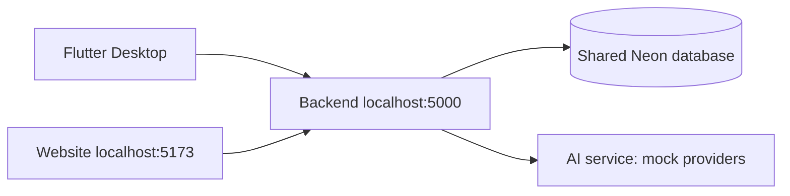
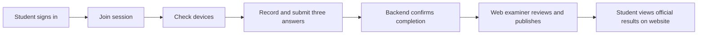

# AIVES Desktop shared Neon demo

Original verification: October 27, 2026. Neon project Aives (sparkling-morning-14712169), database neondb, shared branch br-super-lake-b3tnx2nd. Never apply local Docker schema-repair scripts to Neon.

Configure backend credentials privately for the agreed development database. Never place connection strings in Flutter. Sign out and sign in again after changing backend databases. At verification, test_sv_001 had user ID 26 in both API and direct Neon queries.

## Accounts

Passwords are supplied separately and are not stored in this repository.

| Email | Role | Client |
|---|---|---|
| test_sv_001@example.invalid | STUDENT | Desktop |
| desktop_staff_qa@example.invalid | STAFF | Website: demo course, exam and session |
| desktop_examiner_qa@example.invalid | EXAMINER | Website: review and publish |

The desktop_probe_qa account and session 39 are reserved for technical verification. The demo student belongs to DESKTOP-QA-SWD392 and was not enrolled in the main session at handover.

## Original fixture record

| Field | Value |
|---|---|
| Main session ID | 38 |
| Join code | ESS-D3270001 |
| Course | DESKTOP-QA-SWD392 |
| Exam code | DESKTOP-QA-EX-01 |
| Status at handover | IN_PROGRESS |
| Duration | 30 minutes from first start |
| Questions / points | 3 / 10 |
| Original closing time | October 28, 2026 at 05:10 ICT (UTC+7) |

These historical values do not guarantee availability. Create fresh sessions for later tests; do not reset completed attempts.

## Full test

1. Sign out and sign in as the student. Backend: http://localhost:5000.
2. Enter ESS-D3270001 and select Continue while available. For an existing enrollment, expand Joined exams and select Resume exam or Continue to microphone check.
3. Choose a microphone, record a test and listen through headphones.
4. Confirm that the test is clear and select Start exam (or Resume exam). Record, stop, play back and submit each answer.
5. Wait for confirmed completion. Official scores stay hidden until publication.
6. Sign into http://localhost:5173 as EXAMINER.
7. Open /examiner/results?sessionId=38. Direct lookup can be used if the default queue omits sessions scheduled by another staff member. Check audio, transcript and AI scores.
8. Enter answer scores, total and feedback; save review and publish.
9. Student website: view published results. Scores and feedback must match the examiner review.

## English fixture questions

| Question / points | Suggested answer |
|---|---|
| Distinguish functional and non-functional requirements; give examples. / 3 | Capabilities such as audio submission versus qualities such as performance and security. |
| Explain Model, View and Controller. / 3 | Model: data/business rules; View: presentation; Controller: input and coordination. |
| Why call the backend rather than AI directly? / 4 | Authentication, authorization, exam management, storage, AI orchestration and protection of service credentials. |

Original questions had IDs 84, 85 and 86, APPROVED status, rubrics totaling 10 points and CONTENT/LEARNING_OUTCOMES documents. Follow-ups were disabled.

English seed source: scripts/seed-desktop-neon-flow.sql. Translating the source does not modify existing shared Neon records. Existing names, questions, transcripts and feedback retain their stored language. Do not rerun the translated fixture over an existing populated demo: text-based matching may identify new questions and the exactly-three-questions guard will reject the transaction. Use an explicitly configured fresh development fixture when applying it anew. Dedicated QA accounts must exist first; the script does not reset passwords, attempts or migration history.

## Verification limits

Probe session 39 (ESS-D3270002) passed enrollment, start, three synthetic silent WAV uploads, finish, AI success, examiner review/publication and student result retrieval. Its reviewed result was PUBLISHED at 8/10. No result was pre-created for session 38.

AI/STT/TTS used mock providers: integration and persistence were verified, not real speech recognition or grading accuracy. Audio uses backend-configured storage; Neon holds shared relational data. Playback requires access to the corresponding backend/storage. Question TTS is not implemented in Flutter.
