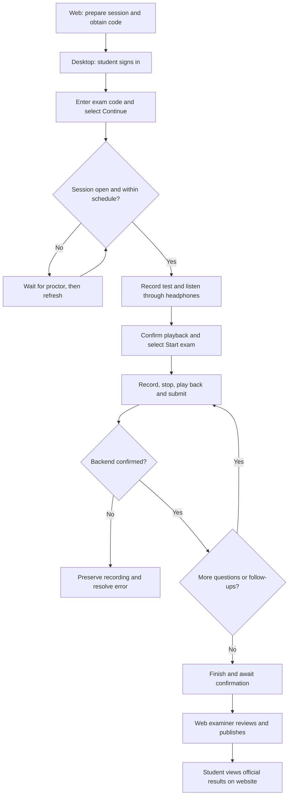
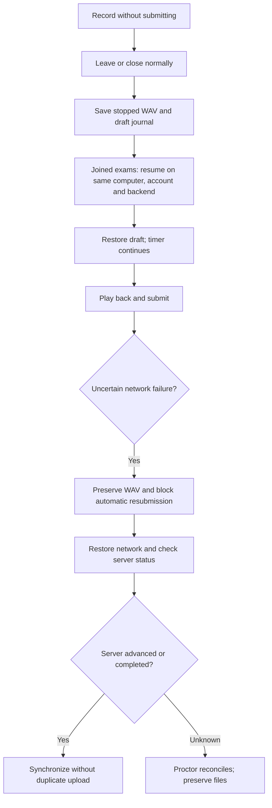

# AIVES Desktop test flows

STUDENT uses desktop; STAFF and EXAMINER use the website. Both clients must use the same backend/database. See desktop-neon-demo.md for the shared Neon fixture. Use approved questions and current schedules. Create fresh sessions rather than resetting completed attempts. Use mock providers for routine checks.

## Complete examination

Verify playable audio belongs to the correct student/question, without duplicate answers. Official scores remain hidden before publication. Publication requires EXAMINER or ADMIN permissions.

## Recovery and uncertain submission

Backend submission idempotency and complete follow-up recovery are unavailable. Do not expect automatic retry after every timeout. Forced termination while recording may leave an incomplete WAV. This is data recovery, not offline examination.

## Manual checklist

| ID | Scenario | Expected behavior |
|---|---|---|
| F01 | Complete examination | Audio and published results match website |
| F02 | Leave and resume | Draft restored; timer continues |
| F03 | Timeout while recording | Stop, attempt submission and finish; preserve files on failure |
| F04 | Network failure during upload | No false success or duplicate upload |
| F05 | Finish early | Confirmation; submit current recording if present; unanswered questions blank |
| F06 | Backend follow-up | Display and submit follow-up |
| N01 | Wrong password or empty email | Show error; no dashboard access |
| N02 | STAFF login on desktop | Reject and direct to website |
| N03 | Incorrect/unavailable server | Connection error |
| N04 | Invalid code | No session added |
| N05 | Unopened/cancelled/out-of-schedule session | Prevent start |
| N06 | Device test not confirmed | Prevent readiness confirmation |
| N07 | Microphone denied/disconnected | Error; no false recording success |
| N08 | Change microphone after testing | Require new recording and playback |
| N09 | Missing/empty recording | Prevent submission |
| N10 | Record again | Confirmation and new recording used |
| N11 | Repeated submit/close while uploading | Prevent concurrent requests; wait for completion |
| N12 | Expired token | Preserve draft; verify same account |
| N13 | Audio over 48 MB | Explain limit and preserve file |
| N14 | Unpublished results | Hide official score |
| N15 | Published results | Match website scores and feedback |
| N16 | Switch student | Never restore another student's draft |

Use separate short sessions for timeout checks and follow-up-enabled questions for follow-up checks. Short answers do not guarantee a follow-up. Flutter question TTS is not implemented. Test two-examiner and moderator processing in backend/web.

## Minimal student interface

- At 780 x 600 and 1280 x 800, sign-in uses one centered form and the home screen focuses on **Exam code** and **Continue**. Joined exams are collapsed by default.
- Empty/invalid codes show an error without starting an exam. A successful code opens the microphone check for the exact session returned by enrollment, even if other sessions are ready.
- An unopened session displays its status and **Check again**. Refreshing never starts the timer. Already enrolled students can expand **Joined exams** and continue or resume.
- **Start exam** stays disabled until the microphone recording has been played and confirmed. There is no second start confirmation. For resumed attempts, the microphone check explains that the timer is already running.
- During the exam, the question and recording controls share one panel. **Submit exam early** still requires confirmation. After the last question, **Finish and submit** becomes the primary action.
- Open **Exam help > Local recordings** to recover files and **Exam help > Verify account** for expired authentication. Successful completion directs students to the website for official results.
