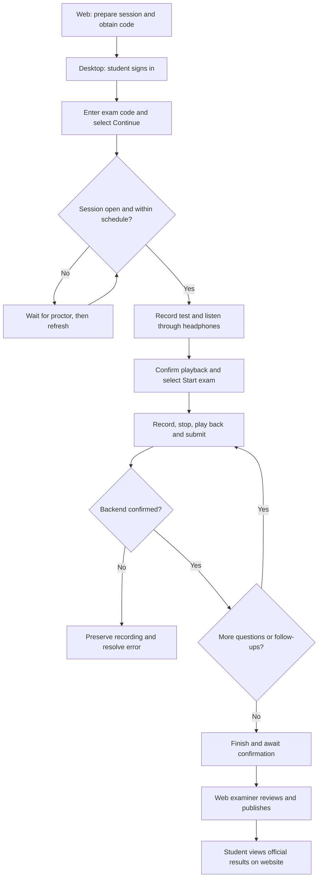
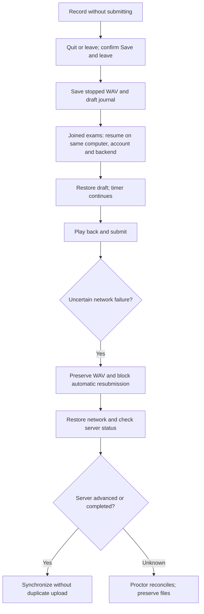

# AIVES Desktop test flows

STUDENT uses desktop; STAFF and EXAMINER use the website. Both clients must use the same backend/database. See desktop-neon-demo.md for the shared Neon fixture. Use approved questions and current schedules. Create fresh sessions rather than resetting completed attempts. Use mock providers for routine checks.

## Complete examination

Verify playable audio belongs to the correct student/question, without duplicate answers. Official scores remain hidden before publication. Publication requires EXAMINER or ADMIN permissions.

## Recovery and uncertain submission

Backend submission idempotency and complete follow-up recovery are unavailable. Do not expect automatic retry after every timeout. Forced termination while recording may leave an incomplete WAV. This is data recovery, not offline examination.

## Manual checklist

| ID | Scenario | Expected behavior |
|---|---|---|
| F01 | Complete examination | Audio and published results match website |
| F02 | Leave and resume | Draft restored; timer continues |
| F03 | Timeout while recording | Stop, attempt submission and finish; preserve files on failure |
| F04 | Network failure during upload | No false success or duplicate upload |
| F05 | Finish early | Confirmation; submit current recording if present; unanswered questions blank |
| F06 | Backend follow-up | Display and submit follow-up |
| N01 | Wrong password or empty email | Show error; no dashboard access |
| N02 | STAFF login on desktop | Reject and direct to website |
| N03 | Incorrect/unavailable server | Connection error |
| N04 | Invalid code | No session added |
| N05 | Unopened/cancelled/out-of-schedule session | Prevent start |
| N06 | Device test not confirmed | Prevent readiness confirmation |
| N07 | Microphone denied/disconnected | Error; no false recording success |
| N08 | Change microphone after testing | Require new recording and playback |
| N09 | Missing/empty recording | Prevent submission |
| N10 | Record again | Confirmation and new recording used |
| N11 | Repeated submit/close while uploading | Prevent concurrent requests; wait for completion |
| N12 | Expired token | Preserve draft; verify same account |
| N13 | Audio over 48 MB | Explain limit and preserve file |
| N14 | Unpublished results | Hide official score |
| N15 | Published results | Match website scores and feedback |
| N16 | Switch student | Never restore another student's draft |
| K01 | Launch release app from Windows desktop | Borderless fullscreen covers the main display and taskbar; Quit is visible before sign-in |
| K02 | Windows keys, Alt+Tab, Alt+Shift+Tab, Alt+Esc, Ctrl+Esc, Ctrl+Shift+Esc, Alt+F4 | Common shortcuts do not switch apps or exit; ordinary typing and in-app keyboard navigation still work |
| K03 | Escape, F11, title-bar gestures, snap/minimize commands | App stays fullscreen; Escape may dismiss an in-app dialog but cannot exit fullscreen |
| K04 | Two monitors, including mixed DPI and negative coordinates | Main app fills its display; opaque covers prevent desktop interaction on other displays |
| K05 | Add/remove monitor or change resolution/scaling | App and covers update without exposing a usable desktop or losing Quit |
| K06 | Quit on sign-in/home; cancel and then confirm | Cancel keeps fullscreen and restrictions; confirmation closes app and restores normal Windows input and displays |
| K07 | Quit from microphone dialog, exam help or another dialog | Global Quit remains accessible; existing recording/close guards are respected |
| K08 | Quit while recording an exam answer | Save and leave confirmation; cancelling continues exam; accepting stops recording and preserves resumable WAV/draft |
| K09 | Quit while upload/recording operation is processing | Wait for operation; no duplicate exit, lost draft or bypass of submission guard |
| K10 | Quit after backend confirms completion | App closes and removes keyboard hook and all display covers |
| K11 | Open local-recordings help | Displays path and instructions; no button launches File Explorer while app is open |

Use separate short sessions for timeout checks and follow-up-enabled questions for follow-up checks. Short answers do not guarantee a follow-up. Flutter question TTS is not implemented. Test two-examiner and moderator processing in backend/web.

Fullscreen and keyboard-hook checks require a physical Windows machine and a release build. Flutter widget tests and cloud build success do not verify operating-system input interception, taskbar coverage, monitor changes or hook cleanup. Test K06 and K10 by switching apps and opening Start after exit. Verify these checks before using the executable for supervised examinations.

The app cannot enforce an operating-system security boundary. Ctrl+Alt+Del, UAC/secure desktop, elevated applications, forced termination, power controls and hardware/accessibility escape routes need administrator-managed kiosk policies. Evaluate those controls on school-managed computers separately; do not interpret K01-K11 as proof of absolute lockdown. See Microsoft's [kiosk hardening guidance](https://learn.microsoft.com/en-us/windows/configuration/assigned-access/recommendations) and [Keyboard Filter](https://learn.microsoft.com/en-us/windows/configuration/keyboard-filter/).

## Minimal student interface

- At 780 x 600 and 1280 x 800, sign-in uses one centered form and the home screen focuses on **Exam code** and **Continue**. Joined exams are collapsed by default.
- Empty/invalid codes show an error without starting an exam. A successful code opens the microphone check for the exact session returned by enrollment, even if other sessions are ready.
- An unopened session displays its status and **Check again**. Refreshing never starts the timer. Already enrolled students can expand **Joined exams** and continue or resume.
- **Start exam** stays disabled until the microphone recording has been played and confirmed. There is no second start confirmation. For resumed attempts, the microphone check explains that the timer is already running.
- During the exam, the question and recording controls share one panel. **Submit exam early** still requires confirmation. After the last question, **Finish and submit** becomes the primary action.
- Open **Exam help > Local recordings** to view the recovery folder path and **Exam help > Verify account** for expired authentication. Quit before opening recovery files in File Explorer. Successful completion directs students to the website for official results.
